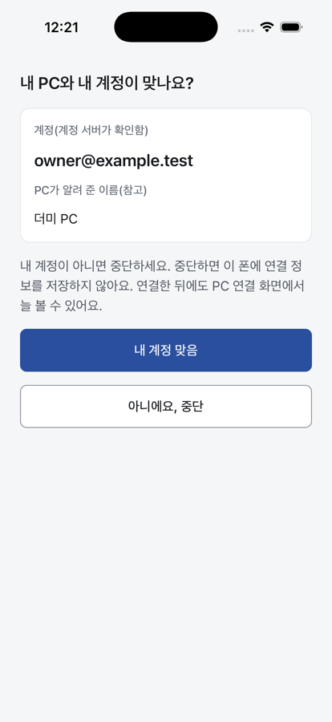
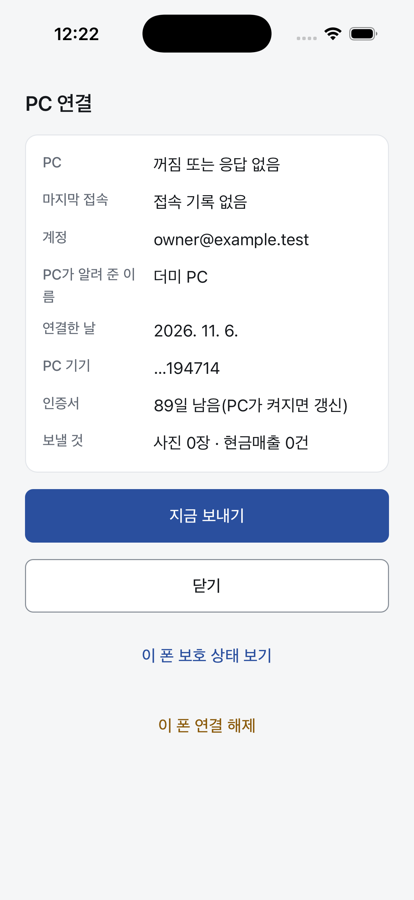
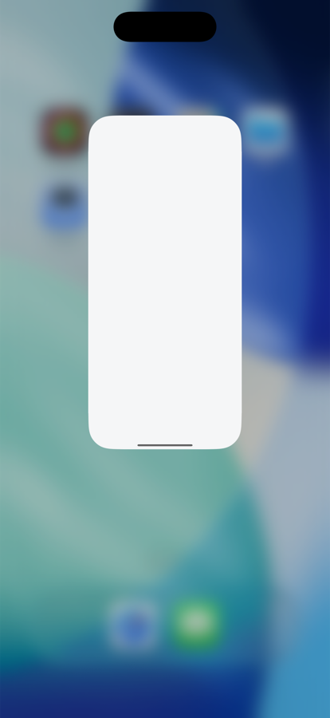

# M7 저장 전 계정 확인 화면(설계 #120)과 실기기 개발 준비 (2026-11-06)

## 확인 화면

`PAIR_OK` 검사(AIK 서명 목록·Sd·Cert_M·Kv)를 통과한 뒤, 키를 저장하기 전에 띄운다. 순서는 다음과 같다.

1. SAS 일치
2. `PAIR_OK` 검사(**acct_claim 포함**)
3. 24시간 경고(해당할 때만)
4. **계정 확인**
5. 저장

[내 계정 맞음]을 눌러야 저장한다. [아니에요, 중단]을 누르면 아무것도 저장하지 않는다.

- **acct_claim(팀장 결정 2026-11-06):** `PAIR_OK.acctClaim` = `b64(JCS({claim:{account_id, email, aik_pub, iat, exp}, sig}))`.
  - 계정 서비스가 `utf8("SAX-acct-claim-v1") ‖ JCS(claim)`에 Ed25519로 서명한다. `iat`·`exp`는 UTC 밀리초 정수이고 `exp = iat + 600000`이다(SIGNING.md §8). 초 단위 값은 만료로 거절한다.
  - 폰은 앱에 고정한 계정 서비스 공개키로 서명을 검증한다. 그리고 `exp`가 지나지 않았는지, `aik_pub`가 `PAIR_OK.aikPub`와 같은지 본다. 하나라도 어긋나면 `acct_claim_invalid`로 중단하고 저장하지 않는다.
  - 서버 구현 전이라 개발 스택은 시험 키(`apps/mobile/dev/test-account-key.ts`)로 서명한다.
  - 릴리스 빌드의 고정 키 목록은 비어 있어서 페어링이 늘 실패한다. 실제 키는 클라우드 세션이 만들면 넣는다.
- 화면에는 검증된 **이메일 전체**를 보인다.
- PC 이름은 서명 없는 `PAIR_OK.desktopName`이다. "PC가 알려 준 이름(참고)"으로만 보이고, 제어·양방향 문자가 있으면 버린다.
- 이메일과 PC 이름은 상태 파일(봉인)에 저장하고, 연결 화면(P-06)에 늘 보인다.
- 스키마: `remote-envelope.schema.json` v1.6에서 `pair.ok`에 `acctClaim`(필수)·`desktopName`(선택)을 더했다.

| 확인 화면 | 연결 화면 | 앱 스위처(영수증 확인 화면에서) |
|---|---|---|
|  |  |  |

앱 스위처 스냅샷: 영수증 확인 화면에서 앱 스위처를 열었다. 카드에는 가림막만 보이고 영수증은 남지 않았다(시뮬레이터). 실기기에서 다시 본다.

## 실기기 개발 준비

- 개발 스택을 맥의 mDNS 이름으로 연다: `STACK_HOST=<소문자 LocalHostName>.local:8787`.
  - 앱은 `EXPO_PUBLIC_TEX_DEV_HOST`로 같은 값을 받는다. 이 값은 실기기 개발 빌드에서만 쓰고, 시뮬레이터 완화(생체 없는 키·견본 카메라)는 켜지 않는다.
  - 평문 http/ws·DPoP `htu`는 `localhost`와 `<이름>.local`만 허용한다. IP와 공개 도메인은 계속 거부한다.
- 더미 PC가 `/dev/qr.html`로 QR을 보여 준다. 실기기 카메라로 찍는다.
- 서명:
  - 팀 ID는 `APPLE_TEAM_ID`로 넘긴다(저장소에 두지 않음).
  - `pod install`에는 UTF-8 로캘이 필요하다.
  - **막힘:** Apple Program License Agreement 갱신 동의가 필요하다(사용자 계정). 동의 전에는 프로비저닝 프로필을 만들 수 없다.
