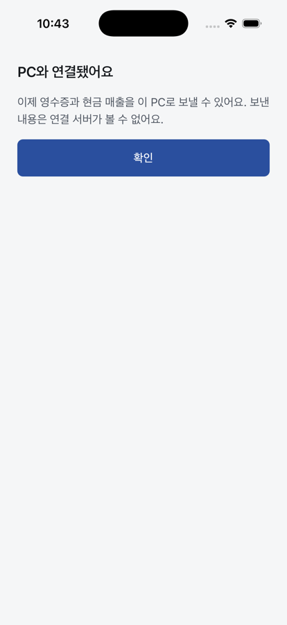
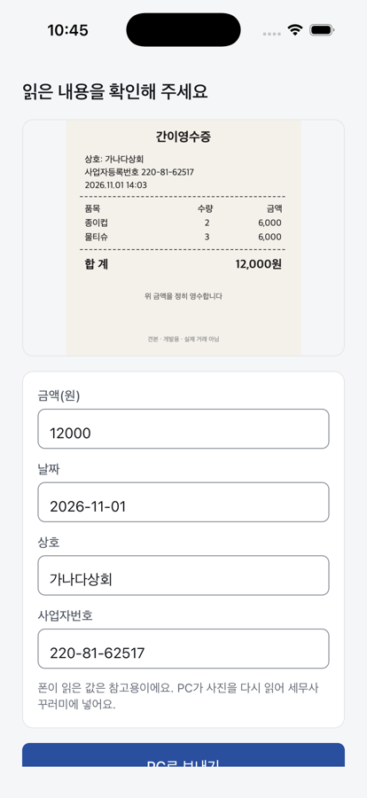
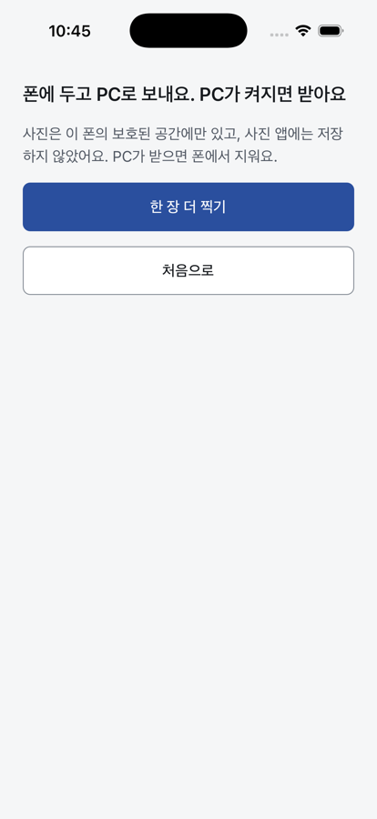
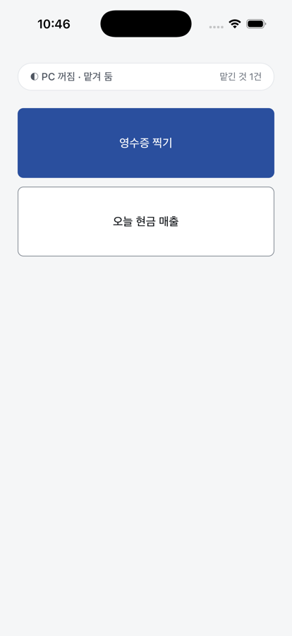

# M7 시뮬레이터 통합 시험: 실제 릴레이·계정 서비스(#63) 위 큐 사진 전송 (2026-11-06)

**결과: 통과 1회.** 페어링 → 기기 토큰 → 큐 사진 전송 → ack까지 실제 `services/relay`·`services/account`(main d7ba693)로 돌렸다. 라이브 WSS는 꺼 두었다(Phase 1과 같다).

## 구성

- 실행: `cd poc/apps/mobile && STACK_LIVE=0 node --conditions=development dev/stack.ts`
- 앞단 `http://localhost:8787` 하나가 계정·릴레이 공개 origin이다(운영 `https://tax.laf-co.com`과 같은 구조). DPoP `htu`도 이 origin이다.
  - 릴레이: `/v1/mailboxes*`, `/v1/rooms*`(WSS 포함)를 `startRelay`로 보낸다.
  - 계정: 나머지 `/v1/*`를 `startAccount`(모의 메일·PG)로 보낸다.
  - 비밀(`TOKEN_SIGNING_SEED`, `QUEUE_KEY`, `INTERNAL_TOKEN`, `CODE_MAC_KEY`)은 기동마다 새로 만들고 출력하지 않는다.
- PC는 더미다(`dev/stack.ts`): 계정 로그인 → `POST /v1/aik` → 기기 토큰 → 페어링 → 번들 PUT → 2초마다 큐 드레인.
- 폰: iPhone 17 Pro 시뮬레이터, 앱은 바꾸지 않았다(개발 빌드, 견본 영수증).

## 흐름과 결과 ([stack.log](raw/m7-relay-it/stack.log), [relay-access.log](raw/m7-relay-it/relay-access.log))

| 단계 | 호출 | 결과 |
|---|---|---|
| PC 계정·AIK | `POST /v1/auth/code`·`verify`, `POST /v1/aik`, `POST /v1/device-tokens` | 200·200·201·200 |
| 페어링 룸 | `POST /v1/rooms` → WSS `/v1/rooms/:id` 양쪽 | 201, Noise XX·SAS 일치 |
| 폰 등록(대역) | `POST /v1/devices/enroll` (PC 세션) → `PUT /v1/device-list`(AIK 서명 목록, PC 기기 토큰) | 201·200 |
| 우편함 | `POST /v1/mailboxes` → `PUT /v1/mailboxes/:id/bundle`(Q_D, Vd 서명) | 201·204 |
| 폰 기기 토큰 | `POST /v1/device-tokens`(AIK 인증서 + Vm DPoP) | 200 |
| 라이브 시도 | WSS `/v1/mailboxes/:id/live` (PC 없음) | 3초 대기 뒤 큐로 넘어감 |
| 큐 전송 | `GET …/bundle` → `POST …/envelopes` ×6 (offer 1 + 32 KiB 청크 5) | 200 → 202 ×6 |
| PC 수신 | `GET …/envelopes` → 금고 대역 hpkeOpen → Vm 서명·seq 검사 → 저장 → `POST …/ack {seq}` | 4건 ack 4, 2건 ack 6, 버림 0 |
| 확인 | 저장된 JPEG SHA-256 = offer `sha256` | `d961f6f3…6bc8439`, 145,271 B |
| 재실행 | 앱 재시작 뒤 같은 사진 | TTL 안이라 다시 넣지 않음 |

화면:

| 페어링 완료 | 확인(견본) | 맡긴 뒤 | 첫 화면 |
|---|---|---|---|
|  |  |  |  |

시험 중 고친 것: 첫 화면 상태 줄의 `queued` 문구가 길어 넘쳤다. "◐ PC 꺼짐 · 맡겨 둠 / 맡긴 것 N건"으로 줄이고 줄바꿈을 허용했다.

## 어긋나는 계약(팀장에게)

1. **폰 기기 등록 주체가 없다.** `PUT /v1/device-list`는 새 항목이 `POST /v1/devices/enroll`(계정 세션)과 같은 키여야 받는다. 하지만 Phase 1 폰 앱에는 계정 로그인이 없다. 이번에는 PC 세션이 대신 등록했다.
   - 선택지 (가): 폰에 이메일 코드 로그인을 넣는다.
   - 선택지 (나): 계정 서비스가 데스크톱 `devices` 범위 토큰으로 모바일 enroll을 받는다(페어링 7단계에서 PC가 한다).
2. **페어링 3단계 `/v1/device-list`를 폰이 부를 수 없다.** 세션 또는 `devlist` 기기 토큰이 필요한데, 페어링 전 폰에는 둘 다 없다. 이번에는 대역 `/dev/account`가 PC 세션으로 받아 주었다. 1번과 같은 결정으로 풀린다. (나)라면 PAIR_OK에 이미 AIK 서명 목록이 있으니 3단계를 PAIR_OK 검사로 대신할 수 있다.
3. **번들이 없을 때도 `404 relay.mailbox_not_found`다**(토큰이 틀릴 때와 같은 코드). 폰은 둘을 구분하지 못하고 둘 다 "PC 오래 꺼짐(stale)"으로 보인다. 존재 오라클 방지 때문이면 그대로 두고 문구만 맞추겠다.
4. 큐는 PC → 폰 ack가 없다. 그래서 폰은 받은 사진도 7일 보관하고, 24시간 뒤 한 번 더 넣는다(PC가 msgId로 중복을 없앤다). 의도대로 동작했다. 이 동작으로 두어도 되는지 확인 부탁한다.
