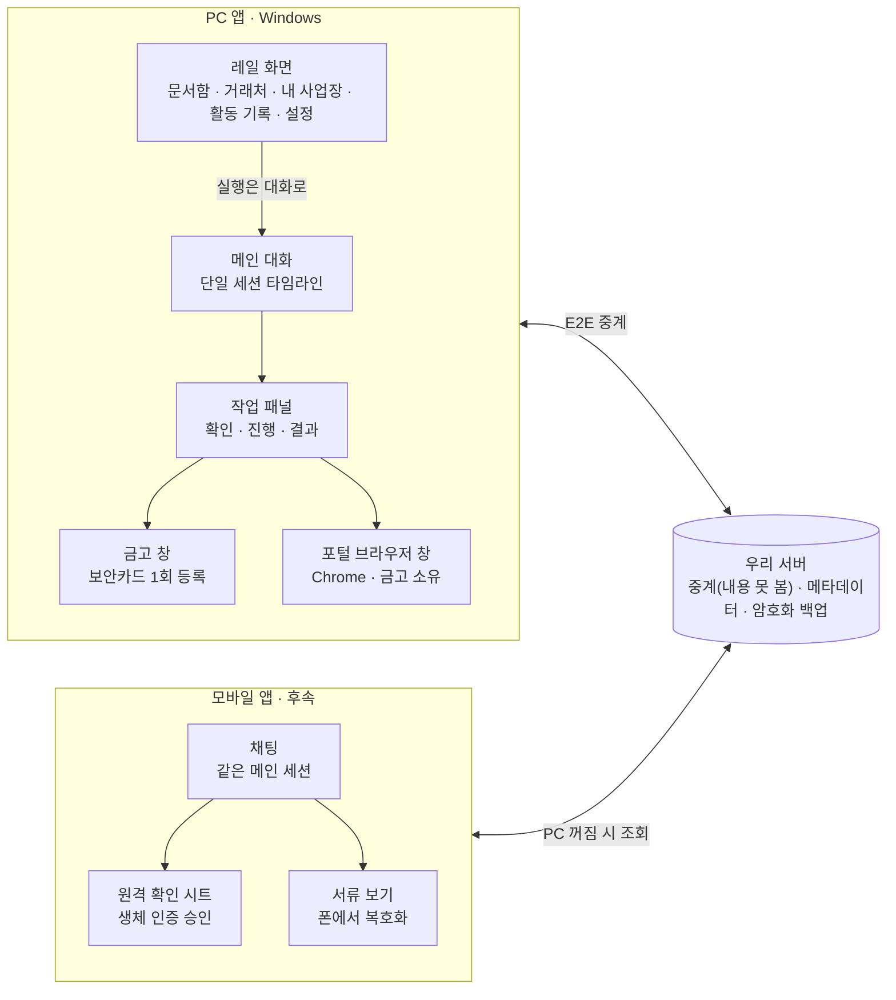
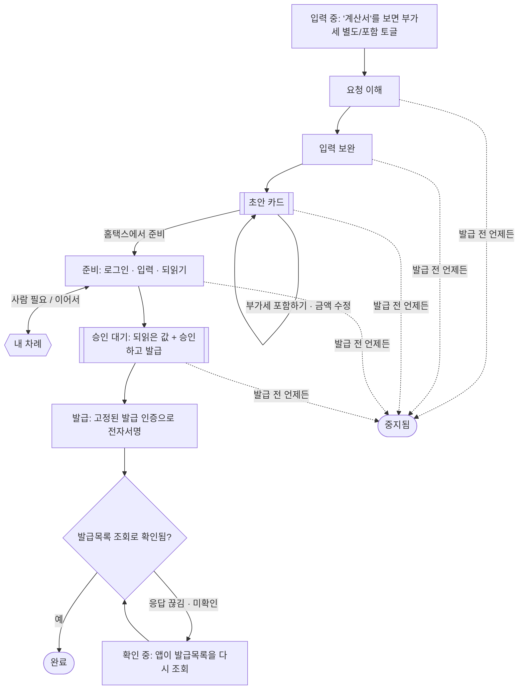

# 08. 화면·기능 기획

> 2026-11-06 문서 후속(ADR-021 결정 7): 승인 절의 위치 문단과 "승인 바 정밀도"(작성일자는 카드에 늘 보임)를 카드 기준으로.
> 2026-11-06 ADR-021 개정(결정 7, 사용자 지시, 디자인 캔버스 T-03·PoC MainConfirm 기준): 렌더러 승인 대기 카드 + main 승인 바를 main이 그리는 승인 카드 하나로 바꿈. 머리말, §1 원칙, T-03, 발급 흐름 단계 5, 승인 절, 결정 표를 맞춤. 승인 절의 남은 "바" 규칙(무장 지연·머무름·남음·폰 우선)은 이 카드에 그대로 적용한다.
> 2026-11-06 사용자·팀장 결정(ADR-038): §3 A-01 로그인에 비밀번호를 더함. 비밀번호가 맞지 않으면 이메일 코드 로그인으로 넘어가는 안내를 둔다(잠금 화면 없음, 잠금은 계정 메일로 알림).
> 2026-11-09 사용자 확정(디자인 캔버스 v60, "이대로 옮겨"): §3 A-01을 로그인·이메일 코드로 로그인·계정 만들기·비밀번호 찾기 네 흐름으로 고쳐 씀. §3 S-02와 §9 설정에 계정 묶음(비밀번호 만들기·바꾸기, 패스키, 로그인 상태 유지, 모든 기기에서 로그아웃)을 더함. 오른쪽 작업 패널 제거와 v2.1 톤은 이 확정에 들지 않음(대기).
> 작성일: 2026-10-30 · 상태: v0.3 (디자인 갱신 2026-11-02, 흐름·화면 ID·보안 규칙은 v0.2.1 그대로; 디자인 캔버스 검토 반영 ADR-020, 승인 버튼 위치 ADR-021) · AUDIT-D 반영 2026-11-03(§4 O-02 진위확인 문구, §6 작성일·중복 표시, §8 세금계산서 [PDF 다시 받기], §9 T-06 OS 프레임 창·금고 잠금·엄격 모드·바 무장 규칙, §10 페어링 범위·원격 실행 생체, §11 예외 상태, ADR-025~029, D19 §3.5. 화면 ID `D-01`~`D-03`은 D19 등록부 ID와 다르다) · 제품 정의 반영 2026-11-05(§3 D-04~D-08·M-02 이번 달 판·P-08·P-09, §5, §10 Phase 1 폰 앱, §13, ADR-031~034) · 관련: 02 제품 명세, 07 서류 카탈로그, ADR-014·016·017·018·019·020·021·022·023·024·026, design-system v1.2
> ADR-036 반영 2026-11-05: §8 문서함 세금계산서 상세에 [발급 취소](H-01c), §11 취소 예외 3줄. 구현은 앱 개발 뒤(D14 M4-10). · 같은 날 Bugbot 반영: §8 [발급 취소]는 당초분에만, §11 "취소 발급 확인 중" 1줄 추가.
> ADR-034 결정 8·9·10 채택 반영 2026-11-05: D-07 보내기는 PC 기본 메일 프로그램 첨부로 확정, D-08 근무표는 세전 → 세후 계산기, P-03 원격 확인 카드·P-07 승인 요청은 Phase 2.
> 같은 날 팀장 결정·R13 D-L3 반영: D-05 카드 미대조 지출은 표시만(기본 접힘, "카드 전표로 충분" 체크), D-07 첨부는 암호 엑셀 + 같은 암호 ZIP 두 파일과 받는 쪽 안내, 급여 시트 주민번호는 가림이 기본(설정에서 켬), D-06 급여 기록 내보내기는 주민번호 제외(ADR-032 결정 8).
> 2026-11-06 정합(팀장 지시, 큐 16~22): 화면·사용자 문구의 "진위확인"을 "상태조회"로 통일(§4 O-02 카드 문구, §9 설정 줄. API 이름과 플레이북 ID H-05는 그대로, 팀장 결정 2026-11-06).
> R15 P1-1 반영 2026-11-05(제안, 사용자 확인 전): 사업자 상태 배지 3종(계속 / 휴업·폐업 / 확인 불가), 배지 용어 "진위확인" → "상태조회", §4 O-02 등록 단계의 휴·폐업을 멈춤에서 경고 배지로 바꿔 §11 [그래도 진행]과 맞춤(§4·§8 D-02). yulmu 지시(2026-11-05): 어떤 상태도 등록·발급을 막지 않고, 새 화면·새 클릭을 더하지 않는다.
> R13 §5 후속 2026-11-05(팀장 지시): T-03 카드(렌더러)와 승인 바(main)의 역할 문구, "승인 바만 보면 된다" 금지(§3 T-03 행, §9 승인).
> R14 반영 2026-11-05(팀장 지시, D-L7은 yulmu 확인 전): §8 [발급 취소] 기한 표시와 §11 "기한이 지남" 줄을 "안내(국세청 자료)"로 낮춤.
> 화면 디자인: [소버린 AX 화면 디자인](https://claude.ai/artifact/Fyc1UUSuZs3e9y6tydeSL3) 캔버스 · v0.1 와이어프레임: Claude Docs [소버린 AX 화면·기능 기획](https://claude.ai/artifact/9rBKqQmQ3Thoaii3r1aMpi)

## v0.3 디자인 갱신 (2026-11-02)

디자인 시스템 v1.2("더 조용하고, 더 적게, 더 분명하게", [design-system/README.md](design-system/README.md) 변경 기록, 근거 [research/R12](research/R12-ai-product-design-trends.md))를 반영했다. 이 절은 시각 변경만 적는다. 화면 목록·ID, 흐름, 문구, 승인 바의 보안 규칙(ADR-021)은 바꾸지 않았다.

- 면: 바탕과 카드의 차이를 줄이고(`canvas` #F5F6F7), 선택·hover·무채 칩에 `surface-tint`를 쓴다. 다크는 위로 뜰수록 밝다.
- 선과 그림자: 카드·표·작은 보조 버튼은 `line`, 입력 칸과 주요·보조 버튼만 `line-strong`. 무채 상태 칩, 오늘 요약(M-02), 검색 칸은 테두리가 없다. 그림자는 입력창(`shadow-raised`)과 떠 있는 것(`shadow-overlay`)뿐이다.
- 글자: 굵기 400·500·600, 화면 제목 18px, 라벨 자간 없음. 사용자 말풍선은 테두리 없는 `surface-overlay`, 모서리 16.
- 간격과 모서리: 4px 격자(카드 안쪽 16, 요소 사이 12), 카드 12, 입력창 16, 버튼 8. 승인 바는 직각.
- 움직임: 색 변화 120/160/220ms, 실행 단계(T-04)의 현재 점만 2.4초 주기로 숨 쉰다. 동작 줄이기면 모두 끈다. 승인 바에는 애니메이션이 없다.
- 승인 바(T-03): 시각만 다듬었다(라벨 12px 500, 무장 상태의 라벨은 `on-accent` 78%, 표시 칩 모서리 6px, 동작 글자 자간 -0.01em). 자리·치수·세 상태 페이지·무장 지연 0.6초·머무름 0.15초·요약 줄의 값은 그대로다.
- PoC 셸(PoC-9 `pnpm demo`)에 같은 토큰을 적용했다. 레이아웃 치수(`shell-layout.ts`)는 같다.

자영업자·중소기업이 대화 하나로 세금계산서와 홈택스 증명서 발급을 맡기고, 홈택스에서 되읽은 값을 확인한 뒤 대화 아래 승인 카드의 [승인하고 발급]으로만 발급하는 Windows 앱이다. 이 문서는 Claude Design에 넘기기 전에 화면 34개(PC 27, 모바일 7)와 기능을 정한다. 서류 범위는 ADR-018(MVP 코어 = 홈택스 자동 6종), PoC 범위는 ADR-017(H-01·H-03·H-04)을 따른다.

## 1. 제품 원칙

범용 에이전트가 "무엇이든 시키세요"라면 이 앱은 "세금계산서와 증명서를 맡기세요"다. [Instinct](https://instinct.xyz/)가 트레이딩 한 분야에서 먼저 알려 주고, 물으면 카드로 답하고, 한 번에 실행하듯 같은 구조를 공공 문서에 적용한다.

| 원칙 | 화면에서 이렇게 보인다 |
|---|---|
| 할 수 있는 일만 약속한다 | 입력창 안내문, 빠른 실행, 추천이 모두 플레이북 카탈로그(02 §10) 안에서만 나온다. 세무 상담·신고·세액 판단은 한 줄로 거절하고 할 수 있는 일을 제안한다 |
| 세션은 하나 | 새 채팅, 스레드 목록, 탭이 없다. 대화는 날짜로 이어지는 타임라인 하나다. 지난 일은 검색, 문서함, 활동 기록으로 찾는다(ADR-019) |
| 말로 시작하고 카드로 확정한다 | 자유 문장은 의도를 알아내는 데만 쓴다. 금액·거래처·품목 같은 값은 카드 필드로 보여 주고 그 자리에서 고친다. 모델 문장은 짧게 쓰고, 데이터는 모델 문장 안에 섞지 않는다 |
| 되돌릴 수 없는 일은 따로 승인한다 | 발급·전송은 홈택스에서 되읽은 값을 확인한 뒤 대화 아래 승인 카드의 [승인하고 발급]으로만 일어난다. 승인 카드는 앱(main)이 대화창과 따로 그려서, 대화창이 악성 내용에 장악돼도 값과 버튼을 위조할 수 없다. 별도 창은 띄우지 않는다. 키보드로는 승인되지 않고, 모바일은 생체 인증과 하드웨어 키로 승인한다(ADR-016·020·021) |
| 비밀은 대화에 남기지 않는다 | 보안카드 번호와 포털 비밀번호는 금고 창에서 한 번만 등록하고 앱이 홈택스 칸에 바로 넣는다. 인증서 비밀번호는 저장하지 않고 사용자가 브라우저 창에 직접 넣는다. 대화와 기록에는 "입력함" 같은 상태만 남는다 |
| 완료는 포털 조회로 확인한다 | 발급 버튼을 눌렀다고 완료로 표시하지 않는다. 발급목록 조회로 확인한 뒤에 완료로 바꾼다. 확인하지 못하면 "확인 필요" 상태로 사람에게 넘긴다 |
| 먼저 알려 준다 | 만료가 다가온 서류, 진행 중인 작업, 사람이 해야 할 일을 대화 맨 위와 알림으로 먼저 보여 준다. 알려만 주고 실행은 승인을 받아서 한다 |

## 2. 정보 구조

화면은 메인 대화 하나를 중심으로 레일 화면, 별도 창, 모바일이 붙는 구조다.



레일 화면의 실행 버튼은 요청을 메인 대화로 넘긴다. 비밀 입력과 포털 조작은 앱 본체와 분리된 창에서 일어난다. 승인은 대화창이 아니라 앱이 대화 열 아래(입력창 위)에 따로 그리는 승인 카드에서 한다(ADR-021 결정 7). 폰은 서버의 E2E 중계를 거쳐 PC의 같은 대화를 연다.

## 3. 화면 목록

디자인할 화면은 PC 32개, 모바일 9개다. 대부분은 독립 화면이 아니라 메인 대화 안의 카드나 오른쪽 패널이다. 범위 열은 PoC(2026-10-29~11-26, ADR-017) · Phase 1 · Phase 2 · 후속 순이다. 11-05 새 기능인 사업용 카드 내역(D-04), 세무사 꾸러미(D-05)와 미리보기·보내기(D-07), 급여대장(D-06)과 근무표(D-08)는 Phase 1 베타다. 홈은 이번 달 판(M-02, ADR-033)이다. 폰 앱이 Phase 1에 들어와 폰 연결(S-03), 잠금(P-01), 연결 상태(P-06), 알림(P-07), 종이 증빙 촬영(P-08), 현금매출 입력(P-09)이 Phase 1이 됐다(ADR-034). 폰 승인(P-03)은 Phase 2다(ADR-034 결정 9 채택).

| ID | 화면 | 형태 | 핵심 기능 | 범위 |
|---|---|---|---|---|
| A-01 | 로그인 | 전체 화면 | 아이디는 이메일이다. 흐름 넷(캔버스 v60, 사용자 확정 2026-11-09, ADR-038). ① 로그인: 이메일 → 비밀번호 두 단계. 이메일 단계에서는 서버를 부르지 않아 없는 이메일도 비밀번호 단계로 간다. 이메일 단계에 [패스키로 로그인](권장). 비밀번호가 맞지 않으면 "이메일 또는 비밀번호가 맞지 않아요" 안내 안에 "이메일 코드로는 바로 로그인할 수 있어요"와 [이메일 코드로 로그인]을 둔다. 잠금은 화면에 따로 알리지 않는다(응답이 같다, 잠금 알림은 계정 메일 1회). 로그인 화면에 "로그인 상태 유지" 체크는 없다(자동 로그인 기본 켬, 끄기는 S-02 계정). ② 이메일 코드로 로그인: 이메일 → 6자리(10분). 비밀번호가 잠겨도 열린다. ③ 계정 만들기: 이메일 → 6자리 → 비밀번호 만들기(선택, [나중에]). ④ 비밀번호 찾기: 이메일 → 6자리 → 새 비밀번호 → 완료("다른 곳의 로그인은 모두 끝났어요", "금고와 기기 연결은 그대로예요"). 계정이 없어도 코드 단계까지 같은 화면. 비밀번호 칸은 보기 토글을 두고 확인 칸은 두지 않는다. 입력 중 조건 3줄(10자 이상 · 흔하거나 알려진 비밀번호가 아님 · 이메일·서비스 이름이 들어가지 않음)을 보이고 최종 판정은 서버가 한다. 거부 문구는 어느 목록에 걸렸는지 말하지 않는다: "많이 쓰이거나 이미 알려진 비밀번호예요. 다른 비밀번호를 써 주세요", "이메일 주소가 들어간 비밀번호는 쓸 수 없어요", "서비스 이름이 들어간 비밀번호는 쓸 수 없어요", "128자까지 쓸 수 있어요" | Phase 1 |
| A-02 | 잠금 화면 | 전체 화면 | 금고 잠김 상태. Windows Hello로 열기 | Phase 1 |
| A-03 | 새 PC 연결 | 전체 화면 | 두 번째 PC부터. 연결된 폰(또는 연결해 둔 다른 PC) 승인으로 백업·기기 연결을 넘겨받고, 폰을 쓸 수 없으면 PASS 본인인증으로 계정만 되찾음 | 후속 (백업·리모트와 함께) |
| O-01 | 환영 | 대화 첫 메시지 | 앱이 하는 일 한 줄, 사업자 등록 시작 | PoC |
| O-02 | 사업자 인식 카드 | 대화 카드 | 사업자등록증 OCR 결과, 필드 수정, ~~진위확인 배지~~ 상태조회 배지(제안, R15 P1-1) | PoC |
| O-03 | 발급 인증 카드 | 대화 카드 | 보안카드·사업자 간편인증·공동인증서·금융인증서 중 하나. 한 번 고르면 고정, 설정에서만 변경 | PoC |
| O-04 | 맡길 업무 선택 | 대화 카드 | 업무 칩 복수 선택 + 자유 입력 | PoC |
| O-05 | 거래처 등록 카드 | 대화 카드 | 등록증 끌어 놓기, 번호 입력, 기본 이메일·금액 해석 | PoC |
| O-06 | 온보딩 요약 카드 | 대화 카드 | 등록 내용, 만들어진 빠른 실행, 첫 작업 제안 | PoC |
| M-01 | 메인 | 앱 틀 | 왼쪽 레일, 가운데 이번 달 판(M-02)과 대화, 오른쪽 작업 패널. 판과 대화의 배치는 디자인 단계에서 정한다(ADR-033) | PoC(대화), Phase 1(판) |
| M-02 | 이번 달 판 | 홈(ADR-033이 오늘 요약을 대체) | 해야 할 일을 기한 순 카드로: 발급할 세금계산서, 받아야 할 증빙, 세무사에게 줄 것, 만료가 다가오는 서류. 지금의 확인 필요·진행 중 건수도 여기에 둔다. 카드를 누르면 확인 카드와 승인 바로 이어지고 판에는 승인 버튼이 없다(제안, ADR-021). "세무사에게 줄 것"은 카드 내역이 오래되면 표시하고 [최신화]로 이어진다(제안) | Phase 1 |
| M-03 | 명령 팔레트 | 오버레이 | Ctrl+K. 작업 실행, 거래처·서류·대화 검색 | Phase 1 |
| T-01 | 부가세 토글·입력 보완 | 입력창 위 + 대화 카드 | "계산서"가 입력되면 보내기 전 부가세 [별도] [포함]. 빠진 값 질문 | PoC |
| T-02 | 초안 카드 | 대화 카드 + 패널 | D1 합계, [홈택스에서 준비] [부가세 포함하기] [금액 수정] [취소]. 패널에 확인 값과 발급 인증 | PoC |
| T-03 | 승인 카드 | 대화 열 아래 main 승인 카드(대화의 작성 카드는 "작성 완료" 한 줄로 접힘) | 앱(main)이 그리는 카드 하나에 금액(합계·공급가액·세액), 홈택스에서 되읽은 값 전체(공급받는자 상호·사업자번호, 품목, 작성일자, 이메일, "처음 거래"·"처음 보내는 주소", 중복 경고), 되돌릴 수 없다는 한 줄, 떨어진 두 버튼 [중지]·[승인하고 발급]. 기본 포커스는 [중지]이고 Enter로 승인되지 않는다. 별도 창 없음(ADR-020·021 결정 7). 발급 취소 확인과 "발급목록에 없음" 증언(황토)도 같은 틀 | PoC |
| T-04 | 실행 진행 | 작업 패널 | 단계 목록, 현재 단계, 브라우저 창 보기, 중지 | PoC |
| T-05 | 사람 차례 | 작업 패널 + 알림 | 간편인증 폰 승인 대기, 가상키패드 직접 입력, 캡차 | PoC |
| T-06 | 보안카드 등록 | 별도 창(금고) | 30개 번호 1회 등록, 사진으로 채우기. 로컬 암호화, 모델·서버 미전송 | PoC |
| T-07 | 결과 카드 | 대화 카드 | 승인번호, PDF, 이메일 전송 상태, "어디로 무엇이 갔는지" | PoC |
| T-08 | 직접 발급 안내 | 작업 패널 | 정부24 후처리 모드. 단계 안내, 값 복사, 저장 파일 감지 | Phase 1, 출시 조건 아님 (PoC는 목업) |
| T-09 | 서류 꾸러미 카드 | 대화 카드 + 패널 | 공고문 → 요구 서류 체크리스트, 서류별 상태, 필요한 것만 발급 | Phase 2 (PoC는 목업) |
| D-01 | 문서함 | 레일 화면 | 서류 목록, 종류·기간 필터, 만료일, 미리보기, 보내기 | PoC |
| D-02 | 거래처 | 레일 화면 | 목록, 상세(상태·이메일·저장 품목·발급 이력) | PoC |
| D-03 | 내 사업장 | 레일 화면 | 사업자 정보, 인증수단, 개인 프로필(최대 2개) | PoC |
| D-04 | 사업용 카드 내역 | 레일 화면(세무사 꾸러미 안에 둘지는 미정) | 홈택스 사업용 신용카드 사용내역(H-12), [최신화] 버튼과 "마지막 최신화: n일 전", 건별 메모. 누르는 것이 실행 승인이고 승인 바는 없음(ADR-032) | Phase 1 베타 |
| D-05 | 세무사 꾸러미 | 레일 화면 | 이번 달 항목(1층 고정, 켠 업종의 2층, 3층 추가 항목)과 상태, 빠진 것(제안), [미리보기]로 D-07. "증빙과 대조되지 않은 카드 지출"은 표시만 하고 기본으로 접는다. "카드 전표로 충분"을 한 번 체크하면 다음 달부터 이 목록을 뺀다. 건마다가 아니라 사업장 설정 한 칸이고, 끄면 돌아온다(판정 없음, 채택 ADR-032 결정 8, decisions.tsv 2026-11-05 M6-14). 종이 증빙은 폰 촬영(P-08)이나 PC 파일 첨부, 현금매출은 폰(P-09)이나 PC 입력. 모델 호출 없음(ADR-032 결정 11) | Phase 1 베타 |
| D-06 | 급여대장 | 레일 화면(쓰는 사장님만 켬, 끄면 레일에서 숨김, ADR-034 결정 8) | 직원 목록(처음 한 번 입력, 최소 입력), 이번 달 "지난달과 같나요?" 확인과 바뀐 것만 고치기, 급여대장·임금명세서, 4대보험 고지액과 예상치 차이 표시(판정 없음)와 고지내역 파일 넣기(ADR-031 결정 4, 제안). 주민번호는 가려서 보임. 처음 쓸 때와 설정에 고지 두 줄: "급여 기록과 파일은 이 PC에만 있고, 고지내역·급여대장·임금명세서 PDF에는 주민번호가 암호화 없이 남을 수 있어요", "임금대장은 3년 보관해야 해요. PC를 바꾸거나 잃기 전에 [급여 기록 내보내기]로 따로 보관하세요". 급여 기록 내보내기에는 주민번호를 넣지 않는다(채택 ADR-032 결정 8). 모델 호출 없음(ADR-031) | Phase 1 베타 |
| D-07 | 세무사 꾸러미 미리보기·보내기 | 오른쪽 패널 + 별도 창 | 이번 달 엑셀(우리 표준 서식, ADR-034 결정 7)의 시트별 미리보기, 빠진 것, 암호 걸기와 "암호는 문자 등 다른 경로로 알려 주세요" 안내. 첨부는 암호 엑셀과(사진·PDF가 있으면) 같은 암호의 ZIP 두 파일이고, 메일 본문에 받는 쪽 안내 문구(ZIP 여는 프로그램 등)를 넣는다. 급여 시트 주민번호는 가림이 기본이고, 켜려면 설정에서 "주민번호 전체 넣기"를 켠다(채택 ADR-032 결정 8, R13 D-L3), [보내기]: "내 세무사" 주소(S-02에 등록)로 메일 첨부. 보내는 경로는 PC 기본 메일 프로그램에 첨부를 붙인 메일 창을 여는 것이다(`MAPI_DIALOG`, 사장님이 보내기를 누름, 서버 미경유, 채택 ADR-034 결정 10). 웹메일만 쓰면 [폴더 열기] | Phase 1 베타 |
| D-08 | 근무표(세후 금액 계산기) | 레일 화면(급여대장 안의 탭) | 직원별 세전 금액 입력 → 원천징수(소득세·지방소득세)·4대보험 근로자 부담분과 세후 금액 표시, 결과를 그 달 급여대장 줄로 넘기기. 근무 시간 합계는 보조 입력(선택). 연장·야간·휴일 가산과 주휴는 계산하지 않고 "세전 금액에 반영해 주세요" 한 줄(채택, ADR-034 결정 8) | Phase 1 베타 |
| S-01 | 활동 기록 | 레일 화면 | 작업별 기록, 모델 호출 여부·전송 바이트 | PoC |
| S-02 | 설정 | 레일 화면 | 발급 인증(등록한 인증 목록·기본 하나·보안카드 재등록), 승인(Windows Hello), 보관 위치, 알림, 기기 연결(폰·다른 PC, 복구용 기기 더하기), 계정(비밀번호 만들기·바꾸기, 패스키, 로그인 상태 유지, 모든 기기에서 로그아웃, ADR-038), 내 데이터, "내 세무사" 이메일 주소(제안, ADR-034 결정 10)와 업종(세무사 꾸러미 2층) | 발급 인증 PoC, 나머지 Phase 1 |
| S-03 | 폰 연결 | 별도 창 | QR + 6자리 코드 페어링(화면 캡처 차단) | Phase 1(ADR-034) |
| P-01 | 잠금 | 전체 화면 | 생체 인증, 30초 후 재잠금 | Phase 1 |
| P-02 | 채팅 메인 | 전체 화면 | 대화 + 채팅바 위 빠른 실행 칩, PC 연결 상태 | Phase 2 |
| P-03 | 원격 확인 카드 | 바텀 시트 | 확인 카드 + 생체 인증 승인 | Phase 2(폰 승인, ADR-034 결정 9 채택) |
| P-04 | 진행·인증 안내 | 대화 카드 | "홈택스 앱에서 간편인증 승인" 안내, 진행 단계 | Phase 2 |
| P-05 | 서류 보기 | 전체 화면 | 폰에서 복호화한 PDF, 공유 | Phase 2 |
| P-06 | 연결 상태 | 바텀 시트 | PC 켜짐·꺼짐, 마지막 접속, 페어링, PC로 아직 못 보낸 사진·현금매출 건수 | Phase 1 |
| P-07 | 알림 | OS 알림 | 승인 요청, 완료, 만료 임박, 세무사 꾸러미 준비됨 | Phase 1(승인 요청은 Phase 2, 폰 승인과 함께) |
| P-08 | 종이 증빙 촬영 | 전체 화면 | 카메라 → 금액·날짜·상호·사업자번호 읽기(폰 OS의 기기 안 OCR, 모델 없음, 제안) → 사장님 확인 → PC로 E2EE 전송. 원본 사진 함께 보관. PC가 꺼져 있으면 폰에 두었다가 켜지면 보냄 | Phase 1(ADR-034 결정 9) |
| P-09 | 현금매출 입력 | 바텀 시트 | 하루 한 번 "오늘 현금 매출" 숫자 하나, 날짜별로 쌓임, PC로 E2EE 전송(제안) | Phase 1(제안) |

## 4. 온보딩

온보딩은 별도 마법사가 아니라 메인 대화의 첫 부분이다. 앱이 한 번에 하나씩 묻고, 사용자는 칩을 누르거나 파일을 끌어 놓거나 문장으로 답한다. 대화 밖에서 하는 단계는 로그인(A-01)과, 보안카드를 고른 경우의 보안카드 등록 창(T-06)뿐이다.

공통 규칙

- 질문마다 고를 수 있는 칩과 자유 입력을 함께 둔다. 자유 입력은 모델이 칩 값으로 바꿔 카드에 보여 준다.
- 모든 단계에 "나중에"가 있다. 건너뛴 항목은 이번 달 판(M-02)에 "할 일"로 남는다.
- 앱을 껐다 켜면 멈춘 질문부터 다시 묻는다.
- 온보딩 대화는 지워지지 않고 타임라인 맨 앞에 남는다. 등록 내용을 고칠 때는 내 사업장(D-03)을 쓰거나 대화로 "이메일 바꿔 줘"라고 말한다.

대화 순서

1. **환영 (O-01)**: "세금계산서 발급과 홈택스 증명서 발급을 대신 해 드려요. 먼저 사업자를 등록할게요." 칩은 [사업자등록증 올리기] [사업자번호로 입력]이다.
2. **사업자 인식 (O-02)**: 등록증 이미지·PDF를 대화창에 끌어 놓으면 PC 안에서 글자를 읽는다(docparse 샌드박스, ADR-014). 카드 문구: "등록증 파일은 이 PC 안에서만 읽어요 · 사업자번호만 국세청 ~~진위확인~~ 상태조회에 보내요(기본: 우리 서버 경유, 설정에서 내 키)"(ADR-029, D-51(N-81)).
    - 카드 필드: 상호, 사업자번호, 대표자, 업태·종목, 사업장 주소, 사업자 이메일. 필드를 클릭하면 그 자리에서 고친다.
    - 국세청 ~~진위확인~~ 상태조회 결과를 배지로 붙이고 배지 옆에 출처 "국세청 조회"와 확인 시각을 둔다(예: 계속사업자 · 일반과세자 · 국세청 조회 11-05 14:20). 공공데이터포털 서비스에서 진위확인(사업자번호·개업일자·대표자명 일치)과 상태조회(계속·휴·폐업·과세유형)는 다른 기능이고, 배지는 상태조회 결과다(제안, R15 P1-1).
    - **배지는 세 가지다(제안, 사용자 확인 전, R15 P1-1)**: ① 계속사업자 ② 휴업·폐업("2026-09-30 폐업으로 조회돼요") ③ 확인 불가("확인 불가 · 국세청 조회 실패 14:20"). 인증 오류·호출 제한·네트워크 실패는 폐업이 아니라 확인 불가로 둔다. 확인 불가는 배지만 조용히 달고 경고 줄·버튼을 두지 않는다. 다시 조회는 자동이다(다음 발급 직전 재확인, §8 D-02). 아직 조회하지 않았으면 배지를 달지 않는다.
    - ~~휴·폐업이면 등록을 멈추고 이유를 보여 준다.~~ 휴·폐업이면 등록을 멈추지 않고 카드에 경고 배지를 단다(제안). 확인은 아래의 기존 [맞아요] 한 번이고, 단계·버튼을 더하지 않는다. §11 발급 단계의 [그래도 진행]과 같은 처리(경고 + 한 번 확인)다. 폐업 뒤에도 수정세금계산서를 낼 일이 있다(R15 P1-1). 어떤 상태도 등록·발급을 막지 않는다(yulmu 지시 2026-11-05).
    - 번호만 입력하면 ~~진위확인~~ 상태조회 뒤 나머지는 첫 홈택스 로그인 때 채운다.
    - 확정 전에 한 줄 고지: "계정마다 사업자 1곳만 등록하고, 바꾸면 90일 뒤에 다시 바꿀 수 있어요." 버튼은 [맞아요] [고칠게요]다.
3. **발급 인증 방법 (O-03)**: "세금계산서를 발급할 때 어떤 인증을 쓰세요?" 수단마다 앱이 맡는 정도를 한 줄로 보여 준다. 한 번 고르면 모든 발급에 고정이고 설정에서만 바꾼다(ADR-020).
    - 보안카드: "한 번 등록하면 발급 때마다 앱이 알아서 입력해요." 홈택스 아이디·비밀번호와 카드 30개 번호를 금고 창(T-06)에 한 번 등록한다. 홈택스에서 보안카드는 아이디로 로그인했을 때만 쓸 수 있다.
    - 사업자 간편인증: "카카오뱅크·IBK·KB 앱에서 발급할 때마다 승인해요." 승인 화면을 미리 보여 준다. 민원증명이 간편인증으로 발급되는지는 S16에서 확인한다(ADR-018 결정 10).
    - 공동인증서: 이 PC에서 찾은 인증서 목록(소유자, 용도, 만료일, 만료 30일 이내 경고)에서 고른다. "비밀번호는 매번 직접 입력해요." 가상키패드·키보드보안 칸이라 저장·자동 입력하지 않는다.
    - 금융인증서: "6자리 비밀번호를 매번 직접 입력해요."
    - 잘 모르겠어요: 네 수단의 차이를 짧게 설명하고, 이 PC에서 찾은 인증서가 있으면 그 수단을 추천한다.
4. **맡길 업무 (O-04)**: "어떤 일을 맡기고 싶으세요? 여러 개 골라도 돼요."
    - 지금 되는 일(ADR-018 MVP 코어): 세금계산서 발급·메일 전송(H-01), 사업자등록증명(H-03), 납세증명서(국세, 사업자·개인, H-04), 부가세 과세표준증명·면세사업자 수입금액증명(H-08), 표준재무제표증명(H-09), 거래처 휴·폐업 확인(H-05). PoC 빌드는 H-01·H-03·H-04만 켠다.
    - 곧 되는 일(회색 칩, 누르면 "지원되면 알림"): 발급한 세금계산서 조회·PDF 보관(H-02), 사실증명(H-10), 휴업·폐업사실증명(H-11), 법인등기사항증명서(S-03), 지방세 납세증명(W-01), 공고문 → 서류 꾸러미(K-01), 주민등록 등·초본·건강보험 자격득실(정부24, 직접 발급 안내).
    - 자유 입력 예: "매달 말일에 거래처 세 곳에 세금계산서 끊어요" → 세금계산서 칩을 켜고 "거래처 세 곳을 등록할까요?"로 이어 간다.
    - 범위 밖 예: "부가세 신고도 해 줘" → "신고와 세금 판단은 하지 않아요. 신고에 필요한 증명서는 뗄 수 있어요."
5. **업무별 후속 질문**: 고른 업무에 대해서만 묻는다.
    - 세금계산서 → 거래처 등록(O-05). 등록증 여러 장을 한 번에 끌어 놓을 수 있다. 거래처마다 받는 이메일과 자주 쓰는 품목을 저장한다. 부가세 별도/포함은 거래처 기본값이 아니라 요청할 때 입력창 토글로 정한다(§6).
    - 증명서 → "제출처에서 정기적으로 내라고 하나요?" 그렇다면 유효기간 알림(D-7, D-1)을 켠다. 알림 실행은 Phase 1이고 PoC는 설정값만 저장한다.
    - 개인 서류 → 개인 프로필을 만든다. 개인 납세증명서나 "곧 되는 일"의 등·초본·건강보험 자격득실을 고르면 묻는다. 이름과 로그인 방법(간편인증 또는 개인 공동인증서)만 받고 O-03 카드를 다시 쓴다. 개인 서류를 고르지 않으면 묻지 않는다.
6. **요약 (O-06)**: 등록한 사업자, 발급 인증, 거래처 수, 맡긴 업무를 한 카드로 보여 준다. 맡긴 업무는 빠른 실행으로 만들어진다. 서류 보관 위치는 기본 경로를 보여 주고 [바꾸기]를 둔다. OneDrive 같은 동기화 폴더를 고르면 경고한다.
7. **첫 작업 제안**: "사업자등록증명을 한 번 떼 볼까요? 돈이 오가지 않아 연습하기 좋아요." 칩은 [지금 해 보기] [세금계산서 1건 발급] [나중에]다. 사업자등록증명은 공고문 97%가 요구하는 서류이기도 하다(07 §0).

## 5. PC 메인 화면 (M-01)

PC 메인은 왼쪽 레일, 가운데 이번 달 판과 대화, 오른쪽 작업 패널의 3단이다(ADR-033). 화면이 넓어도 대화 폭은 읽기 좋은 폭에서 멈추고, 남는 폭은 작업 패널이 쓴다. 작업이 없을 때는 패널을 접어 대화만 보인다.

| 영역 | 내용 | 동작 |
|---|---|---|
| 상단 바 | 프로필 전환(사업자/개인), 금고 자물쇠, 폰 연결 점, 검색 | 자물쇠를 누르면 잠금. 검색은 명령 팔레트를 연다 |
| 왼쪽 레일 | 대화, 문서함, 거래처, 내 사업장, 활동 기록, 설정 | 아이콘 + 툴팁. 문서함에 만료 임박 숫자 배지 |
| 이번 달 판 (M-02) | 해야 할 일을 기한 순 카드로(발급할 세금계산서, 받아야 할 증빙, 세무사에게 줄 것, 만료가 다가오는 서류). 확인 필요·진행 중 건수 포함 | 홈이다(ADR-033). 카드를 누르면 해당 대화 카드나 화면(D-04·D-05·D-06)으로 이동한다. 판에는 승인 버튼이 없다(제안). 판과 대화의 배치(위아래 또는 좌우, 좁은 화면)는 디자인 단계에서 정한다 |
| 대화 타임라인 | 사용자 말, 앱의 짧은 말, 카드(입력 보완·확인·진행·결과·서류·꾸러미), 날짜 구분선 | 카드는 상태 칩을 달고 제자리에서 상태가 바뀐다. 카드를 누르면 작업 패널에 열린다 |
| 입력창 | 여러 줄 입력, 파일 끌어 놓기, 안내문 "세금계산서나 증명서를 말해 주세요" | 입력창 위 칩은 세 가지다. (1) 요청 칩: 입력창이 비어 있고 사람이 카드에서 할 일이 없을 때(대기·완료 뒤) 많이 쓴 요청 2개를 짧은 문장으로("세금계산서 발급해 줘"). 보내기 화살표가 붙고 누르면 바로 보낸다. (2) 채우기 칩: 앱이 되물으면("어느 거래처에?") 최근 보낸 곳을 "A상사 300만원"처럼 띄운다. 점선·연필로 구분하고, 누르면 보내지 않고 입력창에만 채워 고쳐 쓰게 한다. (3) "계산서"가 입력되면 부가세 [별도] [포함] 토글. 입력창을 누르거나 타이핑을 시작하면 (1)(2)는 숨기고, 비운 채 떠나면 다시 보인다. 작성 중·준비 중·내 차례·승인 대기·확인 필요 카드가 있으면 (1)을 숨긴다. 거래처·서류 이름을 치면 후보를 띄운다 |
| 작업 패널 | 지금 다루는 작업 하나: 제목·상태, 확인 값 전체(발급 인증 한 줄 포함), 실행 단계, 결과 파일 | 실행은 한 번에 하나다. 다른 요청은 대기열로 패널 아래에 쌓인다 |
| 포털 브라우저 창 | 금고가 띄우는 별도 Chrome 창 | 평소에는 뒤에 둔다. 사람 차례에 "브라우저로 가기"로 앞으로 가져온다 |

넓은 화면에서 편해야 하는 기능

- **명령 팔레트 (M-03, Ctrl+K)**: 작업 실행, 거래처·서류·지난 대화 검색, 화면 이동을 한 곳에서 한다. 세션이 하나라 검색이 과거를 찾는 주 수단이다.
- **카드 안에서 바로 고치기**: 확인 카드 필드를 클릭해 고치고 Tab으로 다음 필드로 간다. 다시 말로 설명하지 않아도 된다.
- **끌어 놓기**: 사업자등록증을 대화창에 놓으면 거래처 등록, 거래처 화면에 놓아도 같다. 공고문을 놓으면 서류 꾸러미(Phase 2)다.
- **같은 내용으로 다시**: 결과 카드와 거래처 상세에 "지난번과 같게" 버튼. "지난달처럼 A사에 끊어 줘"도 같은 동작이다.
- **복사 버튼**: 승인번호, 사업자번호, 파일 경로 옆에 둔다.
- **트레이 상주**: 창을 닫아도 진행 중인 작업은 계속된다. 사람 차례와 완료는 Windows 알림으로 알린다.
- **단축키**: Enter는 보내기, Shift+Enter는 줄바꿈, Esc는 패널 닫기다. 승인에는 단축키가 없다.

## 6. 작업 실행 흐름

작업 하나는 대화 속 카드 하나가 처음부터 끝까지 상태를 바꾸며 보여 준다. 사용자가 손을 대는 순간은 두 번이다. 초안을 보고 [홈택스에서 준비]를 누를 때, 홈택스에서 되읽은 값을 보고 카드 아래 승인 바의 [승인하고 발급]을 누를 때다. 별도 승인 창은 없다(ADR-020·021). 예시 요청은 "A상사에 330만원 세금계산서 끊고 메일 보내 줘"다.



| 단계 | 카드에 보이는 것 | 사용자가 하는 일 |
|---|---|---|
| 0. 입력 중 (T-01) | 입력창에 "계산서"가 들어오면 보내기 전에 입력창 위에 부가세 [별도] [포함] 토글. "고르지 않으면 별도로 계산해요" | 고르거나 그냥 보낸다 |
| 1. 요청 이해 | 사용자 말 아래 작업 카드가 바로 생긴다. 금액 해석을 고르는 카드는 따로 두지 않는다 | 틀렸으면 다시 말한다 |
| 2. 입력 보완 | 빠진 값만 묻는다(품목, 작성일자 등). 과세·영세·면세는 앱이 추측하지 않는다 | 답한다 |
| 3. 초안 (T-02) | D1 합계. 토글을 고르지 않았으면 별도로 계산한다(330만원 → 공급가 3,300,000 + 세액 330,000 = 3,630,000원, "부가세 별도로 계산했어요"). 부가세 기본값과 품목은 추정 값으로 표시. 버튼 [홈택스에서 준비] [부가세 포함하기] [금액 수정] [취소] | 고치거나 [홈택스에서 준비] |
| 4. 준비 (T-04) | 단계 목록: 로그인 → 건별발급 화면 → 입력 → 되읽기 | 로그인에서 사람 차례(T-05)는 발급 인증에 따라 다르다. 간편인증은 폰 승인, 공동·금융인증서는 브라우저 창에 비밀번호 직접 입력, 보안카드는 아이디 로그인까지 앱이 한다(아이디 로그인 2차 인증 방식은 PoC에서 확인) |
| 5. 승인 대기 (T-03) | 대화의 작성 카드는 "작성 완료" 한 줄로 접히고, 대화 열 아래(입력창 바로 위)에 앱(main)이 그리는 승인 카드가 뜬다. 카드에는 금액, 홈택스에서 되읽은 값 전체(공급받는자 상호·사업자번호, 품목, 작성일자, 이메일), 되돌릴 수 없다는 한 줄, [중지]·[승인하고 발급]이 있다. 이 PC에서 발급한 적 없는 사업자번호에는 "처음 거래", 이메일에는 "처음 보내는 주소"가 붙는다. 같은 건의 기록이 있으면(중복 경고) 버튼 글자가 "같은 건 기록을 확인했고 발급"으로 바뀐다. 기본 포커스는 [중지]다. 초안과 다른 값은 불일치로 표시 | 승인 카드의 값을 보고 [승인하고 발급]을 누른다 |
| 6. 발급·확정 | 고정된 발급 인증으로 전자서명한다. 간편인증은 폰 승인 한 번, 보안카드는 앱이 요청 번호 입력, 공동·금융인증서는 비밀번호 직접 입력. 이어서 발급목록 조회로 확정 | 간편인증·인증서면 그 한 번을 한다 |
| 7. 완료 (T-07) | 승인번호(복사), 금액, 메일 전송 확인, PDF·폴더 열기, "어디로 무엇이 갔는지", [지난번과 같게] | 다음 일을 말한다 |

응답이 끊겨 발급 여부를 모르면 앱이 발급목록을 스스로 다시 조회한다. 카드는 "확인 중"이고 "발급목록 조회 2회째"처럼 진행을 보여 주며, 확인되기 전에는 다시 발급하지 않는다. 조회로 발급되지 않았다고 확인되면 승인 대기로 돌아간다. 홈택스 세션이 끊겨 다시 로그인해야 할 때만 "내 차례"가 된다.

승인 카드 정밀도(ADR-027. 2026-11-06 ADR-021 결정 7로 카드가 작성일자를 늘 보이므로 아래 첫 줄의 '다를 때만'은 대체된다. 대조와 멈춤 문구는 그대로):
- 작성일자가 오늘(한국 시간)과 다를 때만 합계 줄에 '작성일 YYYY-MM-DD'를 붙인다. 홈택스 작성일자가 의도와 다르면 바가 뜨기 전에 "홈택스 작성일자가 오늘(한국 시간)과 달라 멈췄어요. 아무것도 발급하지 않았어요."(D-20(N-26))
- 중복 경고 꼬리: "이미 발급됨(승인번호 있음)"(주의 색)·"발급 여부 확인 안 됨"(주의 색)·"직전 시도 미발급 판정"·"N일 전 같은 금액 발급 있음". 동작 글자: "그래도 한 번 더 발급"/"같은 건 기록을 확인했고 발급". 카드 문장은 ADR-027 UX 영향의 세 문장이다(D-18(N-22), D-32(N-50)).
- [지난번과 같게] 초안 첫 줄: "지난번(MM-DD, 승인번호 끝 4자리)과 같은 금액·품목으로 새 계산서를 끊어요. 작성일자는 오늘이에요." 작성일자는 추정 값(점선)으로 보인다(D-32(N-50)).
- verify 진행 표시: "홈택스 발급목록에서 확인 중이에요(최대 5분)". 커밋 클릭 전 실패는 "홈택스 화면이 예상과 달라 멈췄어요. 아무것도 발급하지 않았어요."(D-18(N-22), D-40(N-21))

증명서 발급(사업자등록증명, 납세증명서, 과세표준증명, 표준재무제표증명)도 같은 카드 흐름이다. H-03·H-08·H-09는 홈택스 즉시발급 민원증명 템플릿 하나를 쓰므로(ADR-018 결정 2) 카드 모양도 하나로 맞춘다. 2단계에서 용도·제출처와 공개 범위(기본 최소)를 묻고, 7단계 결과는 서류 카드(발급일, 유효기간, [만료 알림 켜기], [메일로 보내기])다. 신청형인 사실증명(H-10, 베타)은 6단계 대신 "처리 대기"로 멈췄다가 수령 시 완료로 바뀐다.

카드 상태 칩(디자인 토큰 후보): 작성 중 · 준비 중 · 내 차례 · 승인 대기 · 발급 중 · 확인 중 · 처리 대기 · 확인 필요 · 완료 · 중지됨 · 실패. "내 차례"·"승인 대기"는 파랑, "확인 필요"는 황토다. "확인 필요"는 앱이 스스로 풀 수 없을 때만 쓴다.

## 7. 서류 꾸러미 (T-09, K-01 · Phase 2, PoC는 목업)

공고문 하나에 필요한 서류를 한 카드로 모아 준다(02 §15). 수요검증 데모는 PoC 기간에 목업으로 보여 준다(ADR-018 결정 5).

1. 공고문 PDF·HWP를 대화창에 끌어 놓거나 본문을 붙여 넣는다. 공고문은 공개 문서라 마스킹 없이 Terra로 보낸다는 것을 카드에 한 줄로 표시한다.
2. 꾸러미 카드: 공고명, 마감일, 요구 서류 행. 행마다 서류명, 발급일 조건(예: 공고일 이후 발급), 제출 단계(신청·선정 후·협약), 상태 칩(재사용 가능 / 새로 발급 / 직접 준비 / 생략 가능)이 있다. 사용자가 행을 고치거나 지울 수 있다.
3. [새로 발급할 것 준비]를 누르면 해당 플레이북들이 대기열에 들어간다. 발급마다 승인 규칙은 같고, 법인등기 수수료 결제(S-03)는 사용자에게 넘긴다.
4. 결과는 공고별 폴더와 체크리스트다. 선정 후 단계의 서류는 마감일 알림으로 남긴다.
5. 카드 문구에 "지원 가능", "적격" 같은 판단을 쓰지 않는다. 신청서 작성과 업로드 대행도 하지 않는다.

## 8. 문서함·거래처·내 사업장

훑어보고, 찾고, 정리하는 일은 대화가 아니라 레일 화면에서 한다. 세 화면은 왼쪽 목록과 오른쪽 상세로 된 같은 틀을 쓴다. 상세의 실행 버튼은 요청을 메인 대화로 넘기고 대화 화면으로 돌아간다. 작업은 항상 대화 한 곳에 기록된다.

**문서함 (D-01)**

- 목록 열: 표시 이름, 종류, 프로필, 발급일, 만료일(D-day), 출처(앱이 발급 / 직접 발급 / 직접 추가).
- 필터: 종류, 기간, 만료 임박. 기본 정렬은 최근 발급순이고, 만료 7일 이내 서류는 맨 위에 고정한다.
- 상세: PDF 미리보기, 발급일·유효기간, [메일로 보내기] [폴더 열기] [다시 발급] [폰으로 보내기(후속)]. 세금계산서는 [PDF 다시 받기] [메일 다시 보내는 방법] [발급 취소]만 둔다. [발급 취소]는 당초분(합계 양(+), 수정분 아님)에만 보이고, 취소로 낸 음(-) 수정분·정정 발급분 상세에는 없다(대신 "원본 보기" 링크). [발급 취소]는 전액 상쇄 수정세금계산서(H-01c)를 대화로 넘기고, 초안 카드에서 사유(계약의 해제 / 착오에 의한 이중발급)를 사용자가 고르며 기한 안내를 보여 준다. 계약의 해제는 "국세청 안내 발급기한 {계약해제일 다음 달 10일}"과 출처 한 줄("국세청 수정세금계산서 발급방법 안내 기준"), 착오에 의한 이중발급은 날짜 없이 "착오를 알면 바로 발급하세요"다. "법정 기한"이라고 쓰지 않고, 전송기한은 보이지 않는다(R14 §2.1, 제안). 승인 바 줄은 "발급 취소 · 거래처 · −합계 · 원본 승인번호 끝 8자리 · 사유", 버튼은 [승인하고 취소 발급]이다(ADR-036 결정 3). 새 발급은 거래처 화면의 [세금계산서 발급]에서만 한다. 증명서의 [다시 발급]은 그대로다(ADR-027, D-32(N-50)).
- 대상 사업자 불일치 서류: 체크 "내 사업장 서류가 맞아요"를 눌러야 확정된다('저장'만으로는 확정되지 않는다, ADR-027, D-21(N-27)).
- 파일을 끌어 놓으면 글자를 읽어 종류와 발급일을 제안한다. 법인인감·신용평가처럼 앱이 발급하지 않는 서류도 보관·만료 추적한다(ADR-018 결정 7).
- 디스크의 파일명에는 거래처·승인번호를 넣지 않는다. 알아볼 수 있는 표시 이름은 앱 안에만 있다(02 §4).

**거래처 (D-02)**

- 목록 열: 상호, 사업자번호, 상태(계속·휴업·폐업 + 마지막 확인일. 제안: 조회 실패는 "확인 불가"와 실패 시각을 배지로만, R15 P1-1), 최근 발급일, 이번 달 발급 여부.
- 상세: 받는 이메일, 저장 품목, 금액 해석 기본값(합계/공급가액), 세금계산서 발급 이력, [세금계산서 발급] [지난번과 같게] [상태 다시 확인].
- 추가: 등록증 끌어 놓기 또는 번호 입력. 여러 장을 한 번에 놓으면 카드가 여러 장 생기고 한 번에 확인한다.
- 휴·폐업 상태는 발급 직전에 자동으로 다시 확인한다(H-05). (제안) 확인 불가인 거래처도 이때 자동으로 다시 조회하고, 다시 실패하면 배지만 남긴 채 발급은 그대로 진행한다(경고 줄·추가 클릭 없음). 휴·폐업으로 나오면 §11의 기존 경고 줄이 뜬다.

**내 사업장 (D-03)**

- 사업자 프로필: 상호, 번호, 대표자, 업태·종목, 주소, 이메일. 홈택스 로그인 후 "홈택스 값과 다름"을 표시하고 맞추기를 제안한다.
- 인증수단: 고정한 발급 인증(ADR-020), 선택한 인증서와 만료일, 간편인증 앱, 보안카드 등록 여부.
- 개인 프로필: 온보딩에서 개인 서류를 고르면 만든다. "프로필 2개 중 1개 사용"처럼 한도를 보여 준다.
- 맡긴 업무: 온보딩에서 고른 업무 = 빠른 실행 목록. 순서를 바꾸고 켜고 끈다.

## 9. 보안·설정

보안 장치는 발급 인증 저장(금고), 승인 버튼, 활동 기록으로 사용자에게 보인다.

**발급 인증 (O-03에서 고르고 S-02에서 바꾼다, ADR-020)**

| 수단 | 로그인 | 발급 전자서명 | 앱이 맡는 정도 |
|---|---|---|---|
| 보안카드 | 홈택스 아이디(2차 인증 방식은 PoC 확인) | 요청한 카드 번호 | 전부. 아이디·비밀번호와 카드 30개 번호를 한 번 등록하면 앱이 입력한다 |
| 사업자 간편인증 | 카카오뱅크·IBK·KB 앱 승인 | 앱 승인 | 폰 승인만 사용자가 한다 |
| 공동인증서 | 인증서 + 비밀번호 | 인증서 비밀번호 | 비밀번호만 사용자가 브라우저 창에 직접 넣는다. 가상키패드·키보드보안을 우회하지 않는다 |
| 금융인증서 | 금융인증서 + 6자리 | 6자리 | 공동인증서와 같다 |

- 한 번 고르면 모든 발급에 고정이다. 바꾸려면 설정 > 발급 인증에서만 바꾸고, 다음 발급부터 적용된다. 진행 중인 작업은 원래 방법으로 끝낸다.
- 작업 패널 확인 값에 "발급 인증 · 간편인증(카카오뱅크) · 설정에서 변경"을 한 줄로 보여 준다.
- 보안카드 입력칸이 가상키패드인지는 PoC에서 확인한다. 보안카드 자동 입력이 홈택스 규정상 괜찮은지는 법률 질의에 넣는다.
- 금융인증서를 우리 서비스에 직접 연동(금융결제원 이용기관 계약)할 필요는 없다. 홈택스가 이미 지원한다.

**보안카드 등록 (T-06, 금고 창)**

- 30개 번호를 칸에 입력하거나 카드 사진으로 채운다. 사진은 Windows 기본 OCR(`Windows.Media.Ocr`)로 이 PC 안에서 숫자만 읽고 바로 지운다. 읽은 값은 칸에 채워 두고 사용자가 확인한다.
- 칸은 기본으로 가려 두고, 그리드 위 [번호 보기](눈 아이콘)로 30칸을 한꺼번에 보이게 한다. 켜면 30초 뒤 다시 가린다. 사진으로 채운 값을 대조할 때 쓴다.
- 보안카드 등록은 제목줄이 있는 별도 Windows 창('금고 · 보안카드 등록')에서 한다. 앱 본체는 뒤에서 흐려진다. 창 아래 고정 문구: '앱은 대화창 안에서 비밀번호·카드 번호를 묻지 않아요. 이 창의 제목줄이 보일 때만 입력하세요.' 번호는 대화창 프로세스로 들어가지 않는다(ADR-026, D-03(N-11)).
- 번호는 칸마다 암호화해 이 PC에만 저장한다(ADR-026, D-01(N-07)). 저장 문구(TPM PC): "번호는 이 PC의 보안 칩(TPM)에 묶인 열쇠로 잠가 이 PC 안에만 둬요. 다른 PC로 옮기면 열리지 않아요." (TPM 없는 PC): "이 PC에는 보안 칩(TPM)이 없어 Windows 로그인 계정으로만 잠가요. Windows가 열려 있는 동안 같은 계정의 프로그램이 열 수 있어요." Windows를 잠그거나 15분 넘게 자리를 비우면 금고도 잠긴다. 설정에서 발급마다 Windows Hello 확인을 켤 수 있다.
- 값은 금고 프로세스만 다루고 홈택스 칸에 바로 넣는다(ADR-005 타이피스트). 모델, 우리 서버, 대화, 활동 기록에는 남지 않고 기록에는 "보안카드 입력함"만 남는다.
- 같은 PC에서 같은 Windows 사용자 권한으로 도는 악성코드까지 막지는 못한다고 고지한다.

**승인 (T-03, main 승인 카드)**

- 별도 승인 창은 없다. 홈택스에서 되읽은 값이 "홈택스 확정"으로 대화 열 아래 main 승인 카드와 작업 패널에 뜨고, 카드의 [승인하고 발급]을 누르면 바로 발급한다(ADR-020·021 결정 7). 대화의 작성 카드는 "작성 완료" 한 줄로 접힌다.
- 2026-11-06 개정(ADR-021 결정 7): 아래 줄의 "승인 바"·"바"는 이 승인 카드를 뜻한다. 카드는 높이가 내용에 맞게 정해지고, 버튼은 떨어진 [중지]·[승인하고 발급] 두 개다. 기본 포커스는 [중지]다. 무장 지연·머무름은 [승인하고 발급]에만 걸린다.
- ~~**카드와 승인 바의 역할**(R13 §2.2, 2026-11-05): 카드는 홈택스에서 되읽은 값 전체(…)를 보인다. 카드는 대화 화면(렌더러)이 그리므로 그 화면이 침해되면 바뀔 수 있다. 위조할 수 없는 표시는 앱 본체(main)가 그리는 승인 바 3줄이다.~~ (2026-11-06 개정) 되읽은 값 전체를 앱 본체(main)가 승인 카드에 그린다. 그래서 대화 화면이 침해돼도 카드의 값은 바뀌지 않는다. 승인은 카드 전체를 묶은 `cardHash`·`actionHash`에 걸리므로, 승인 뒤 값이 바뀌면 발급하지 않는다(D03 §3).
  - 화면·도움말·온보딩 문구: "승인 카드의 값을 확인하고 승인합니다."(2026-11-06 개정. 카드가 하나라 "승인 바만 보면 된다" 금지 문구는 쓸 일이 없다. D11 §8.1은 후속으로 맞춘다.)
  - 도움말에 둘 설명(제안): "승인 카드에는 홈택스에서 다시 읽어 온 값이 모두 있어요. 앱이 대화창과 따로 그려서 바꿔치기할 수 없어요. 승인하면 카드에 있는 값 그대로만 발급해요."
- 승인 카드는 앱이 대화창과 따로 그리는 화면이다. 위치는 대화 열 아래, 입력창 바로 위로 고정이다(사용자 결정 2026-11-01·2026-11-06). 대화의 작성 카드는 "작성 완료" 한 줄로 접힌다. 입력창은 제자리에 두고, 승인 대기 중에는 3줄 높이까지만 늘어나며 그보다 길면 입력창 안에서 스크롤한다. 카드와 입력창 사이에는 간격을 둬 입력하려는 클릭이 카드에 떨어지지 않게 한다. ~~바에는 공급받는자(상호·사업자번호), 합계와 세액, 받는 이메일을 함께 보여 준다. 바 전체가 하나의 버튼이고, 바 안에 작은 버튼을 따로 두지 않는다.~~ (2026-11-06 개정: 카드에 되읽은 값 전체와 떨어진 두 버튼 [중지]·[승인하고 발급]을 둔다.) 대화창이 악성 내용에 장악돼도 승인 카드를 누른 것처럼 꾸밀 수 없다. 대화 카드에는 승인 버튼을 두지 않는다. 입력창 쪽 습관 클릭은 PoC-9에서 시험한다.
- 한 번 뜬 승인 바는 승인·중지·만료로 끝날 때까지 같은 자리에 남는다. 다른 화면(문서함 등)으로 가도 남는다. 승인을 10분 안에 하지 않으면 멈추고 아무것도 발급하지 않는다. Windows를 잠그면 바가 내려가고, 카드를 다시 열면 같은 내용으로 다시 뜬다(ADR-026, D-01(N-07)).
- [승인하고 발급]은 승인 카드(PC)와 모바일 승인 시트에만 둔다. 키보드(입력창의 Enter 포함)로는 눌리지 않는다. 카드의 기본 포커스는 [중지]다.
- 바가 나타나거나 내용이 바뀐 직후, 그리고 앱 창이 옮겨지거나 다시 보이거나 앞으로 온 직후 0.6초는 흐리게 보이며 눌리지 않는다. 그동안 누르면 "잠시 뒤 다시 눌러 주세요"가 뜨고 0.6초를 다시 센다. 앱이 연 비밀번호 창·전용 Chrome에서 돌아오는 첫 클릭은 받는다. 그 밖의 창에서 돌아온 첫 클릭은 앱을 앞으로 가져오기만 하고 0.6초 뒤부터 눌린다. 앱 창이 뒤로 가면 바가 흐려진다(ADR-027, D-31(N-48)).
- 바 위에서 마우스를 움직인 직후 아주 짧은 순간(0.15초)의 클릭도 받지 않는다. 바를 가리던 알림 창이 사라지는 순간, 그 알림을 누르려던 클릭으로 발급되지 않게 하기 위해서다. 이때는 "마우스를 조금 움직인 뒤 눌러 주세요"가 뜬다. 바가 멈춰 있던 커서 아래에 나타난 경우에는 0.6초가 지나면 움직이지 않고 눌러도 된다.
- 승인을 기다리는 동안 앱 창이 앞에 있으면 이 앱의 Windows 알림은 띄우지 않는다. 창이 뒤에 있으면 작업 표시줄만 깜빡인다.
- 폰·예약 실행에서 시작한 작업과 "PC에서 승인 필요"로 넘어온 작업은 승인 바를 자동으로 띄우지 않는다. 사용자가 PC에서 그 카드를 열면 뜬다. 폰에서 먼저 승인·거절하면 바는 "폰에서 이미 승인했어요"를 2초 보인 뒤 내려간다.
- 설정의 "발급마다 Windows Hello 확인(가장 안전)"(기본 꺼짐)을 켜면 승인 바를 누른 뒤 Hello 확인을 한 번 더 한다. 금고 Hello와 합쳐 한 번만 묻는다(ADR-026). Hello가 설정된 PC에서만 켤 수 있다. PC 앞에 있는 다른 사람의 승인을 막는다. 다만 Hello를 쓸 수 없게 된 순간(원격 데스크톱 등)에는 "이번만 Hello 없이 승인"을 허용하고 알림만 남기므로, 그 순간에는 막지 못한다. 켜고 끄는 것은 승인 바 자리에 뜨는 Hello 설정 바를 누르고 Hello 확인을 해야 바뀐다. Hello를 쓸 수 없게 된 PC에서는 끄기 바를 누르기만 해도 꺼지고 알림이 남는다. 발급을 기다리는 동안에는 바꿀 수 없다.

**새 PC 연결 (A-03)**

- 12단어 복구 문구는 쓰지 않는다. 새 PC에 로그인하면 연결된 폰으로 알림이 가고, 생체 인증으로 승인하면 백업 서류와 기기 연결을 넘겨받는다. 연결해 둔 다른 PC에서 승인해도 된다.
- 폰을 잃어버렸거나 쓸 수 없으면 PASS 본인인증으로 **계정만** 되찾는다. 백업 서류는 연결된 기기가 있을 때만 되찾고, 기기를 모두 잃으면 되찾을 수 없다(ADR-020 "PASS 복구 범위"). 화면 문구: "백업한 서류는 연결된 폰이나 다른 PC가 있을 때만 되찾을 수 있어요. 폰 없이 PASS로는 계정만 되찾아요." 새 기기 키 등록 지연·알림·거부는 키 설계를 따른다(ADR-029 결정 1, D08 §9.5: 새 AIK′ 7일 지연, 전 기기·이메일 알림, 기존 기기의 거부, D-16(N-09)).
- 폰만 바뀐 경우는 PC에서 새 폰을 다시 연결한다. 공동인증서는 백업하지 않으므로 새 PC에는 사용자가 직접 옮긴다.
- 복구용 기기는 언제든 더한다. 온보딩에서 두 번째 기기 연결을 권하되 건너뛸 수 있고, 설정 > 기기 연결의 [복구용 기기 더하기] 모달에서 언제든 폰(QR)이나 다른 PC를 더한다. 새 기기는 이미 연결된 기기에서 승인해야 붙는다. 기기가 하나뿐이면 설정과 백업 켜기 화면에 "하나 더 두면 하나를 잃어도 바로 복구돼요"를 보인다(ADR-020 결정 8).
- 기존 PC가 켜져 있으면, 그 PC가 중복 발급 경고에 쓰는 열쇠도 넘긴다. 그래야 두 PC가 서로의 발급 기록을 알아보고(백업을 켠 경우), 사업자 프로필 정보도 그대로 이어진다. 기존 PC가 없을 때(PC 교체)는 F-11에서 따로 정한다(ADR-024 결정 4).

**활동 기록 (S-01)**

- 행: 시각, 작업, 프로필, 포털, 결과, 모델 사용(안 함 / 마스킹 후 n바이트).
- 펼치면 입력값 요약, 플레이북 버전, 단계별 결과, "모델로 보낸 내용 보기"(기본 접힘).
- 결과 카드의 "어디로 무엇이 갔는지"는 이 행을 카드 안에서 펼친 것이다.

**설정 (S-02)**

| 묶음 | 항목 | 범위 |
|---|---|---|
| 발급 인증 | 수단 변경(4종), 보안카드 다시 등록·삭제, 간편인증 앱 | PoC |
| 승인 | 발급마다 Windows Hello 확인(가장 안전)(기본 꺼짐, Windows 11에서 Hello가 설정된 PC에서만 켤 수 있음, 켜기·끄기는 Hello 설정 바 + Hello 확인). 설명: "켜면 발급할 때마다 얼굴·지문·PIN을 한 번 확인해요. 이 PC 앞의 다른 사람이나 프로그램이 몰래 발급하기 어려워져요."(ADR-026, D-01(N-07)) | Phase 1 |
| 금고 | 자리를 비우면 금고 잠금: 15분(고정). Windows를 잠그면 금고도 잠기고, 풀면 프롬프트 없이 다시 열린다(ADR-026) | Phase 1 |
| 보관 | 서류 보관 위치, 클라우드 백업 켜기/끄기 | 위치 PoC. 백업 스위치('백업(메타데이터 동기화)')는 후속(Phase 2, 서류 백업·메타데이터 색인·PC 두 대 계정의 업무 키 표시와 함께, ADR-024). Phase 1 설정에는 없다 |
| 알림 | 만료 알림(D-7, D-1), 작업 가능 시간대(예: 평일 09:00~18:00) | Phase 1 |
| 계정 | 이메일, 비밀번호 [만들기]/[바꾸기](없으면 "없음", 있으면 바꾼 날짜), 패스키(권장) [만들기], 로그인 상태 유지(기본 켬), [모든 기기에서 로그아웃]. 만들기는 최근 10분 안에 코드·패스키·비밀번호로 인증했으면 바로, 아니면 이메일 코드로 확인한다. 바꾸기는 현재 비밀번호로 확인하고, 바꾸면 다른 곳의 로그인을 모두 끝낸다(재설정과 같다). 완료 문구: "다른 곳의 로그인은 모두 끝났어요", "금고와 기기 연결은 그대로예요". 로그인 상태 유지 끄기는 "다음에 앱을 켤 때 다시 로그인해요" 확인 뒤 갱신 토큰을 금고와 서버에서 지운다. 모든 기기에서 로그아웃은 "이 PC를 포함해 모두 다시 로그인해요", "금고와 기기 연결은 그대로예요" 확인 뒤 한다(ADR-038 (e)·(f), 사용자 확정 2026-11-09) | Phase 1 |
| 기기 연결 | 연결된 기기(폰·PC), 연결 해제, 복구용 기기 더하기(언제든), 원격 승인 하루 상한 5건 표시 | 후속 |
| 모델 | 내 API 키 사용(ADR-009) | Phase 1 |
| ~~진위확인~~ 상태조회 | 기본: 우리 서버 경유 / 내 키. 설명: "기본은 우리 서버를 거쳐 국세청에 조회해요. 서버는 번호를 계정과 묶거나 기록하지 않아요."(ADR-029, D-51(N-81)) | Phase 1 |
| 내 데이터 | 우리 서버에 있는 내 데이터 보기·내보내기·삭제 | Phase 1 |

**폰 연결 (S-03)**: PC에 QR을 띄우고, 폰이 스캔하면 폰에 뜬 6자리를 PC에 입력한다. QR 창은 화면 캡처를 막고, 폰의 6자리 옆에는 "PC 화면에만 입력" 경고를 둔다(ADR-016).

## 10. 모바일 앱 (Phase 1 일부, ADR-034)

**Phase 1 폰 앱**: 사장님은 PC 앱과 폰 앱을 둘 다 쓴다(결정). Phase 1 폰 앱은 PC와 페어링(S-03)하고, 종이 증빙 촬영(P-08)과 현금매출 입력(P-09, 제안)을 맡는다. 첫 화면은 두 버튼([영수증 찍기] [오늘 현금 매출])과 PC 연결 상태 줄이다(제안). 잠금(P-01), 연결 상태(P-06), 알림(P-07)도 Phase 1이다. 폰 승인(P-03)은 Phase 2다(ADR-034 결정 9 채택, 2026-11-05). 아래 "원격 발급" 4단계의 하드웨어 키 규칙도 그때 들어온다. 아래 채팅 메인·원격 발급·서류 가져오기는 Phase 2다.

모바일 앱은 PC의 리모컨이다. 화면은 채팅 하나이고, 할 수 있는 일은 원격 발급 요청, 발급된 서류 가져오기, 승인·알림 받기 세 가지다. 거래처 편집, 설정, 온보딩은 PC에서 한다.

**채팅 메인 (P-02)**

- 상단: PC 연결 상태("● 사무실 PC 켜짐" / "○ PC 꺼짐 · 2시간 전"). 누르면 연결 상태 시트(P-06).
- 채팅바 바로 위에 많이 쓴 요청 칩 2개를 한 줄로 둔다(예: [세금계산서 발급해 줘] [서류 가져와 줘]). 누르면 바로 보내고, 되물으면 PC와 같은 채우기 칩이 뜬다. 입력창에 포커스가 가면 칩을 숨긴다. 좌우 스크롤은 쓰지 않는다.
- 대화는 PC와 같은 메인 세션을 보여 주고, 폰에서 보낸 말에는 "폰에서" 표시가 붙는다. PC가 꺼져 있을 때 서버가 한 답은 "서버 답변"으로 표시하고, PC가 켜지면 PC 타임라인의 같은 시각 자리에 합친다(ADR-019).

**원격 발급 (PC 켜짐)**

1. "B상사 55만원 세금계산서" 또는 칩 → PC와 같은 입력 보완 카드.
2. 초안 확인 시트(P-03) → [홈택스에서 준비]. 저장된 홈택스 자격을 쓰는 작업이면 이 탭에 생체 확인이 붙는다: "내 PC가 홈택스에 로그인해요 · 얼굴·지문으로 확인"(시작 게이트, ADR-029, D-34(N-13)). PC가 실행한다.
3. 로그인·전자서명은 PC에 고정된 발급 인증을 따른다. 간편인증은 "카카오뱅크 앱에서 승인해 주세요" 안내 카드(P-04), 보안카드는 앱이 입력해서 폰에서 할 일이 없다. 공동·금융인증서는 원격 발급이 안 된다("인증서 비밀번호는 PC에서만 입력할 수 있어요").
4. 승인: 되읽은 값으로 승인 시트 → 생체 인증. 처음 쓰는 거래처, 하루 5건 초과, 하드웨어 키가 없는 폰이면 "PC에서 승인 필요"로 멈춘다(ADR-016).
5. 완료: 결과 카드 + PDF 미리보기.

**서류 가져오기**

- PC 켜짐: "지난달 납세증명서 줘" → PC 문서함에서 찾아 암호화해 보낸다 → 서류 카드 → 뷰어(P-05) → 공유(카카오톡·메일·파일 저장).
- PC 꺼짐: 백업을 켠 서류만 서버의 암호화 파일을 받아 폰에서 푼다. "중소기업확인서 언제 만료돼?" 같은 날짜 질문은 답한다. 발급은 할 수 없고 "PC가 켜지면 승인 요청" 예약만 받는다.

**페어링·기기 목록**: 페어링 마지막 화면 "서류 열람 허용: [사업자 서류] [개인 서류]"(기본 사업자만, 개인 프로필이 없으면 한 줄도 바뀌지 않는다, D-35(N-53)). 기기 목록 배지 "하드웨어 키 확인됨", iPhone은 "앱 무결성만 확인됨(iPhone)"(D-36(N-55)).

**그 밖의 화면**: 잠금(P-01)은 앱을 열 때 생체 인증, 백그라운드 30초 뒤 재잠금이다. 알림(P-07)은 승인 요청, 간편인증 차례, 완료, 만료 임박, "PC에서 승인 필요" 다섯 가지다. 알림 문구에는 거래처명·금액을 넣지 않는다(잠금 화면 노출).

## 11. 예외 상태

예외는 모두 같은 작업 카드 안에서 상태 칩과 한 줄 설명, 다음 행동 버튼으로 보여 준다. 새 창이나 오류 대화상자를 띄우지 않는다. 단, 발급 후 결과를 모르는 경우에는 어떤 버튼도 다시 발급하지 않는다.

| 상황 | 카드 상태와 문구 | 선택지 |
|---|---|---|
| 간편인증 폰 승인 대기 | 내 차례 · "카카오뱅크 앱에서 승인해 주세요" + Windows·폰 알림 | [다시 요청] [중지] |
| 가상키패드·캡차 | 내 차례 · "브라우저 창에서 직접 입력해 주세요". 브라우저 창을 앞으로 가져온다 | [브라우저로 가기] [중지] |
| 화면이 바뀌어 자동 진행 실패 | 내 차례 · "이 단계는 직접 해 주세요: 품목 칸에 '컨설팅' 입력". 시도 3회와 자동 복구가 실패한 뒤다 | [다 했어요] [중지] |
| 다른 기기에서 홈택스 로그인 | 중지됨 · "다른 곳에서 홈택스에 로그인해 연결이 끊겼어요". 시작 전에도 한 줄 안내한다 | [다시 준비] |
| 발급 후 응답 끊김 | 확인 중 · "발급목록을 직접 조회해서 발급됐는지 확인하고 있어요. 확인되기 전에는 다시 발급하지 않아요" · 조회 n회째 | [중지] (조회가 계속 실패하면 확인 필요로 바뀌고 [홈택스에서 직접 확인]. 직접 확인한 뒤의 "발급목록에 없음" 확인은 그 카드를 열었을 때 승인 바 자리에 뜨는 황토색 증언 바(그 건의 거래처·합계가 함께 보임)로만 받는다. 증언 뒤 다시 발급하려면 새로 승인해야 한다, ADR-021) |
| 아직 발급할 수 없는 서류 | 실패 · 예: 표준재무제표증명은 신고가 반영된 뒤에만 발급된다(02 §10) | [알림 받기] |
| 홈택스 차단·제한 신호 | 중지됨 · "홈택스 차단·경고 신호가 보여 24시간 동안 홈택스 실행을 쉬어요. 아무것도 발급하지 않았어요." 대기열도 멈춘다(ADR-025) | [직접 하는 방법 보기] |
| 거래처 휴·폐업 | 초안 단계 경고 줄 · "B상사는 2026-09-30 폐업으로 조회돼요" | [그래도 진행] [취소] |
| 인증서 만료 임박·만료 | 이번 달 판(M-02)에 표시, 준비 전에 경고. 만료되면 시작하지 않는다 | [갱신 방법 보기] |
| 금고 잠김(유휴 15분·Windows 잠금 뒤) | 승인 바 안내 줄(Hello PC) · "자리를 비운 사이 금고를 잠갔어요 · 누르면 Windows Hello로 열고 발급해요" / (Hello 없는 PC, 바 무장 안 함) · "자리를 비운 사이 금고를 잠갔어요 · Windows를 잠갔다 풀면(Win+L) 이어서 발급돼요"(ADR-026) | 바 클릭 + Hello 또는 Win+L |
| 홈택스 비밀번호 오류 | 중지됨 · "홈택스가 비밀번호 오류라고 알렸어요. 저장된 비밀번호를 금고에서 확인해 주세요. 확인 전에는 앱이 다시 입력하지 않아요."(ADR-026, D-19(N-25)) | [금고에서 확인] |
| 모르는 화면 | 중지됨 · "예상한 홈택스 화면이 아니에요. 전용 Chrome 창에 뜬 안내를 확인해 주세요. 아무것도 발급하지 않았어요." 2회 연속 뒤 꼬리: "홈택스 화면을 연달아 알아보지 못해 당분간 천천히, 횟수를 줄여 실행해요." 홈택스가 대화상자로 한 말이 있으면 한 줄 "홈택스 안내: “{문구}”"(ADR-025, D-06(N-03), D-10(N-16)) | [브라우저로 가기] [중지] |
| 경로 밖 화면 | 중지됨 · "홈택스가 예상하지 못한 화면으로 보내 멈췄어요. 전용 Chrome 창의 안내를 확인해 주세요. 아무것도 발급하지 않았어요."(ADR-025) | [브라우저로 가기] |
| 반복 추가 인증 | 중지됨 · "홈택스 추가 인증이 반복돼 앱이 스스로 멈췄어요(차단 신호는 아니에요). 홈택스에서 직접 인증을 마친 뒤 다시 준비해 주세요. 아무것도 발급하지 않았어요."(ADR-025, D-09(N-14)) | [다시 준비] |
| 화면 확인 불가 | 중지됨 · "홈택스 화면을 확인하지 못해 승인을 열지 않았어요. 아무것도 발급하지 않았어요."(ADR-025, D-13(N-20)) | [다시 준비] |
| 누출 의심 | 중지됨 · "보안 점검에서 이상이 보여 멈췄어요. 아무것도 발급하지 않았어요. 앱을 다시 시작해 주세요."(ADR-025, D-11(N-17)) | — |
| 전용 Chrome에 Google 로그인 | 내 차례 · "전용 Chrome에 Google 계정이 로그인돼 있어 비밀번호 창을 열지 않았어요. 전용 Chrome에서 로그아웃한 뒤 다시 준비해 주세요."(ADR-025, D-12(N-18)) | [다시 준비] |
| 비밀번호 만료 | 카드 한 줄 · "입력한 비밀번호를 5분 안에 쓰지 않아 지웠어요. 필요할 때 다시 물어볼게요."(ADR-025, D-15(N-44)) | — |
| 작성일자 불일치 | 중지됨 · "홈택스 작성일자가 오늘(한국 시간)과 달라 멈췄어요. 아무것도 발급하지 않았어요."(ADR-027, D-20(N-26)) | [다시 준비] |
| 앱 열쇠 유실(Phase 1, 지금은 앱이 안 켜짐) | 시작 화면 · "이 PC의 자격 증명 관리자에서 앱 열쇠를 찾지 못했어요. 기록을 지키려고 앱을 열지 않았어요." 새로 시작 뒤 첫 발급 카드: "이전 발급 이력이 없어 중복 확인을 할 수 없어요."(ADR-029, D-22(N-30)) | [복원 방법 보기] [기록을 포기하고 새로 시작] |
| 발급 전 Hello 확인을 켰는데 쓸 수 없음 | 준비 시작 전 한 줄 · "이 PC에서 Windows Hello를 쓸 수 없어요". 발급 순간 Hello가 취소되면 승인 대기를 유지하고 승인 바가 "Windows Hello 다시 시도"로 바뀐다. 시도 횟수를 넘겼으면 "Windows 잠금 화면에서 PIN으로 잠금을 푼 뒤 다시 시도해 주세요". Hello를 쓸 수 없게 됐으면(원격 데스크톱 등) 한 번 다시 시도한 뒤 승인 바가 "이번만 Hello 없이 승인"으로 바뀌고, 누르면 Windows 알림·활동 기록(폰 연결 시 폰)에 남긴다(ADR-021) | 승인 바 전체를 누른다 |
| PC 인터넷 끊김 | 중지됨 · 연결이 돌아와도 승인 뒤 단계는 자동으로 이어 가지 않는다 | [다시 준비] |
| PC 꺼짐(모바일) | 채팅 상단 배너 · "PC가 꺼져 있어요. 발급은 PC가 켜지면 승인 요청으로 다시 와요" | [PC 켜지면 요청] |
| 범위 밖 요청 | 카드 없이 앱의 한 줄 · "신고와 세금 판단은 하지 않아요" | 할 수 있는 일 칩 1~2개 |
| 발급 취소: 이미 취소 발급한 건 | 초안 단계 · "이 세금계산서는 이미 취소 발급했어요(수정 승인번호 …)"(ADR-036). 원장 기준 차단이며 승인 직전에도 다시 확인한다 | [취소 발급 건 보기] |
| 발급 취소: 취소 발급 확인 중 | 초안 단계 · "이 세금계산서의 취소 발급 여부를 아직 확인하지 못했어요. 홈택스 발급목록에서 확인한 뒤 다시 시도해 주세요"(원장 `armed`·`in_doubt`, ADR-036 결정 3.6) | [발급목록 확인] |
| 발급 취소: 국세청 안내 기한이 지남(계약의 해제만) | 초안 단계 경고 줄 · "국세청 표의 발급기한이 지났어요. 가산세가 붙는지는 세무사에게 확인해 보세요."(막지 않음, 가산세율·금액 미표시, 제안, R14 §2.1) | [그래도 진행] [취소] |
| 발급 취소: 홈택스 당초분이 기록과 다름 | 중지됨 · "홈택스에서 찾은 원본이 앱 기록과 달라 멈췄어요. 아무것도 발급하지 않았어요."(`assert.original_mismatch`) | [홈택스에서 직접 확인] |

## 12. Claude Design 전달 사항

색·서체·데이터 위계의 기준은 [design-system/](design-system/README.md)이다(2026-10-30 결정: A안 구조 + 파랑 강조색 하나, 색 최소화). 이 절의 톤 항목과 디자인 시스템이 다르면 디자인 시스템을 따른다. Claude Design에는 PC 메인과 세금계산서 작업 카드 세트를 먼저 맡기고, 모바일은 PC 컴포넌트가 정해진 뒤에 맡긴다. 정부24 직접 발급 안내(T-08)와 서류 꾸러미(T-09)는 PoC 수요검증에서 목업으로만 보여 주므로(ADR-017·018) 동작 없는 화면이면 된다.

**톤**

- 거의 무채색 화면에 파랑 강조색 하나("내 차례"와 승인에만)와 황토 주의색("확인 필요")만 쓴다. 완료·실패에는 색을 쓰지 않는다. 라이트·다크 모두 지원한다.
- 관공서 파랑 톤과 장난스러운 마스코트를 피한다. 넓은 여백, 선 대신 면, 아이콘은 레일과 상태에만 쓴다.
- 금액·사업자번호·승인번호는 고정폭 숫자로 맞춰 세로로 비교하기 쉽게 한다. 금액은 천 단위 쉼표와 "원"을 붙인다.
- 문구는 짧은 해요체다. 버튼은 동사로 끝낸다("승인하고 발급", "다시 조회").
- 창 틀은 Windows 11 기준이다(ADR-008). 최소 창 크기에서는 작업 패널이 대화 위로 덮는 서랍이 된다.
- 앱 이름은 미정이다. 로고 자리는 임시 표기를 쓴다.

**컴포넌트 목록**

| 묶음 | 컴포넌트 |
|---|---|
| 메시지 | 사용자 말풍선, 앱 메시지(말풍선 없는 글), 날짜 구분선, "폰에서"·"서버 답변" 표시 |
| 칩 | 선택 칩(하나/여러 개), 비활성 "곧 지원" 칩, 요청 칩(바로 보냄), 채우기 칩(입력창에만 채움), 부가세 [별도] [포함] 토글, 상태 칩 11종 |
| 대화 카드 | 사업자·거래처 인식(필드 편집), 발급 인증 선택, 업무 선택, 초안(부가세·금액 수정), 진행, 내 차례, 승인 대기, 결과, 서류, 꾸러미 체크리스트, 온보딩 요약 |
| 앱 틀 | 레일, 상단 바, 이번 달 판(M-02, ADR-033. 디자인 v1.2의 오늘 요약 바를 키운다), 입력창(끌어 놓기 오버레이 포함), 작업 패널, 대화 열 하단 승인 바(design-system `ApprovalBar`의 상태 전부: 누를 수 있게 되기 전 0.6초의 흐린 상태, "잠시 뒤 다시 눌러 주세요", 처음 거래·처음 보내는 주소, Hello 다시 시도·면제, 폰이 먼저 결정, 황토색 증언 바, Hello 설정 바, 창이 좁을 때 넓어지는 띠, 패널을 접었을 때의 모양), 대기열, 목록+상세 틀, 빈 상태 |
| 별도 창·화면 | 보안카드 등록(금고 모달, 번호 보기 토글), 잠금 화면, 새 PC 연결, 폰 연결 QR, 설정 > 발급 인증 |
| 오버레이 | 명령 팔레트, Windows 알림 문구 |

**디자인 순서**

1. PC 메인 + 세금계산서 카드 세트(T-01~T-07): PoC 데모의 핵심 흐름이다.
2. 온보딩 대화(O-01~O-06)와 보안카드 등록(T-06).
3. 승인 대기 카드·설정 > 발급 인증·새 PC 연결(A-03).
4. 문서함·거래처·내 사업장.
5. 명령 팔레트·이번 달 판·활동 기록·설정, 목업 화면(T-08·T-09).
6. 모바일(P-01~P-07).

첫 요청으로 쓸 문장:

```text
자영업자·중소기업의 세금계산서·홈택스 증명서 발급을 대신하는 Windows 데스크톱 에이전트 앱의 메인 화면을 디자인해 줘.
왼쪽 아이콘 레일(대화·문서함·거래처·내 사업장·활동 기록·설정), 가운데 단일 대화 타임라인, 오른쪽 작업 패널.
대화에는 "A상사에 330만원 세금계산서 끊고 메일 보내 줘" 요청과 초안 카드(부가세 별도 기본, 부가세 포함하기·금액 수정·취소)가 있고,
작업 패널에는 로그인 → 입력 → 되읽기 단계가 보인다. 거의 무채색, 강조색 하나, 금액은 고정폭 숫자, 해요체. 앱 이름은 미정이라 로고 자리는 임시 표기로.
```

## 13. 결정 기록 (2026-10-30)

| 질문 | 결정 | 반영한 곳 |
|---|---|---|
| 폰 대화와 PC 세션 | 하나의 타임라인. 폰에서 보낸 말은 "폰에서", PC가 꺼져 있을 때 서버가 한 답은 "서버 답변"으로 표시하고 PC가 켜지면 합친다 | §10, ADR-019 |
| 첫 작업 제안 | 사업자등록증명을 먼저 권하고 세금계산서 칩도 함께 둔다 | §4, 02 §2 |
| 복구 문구 | (10-30 디자인 검토에서 바꿈) 12단어 문구 없음. 새 PC는 폰(또는 다른 PC) 승인으로, 폰을 쓸 수 없으면 PASS로 계정만(11-03 결정). 복구용 기기는 설정에서 언제든 더함 | §3, §9, ADR-020 |
| 개인 프로필 | 온보딩에서 개인 서류를 고르면 그때 만든다 | §4, 02 §2 |
| 거래명세서로 초안 만들기 | Phase 1 이후로 보류. 모델로 보낼 마스킹 범위를 정한 뒤 다시 본다 | 없음 |
| 앱 이름 | 디자인 후 결정. 디자인에는 임시 표기를 쓴다 | §12 |
| 디자인 방향 | A안(서류와 도장) 구조에 파랑 강조색 하나, 색 최소화. 데이터 위계는 디자인 시스템에서 정의 | §12, design-system/ |
| 업무 목록 | ADR-018 MVP 코어 6종을 "지금 되는 일"로, 베타·Phase 2를 "곧 되는 일"로 둔다. PoC 빌드는 H-01·H-03·H-04만 | §4 |
| 세금계산서 금액 | 금액 해석 카드를 없앤다. 입력창에 "계산서"가 보이면 보내기 전 부가세 [별도] [포함] 토글, 고르지 않으면 별도로 계산하고 카드에 [부가세 포함하기] [금액 수정] [취소] | §6, ADR-020 |
| 승인 창 | 별도 승인 창을 없애고 [승인하고 발급]으로 바로 발급. 보완은 Windows Hello 확인 옵션. (10-31 ADR-021) 버튼은 대화 카드 안이 아니라 앱 소유 승인 바에 둔다. (11-01) 승인 바 자리는 대화 열 하단, 입력창 바로 위로 정했다(목업 비교 뒤 사용자 선택). (11-06) 렌더러 카드 + 승인 바를 main이 그리는 승인 카드 하나로 합쳤다. 값 전체, 비가역 한 줄, 떨어진 [중지]·[승인하고 발급], 기본 포커스 [중지]. "중지는 바에 두지 않음"은 철회했다(디자인 캔버스 T-03, ADR-021 결정 7) | §6, §9, ADR-020·021 |
| 응답 끊김 | 앱이 발급목록을 스스로 다시 조회("확인 중"). 확인 전에는 재발급하지 않는다 | §6, §11, ADR-020 |
| 발급 인증 | 보안카드는 1회 등록 후 완전 위임(로컬 암호화), 간편인증은 매번 폰 승인, 공동·금융인증서는 비밀번호만 사용자 입력. 한 번 고르면 고정, 설정에서만 변경 | §4, §9, ADR-020 |
| 사업용 카드 내역 | (11-05) 매일 자동으로 가져오지 않는다. 내역 화면의 [최신화] 버튼을 누르는 것이 실행 승인이고, 옆에 마지막 최신화가 며칠 전인지 보인다. 조회라 승인 바는 없다 | §3, ADR-032 |
| 홈 | (11-05) 홈은 이번 달 판(M-02)이다. 오늘 요약 한 줄을 대신한다. 판 카드에는 승인 버튼이 없다(제안) | §3, §5, ADR-033 |
| 폰 앱 | (11-05) Phase 1에 들어온다. 종이 증빙 촬영(결정), 현금매출 입력·승인(제안). 채팅·서류 보기·원격 발급은 Phase 2 | §3, §10, ADR-034 |
| 세무사 꾸러미 보내기 | (11-05) 우리 표준 서식 엑셀, "내 세무사" 주소로 PC 기본 메일 프로그램 첨부(채택, ADR-034 결정 10). 세무사 화면은 다음 단계 | §3 D-07, ADR-034 |
| 입력창 위 칩 | (11-03) 늘 떠 있던 빠른 실행 칩 4개를 없앤다. 대기 중에는 많이 쓴 요청 2개(누르면 바로 보냄), 되물으면 최근 보낸 곳(누르면 입력창에만 채움), 입력을 시작하면 칩 없음. 카드에서 할 일이 있는 동안 요청 칩 숨김 | §5, §10, 캔버스 M-01 대기·되묻기 |
