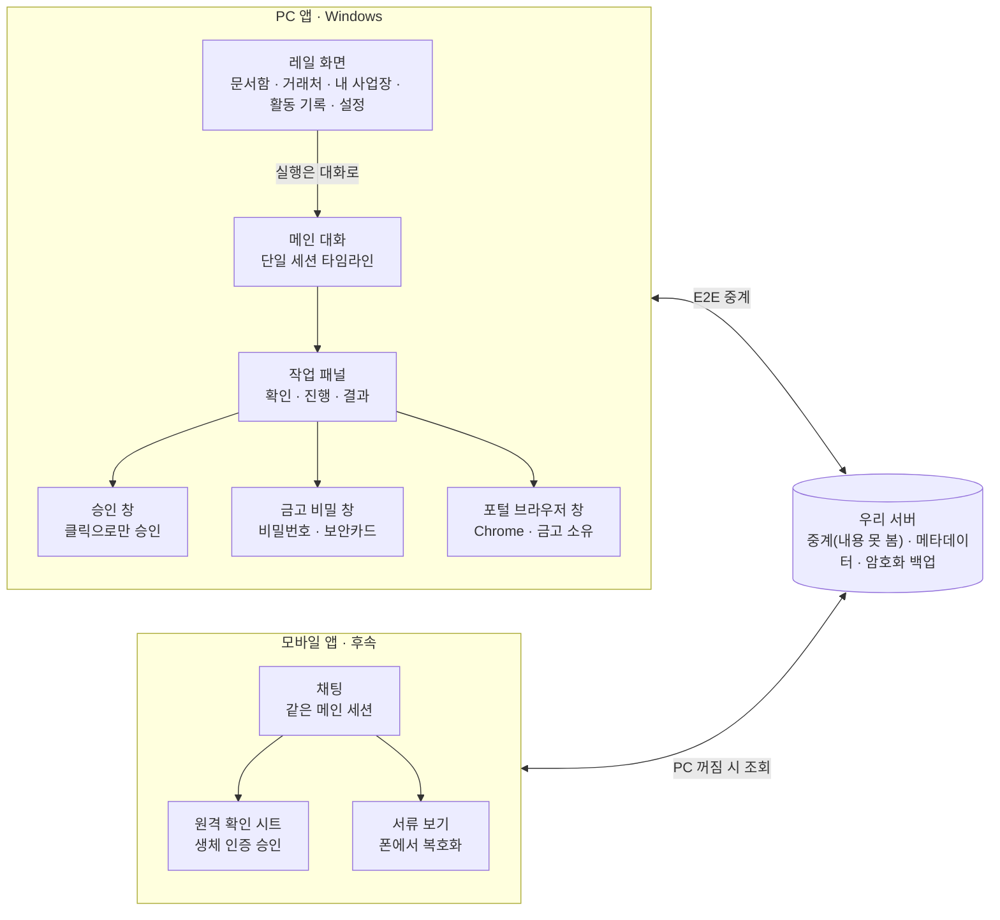
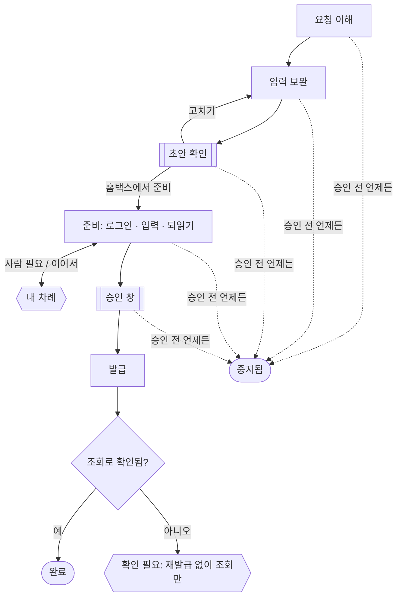

# 08. 화면·기능 기획

> 작성일: 2026-10-30 · 상태: v0.1 (Claude Design 전 단계) · 관련: 02 제품 명세, 07 서류 카탈로그, ADR-014·016·017·018·019
> 와이어프레임·흐름도가 들어간 같은 내용: Claude Docs [소버린 AX 화면·기능 기획](https://claude.ai/artifact/9rBKqQmQ3Thoaii3r1aMpi)

자영업자·중소기업이 대화 하나로 세금계산서와 홈택스 증명서 발급을 맡기고, 앱이 따로 띄우는 승인 창에서만 승인하는 Windows 앱이다. 이 문서는 Claude Design에 넘기기 전에 화면 34개(PC 27, 모바일 7)와 기능을 정한다. 서류 범위는 ADR-018(MVP 코어 = 홈택스 자동 6종), PoC 범위는 ADR-017(H-01·H-03·H-04)을 따른다.

## 1. 제품 원칙

범용 에이전트가 "무엇이든 시키세요"라면 이 앱은 "세금계산서와 증명서를 맡기세요"다. [Instinct](https://instinct.xyz/)가 트레이딩 한 분야에서 먼저 알려 주고, 물으면 카드로 답하고, 한 번에 실행하듯 같은 구조를 공공 문서에 적용한다.

| 원칙 | 화면에서 이렇게 보인다 |
|---|---|
| 할 수 있는 일만 약속한다 | 입력창 안내문, 빠른 실행, 추천이 모두 플레이북 카탈로그(02 §10) 안에서만 나온다. 세무 상담·신고·세액 판단은 한 줄로 거절하고 할 수 있는 일을 제안한다 |
| 세션은 하나 | 새 채팅, 스레드 목록, 탭이 없다. 대화는 날짜로 이어지는 타임라인 하나다. 지난 일은 검색, 문서함, 활동 기록으로 찾는다(ADR-019) |
| 말로 시작하고 카드로 확정한다 | 자유 문장은 의도를 알아내는 데만 쓴다. 금액·거래처·품목 같은 값은 카드 필드로 보여 주고 그 자리에서 고친다. 모델 문장은 짧게 쓰고, 데이터는 모델 문장 안에 섞지 않는다 |
| 되돌릴 수 없는 일은 별도로 승인한다 | 발급·전송은 대화창 버튼으로 끝나지 않는다. PC는 앱이 따로 띄우는 승인 창에서 마우스로 클릭하고, 모바일은 생체 인증과 하드웨어 키로 승인한다. Enter 키로는 승인되지 않는다(ADR-014·016) |
| 비밀은 대화에 남기지 않는다 | 인증서 비밀번호, 보안카드, 포털 비밀번호, 복구 문구는 금고 창이나 전용 전체 화면에서만 입력·표시한다. 대화에는 "입력함" 같은 상태만 남는다 |
| 완료는 포털 조회로 확인한다 | 발급 버튼을 눌렀다고 완료로 표시하지 않는다. 발급목록 조회로 확인한 뒤에 완료로 바꾼다. 확인하지 못하면 "확인 필요" 상태로 사람에게 넘긴다 |
| 먼저 알려 준다 | 만료가 다가온 서류, 진행 중인 작업, 사람이 해야 할 일을 대화 맨 위와 알림으로 먼저 보여 준다. 알려만 주고 실행은 승인을 받아서 한다 |

## 2. 정보 구조

화면은 메인 대화 하나를 중심으로 레일 화면, 별도 창, 모바일이 붙는 구조다.



레일 화면의 실행 버튼은 요청을 메인 대화로 넘긴다. 승인, 비밀 입력, 포털 조작은 앱 본체와 분리된 창에서 일어난다. 폰은 서버의 E2E 중계를 거쳐 PC의 같은 대화를 연다.

## 3. 화면 목록

디자인할 화면은 PC 27개, 모바일 7개다. 대부분은 독립 화면이 아니라 메인 대화 안의 카드나 오른쪽 패널이다. 범위 열은 PoC(2026-10-29~11-26, ADR-017) · Phase 1 · Phase 2 · 후속 순이다.

| ID | 화면 | 형태 | 핵심 기능 | 범위 |
|---|---|---|---|---|
| A-01 | 로그인 | 전체 화면 | 이메일 → 6자리 코드. 패스키 권장 | Phase 1 |
| A-02 | 잠금 화면 | 전체 화면 | 금고 잠김 상태. Windows Hello로 열기 | Phase 1 |
| A-03 | 복구 문구 | 전체 화면 | 첫 로그인 직후 12단어를 한 번 보여 주고 세 단어로 확인. 화면 캡처 차단. 새 PC에서는 문구를 입력해 복구(72시간 보류 안내) | Phase 1 |
| O-01 | 환영 | 대화 첫 메시지 | 앱이 하는 일 한 줄, 사업자 등록 시작 | PoC |
| O-02 | 사업자 인식 카드 | 대화 카드 | 사업자등록증 OCR 결과, 필드 수정, 진위확인 배지 | PoC |
| O-03 | 인증수단 카드 | 대화 카드 | 공동인증서 자동 탐지 목록, 간편인증 안내, 비밀번호 저장 여부 | PoC |
| O-04 | 맡길 업무 선택 | 대화 카드 | 업무 칩 복수 선택 + 자유 입력 | PoC |
| O-05 | 거래처 등록 카드 | 대화 카드 | 등록증 끌어 놓기, 번호 입력, 기본 이메일·금액 해석 | PoC |
| O-06 | 온보딩 요약 카드 | 대화 카드 | 등록 내용, 만들어진 빠른 실행, 첫 작업 제안 | PoC |
| M-01 | 메인 | 앱 틀 | 왼쪽 레일, 가운데 대화, 오른쪽 작업 패널 | PoC |
| M-02 | 오늘 요약 | 대화 상단 고정 | 확인 필요, 진행 중, 만료 임박 | Phase 1 |
| M-03 | 명령 팔레트 | 오버레이 | Ctrl+K. 작업 실행, 거래처·서류·대화 검색 | Phase 1 |
| T-01 | 입력 보완 카드 | 대화 카드 | 빠진 값 질문, 금액 두 가지 해석 중 선택 | PoC |
| T-02 | 확인 카드 | 대화 카드 + 패널 | 공급자·공급받는자·금액·품목·이메일 한 장. "홈택스에서 준비" | PoC |
| T-03 | 승인 창 | 별도 창 | 앱이 따로 띄우는 정적 창. 클릭으로만 승인 | PoC |
| T-04 | 실행 진행 | 작업 패널 | 단계 목록, 현재 단계, 브라우저 창 보기, 중지 | PoC |
| T-05 | 사람 차례 | 작업 패널 + 알림 | 간편인증 폰 승인 대기, 가상키패드 직접 입력, 캡차 | PoC |
| T-06 | 금고 비밀 창 | 별도 창 | 포털 비밀번호·보안카드 입력. 대화에 값이 남지 않음 | PoC |
| T-07 | 결과 카드 | 대화 카드 | 승인번호, PDF, 이메일 전송 상태, "어디로 무엇이 갔는지" | PoC |
| T-08 | 직접 발급 안내 | 작업 패널 | 정부24 후처리 모드. 단계 안내, 값 복사, 저장 파일 감지 | Phase 1, 출시 조건 아님 (PoC는 목업) |
| T-09 | 서류 꾸러미 카드 | 대화 카드 + 패널 | 공고문 → 요구 서류 체크리스트, 서류별 상태, 필요한 것만 발급 | Phase 2 (PoC는 목업) |
| D-01 | 문서함 | 레일 화면 | 서류 목록, 종류·기간 필터, 만료일, 미리보기, 보내기 | PoC |
| D-02 | 거래처 | 레일 화면 | 목록, 상세(상태·이메일·저장 품목·발급 이력) | PoC |
| D-03 | 내 사업장 | 레일 화면 | 사업자 정보, 인증수단, 개인 프로필(최대 2개) | PoC |
| S-01 | 활동 기록 | 레일 화면 | 작업별 기록, 모델 호출 여부·전송 바이트 | PoC |
| S-02 | 설정 | 레일 화면 | 승인 규칙, 보관 위치, 알림, 폰 연결, 내 데이터(서버 보관분) | Phase 1 |
| S-03 | 폰 연결 | 별도 창 | QR + 6자리 코드 페어링(화면 캡처 차단) | 후속 |
| P-01 | 잠금 | 전체 화면 | 생체 인증, 30초 후 재잠금 | 후속 |
| P-02 | 채팅 메인 | 전체 화면 | 대화 + 채팅바 위 빠른 실행 칩, PC 연결 상태 | 후속 |
| P-03 | 원격 확인 카드 | 바텀 시트 | 확인 카드 + 생체 인증 승인 | 후속 |
| P-04 | 진행·인증 안내 | 대화 카드 | "홈택스 앱에서 간편인증 승인" 안내, 진행 단계 | 후속 |
| P-05 | 서류 보기 | 전체 화면 | 폰에서 복호화한 PDF, 공유 | 후속 |
| P-06 | 연결 상태 | 바텀 시트 | PC 켜짐·꺼짐, 마지막 접속, 페어링 | 후속 |
| P-07 | 알림 | OS 알림 | 승인 요청, 완료, 만료 임박 | 후속 |

## 4. 온보딩

온보딩은 별도 마법사가 아니라 메인 대화의 첫 부분이다. 앱이 한 번에 하나씩 묻고, 사용자는 칩을 누르거나 파일을 끌어 놓거나 문장으로 답한다. 대화 밖에서 하는 단계는 로그인(A-01)과 그 직후의 복구 문구 보관(A-03) 둘뿐이다.

공통 규칙

- 질문마다 고를 수 있는 칩과 자유 입력을 함께 둔다. 자유 입력은 모델이 칩 값으로 바꿔 카드에 보여 준다.
- 모든 단계에 "나중에"가 있다. 건너뛴 항목은 오늘 요약(M-02)에 "할 일"로 남는다.
- 앱을 껐다 켜면 멈춘 질문부터 다시 묻는다.
- 온보딩 대화는 지워지지 않고 타임라인 맨 앞에 남는다. 등록 내용을 고칠 때는 내 사업장(D-03)을 쓰거나 대화로 "이메일 바꿔 줘"라고 말한다.

대화 순서

1. **환영 (O-01)**: "세금계산서 발급과 홈택스 증명서 발급을 대신 해 드려요. 먼저 사업자를 등록할게요." 칩은 [사업자등록증 올리기] [사업자번호로 입력]이다.
2. **사업자 인식 (O-02)**: 등록증 이미지·PDF를 대화창에 끌어 놓으면 PC 안에서 글자를 읽는다(docparse 샌드박스, ADR-014). 카드에 "이 PC 밖으로 보내지 않음"을 표시한다.
    - 카드 필드: 상호, 사업자번호, 대표자, 업태·종목, 사업장 주소, 사업자 이메일. 필드를 클릭하면 그 자리에서 고친다.
    - 국세청 진위확인 결과를 배지로 붙인다(예: 계속사업자 · 일반과세자). 휴·폐업이면 등록을 멈추고 이유를 보여 준다.
    - 번호만 입력하면 진위확인 뒤 나머지는 첫 홈택스 로그인 때 채운다.
    - 확정 전에 한 줄 고지: "계정마다 사업자 1곳만 등록하고, 바꾸면 90일 뒤에 다시 바꿀 수 있어요." 버튼은 [맞아요] [고칠게요]다.
3. **홈택스 로그인 방법 (O-03)**: "홈택스에 보통 어떻게 로그인하세요?" 칩은 [공동인증서] [사업자 간편인증] [잘 모르겠어요]다.
    - 공동인증서: 이 PC에서 찾은 인증서를 목록 카드로 보여 준다(소유자, 용도, 만료일, 만료 30일 이내 경고). 하나를 고른다.
    - 비밀번호 저장 여부를 따로 묻는다. 기본은 "매번 입력"이다. 고지: 홈택스 공동인증서 로그인은 가상키패드라 저장해도 자동으로 입력되지 않고, 저장한 값은 보안카드·포털 비밀번호 칸에만 쓰인다.
    - 사업자 간편인증: 카카오뱅크·IBK·KB 앱에서 승인하는 화면을 미리 보여 준다. 민원증명이 간편인증으로 발급되는지는 S16에서 확인한다(ADR-018 결정 10).
    - 잘 모르겠어요: 두 방법의 차이를 두 줄로 설명하고, PC에서 찾은 인증서가 있으면 그것을 추천한다.
4. **맡길 업무 (O-04)**: "어떤 일을 맡기고 싶으세요? 여러 개 골라도 돼요."
    - 지금 되는 일(ADR-018 MVP 코어): 세금계산서 발급·메일 전송(H-01), 사업자등록증명(H-03), 납세증명서(국세, 사업자·개인, H-04), 부가세 과세표준증명·면세사업자 수입금액증명(H-08), 표준재무제표증명(H-09), 거래처 휴·폐업 확인(H-05). PoC 빌드는 H-01·H-03·H-04만 켠다.
    - 곧 되는 일(회색 칩, 누르면 "지원되면 알림"): 발급한 세금계산서 조회·PDF 보관(H-02), 사실증명(H-10), 휴업·폐업사실증명(H-11), 법인등기사항증명서(S-03), 지방세 납세증명(W-01), 공고문 → 서류 꾸러미(K-01), 주민등록 등·초본·건강보험 자격득실(정부24, 직접 발급 안내).
    - 자유 입력 예: "매달 말일에 거래처 세 곳에 세금계산서 끊어요" → 세금계산서 칩을 켜고 "거래처 세 곳을 등록할까요?"로 이어 간다.
    - 범위 밖 예: "부가세 신고도 해 줘" → "신고와 세액 계산은 하지 않아요. 신고에 필요한 증명서는 뗄 수 있어요."
5. **업무별 후속 질문**: 고른 업무에 대해서만 묻는다.
    - 세금계산서 → 거래처 등록(O-05). 등록증 여러 장을 한 번에 끌어 놓을 수 있다. 거래처마다 받는 이메일, 자주 쓰는 품목, "330만원"이라고 말할 때 합계로 볼지 공급가액으로 볼지를 저장한다.
    - 증명서 → "제출처에서 정기적으로 내라고 하나요?" 그렇다면 유효기간 알림(D-7, D-1)을 켠다. 알림 실행은 Phase 1이고 PoC는 설정값만 저장한다.
    - 개인 서류 → 개인 프로필을 만든다. 개인 납세증명서나 "곧 되는 일"의 등·초본·건강보험 자격득실을 고르면 묻는다. 이름과 로그인 방법(간편인증 또는 개인 공동인증서)만 받고 O-03 카드를 다시 쓴다. 개인 서류를 고르지 않으면 묻지 않는다.
6. **요약 (O-06)**: 등록한 사업자, 로그인 방법, 거래처 수, 맡긴 업무를 한 카드로 보여 준다. 맡긴 업무는 빠른 실행으로 만들어진다. 서류 보관 위치는 기본 경로를 보여 주고 [바꾸기]를 둔다. OneDrive 같은 동기화 폴더를 고르면 경고한다.
7. **첫 작업 제안**: "사업자등록증명을 한 번 떼 볼까요? 돈이 오가지 않아 연습하기 좋아요." 칩은 [지금 해 보기] [세금계산서 1건 발급] [나중에]다. 사업자등록증명은 공고문 97%가 요구하는 서류이기도 하다(07 §0).

## 5. PC 메인 화면 (M-01)

PC 메인은 왼쪽 레일, 가운데 대화, 오른쪽 작업 패널의 3단이다. 화면이 넓어도 대화 폭은 읽기 좋은 폭에서 멈추고, 남는 폭은 작업 패널이 쓴다. 작업이 없을 때는 패널을 접어 대화만 보인다.

| 영역 | 내용 | 동작 |
|---|---|---|
| 상단 바 | 프로필 전환(사업자/개인), 금고 자물쇠, 폰 연결 점, 검색 | 자물쇠를 누르면 잠금. 검색은 명령 팔레트를 연다 |
| 왼쪽 레일 | 대화, 문서함, 거래처, 내 사업장, 활동 기록, 설정 | 아이콘 + 툴팁. 문서함에 만료 임박 숫자 배지 |
| 오늘 요약 (M-02) | 확인 필요, 진행 중, 만료 임박 건수 | 대화 맨 위에 한 줄로 고정. 누르면 해당 카드로 이동 |
| 대화 타임라인 | 사용자 말, 앱의 짧은 말, 카드(입력 보완·확인·진행·결과·서류·꾸러미), 날짜 구분선 | 카드는 상태 칩을 달고 제자리에서 상태가 바뀐다. 카드를 누르면 작업 패널에 열린다 |
| 입력창 | 여러 줄 입력, 파일 끌어 놓기, 안내문 "세금계산서나 증명서를 말해 주세요" | 비어 있을 때 위에 빠른 실행 칩 3~5개. 거래처·서류 이름을 치면 후보를 띄운다 |
| 작업 패널 | 지금 다루는 작업 하나: 제목·상태, 확인 카드 전체, 실행 단계, 결과 파일 | 실행은 한 번에 하나다. 다른 요청은 대기열로 패널 아래에 쌓인다 |
| 포털 브라우저 창 | 금고가 띄우는 별도 Chrome 창 | 평소에는 뒤에 둔다. 사람 차례에 "브라우저로 가기"로 앞으로 가져온다 |

넓은 화면에서 편해야 하는 기능

- **명령 팔레트 (M-03, Ctrl+K)**: 작업 실행, 거래처·서류·지난 대화 검색, 화면 이동을 한 곳에서 한다. 세션이 하나라 검색이 과거를 찾는 주 수단이다.
- **카드 안에서 바로 고치기**: 확인 카드 필드를 클릭해 고치고 Tab으로 다음 필드로 간다. 다시 말로 설명하지 않아도 된다.
- **끌어 놓기**: 사업자등록증을 대화창에 놓으면 거래처 등록, 거래처 화면에 놓아도 같다. 공고문을 놓으면 서류 꾸러미(Phase 2)다.
- **같은 내용으로 다시**: 결과 카드와 거래처 상세에 "지난번과 같게" 버튼. "지난달처럼 A사에 끊어 줘"도 같은 동작이다.
- **복사 버튼**: 승인번호, 사업자번호, 파일 경로 옆에 둔다.
- **트레이 상주**: 창을 닫아도 진행 중인 작업은 계속된다. 사람 차례와 완료는 Windows 알림으로 알린다.
- **단축키**: Enter는 보내기, Shift+Enter는 줄바꿈, Esc는 패널 닫기다. 승인에는 단축키가 없다.

## 6. 작업 실행 흐름

작업 하나는 대화 속 카드 하나가 처음부터 끝까지 상태를 바꾸며 보여 준다. 사용자가 손을 대는 순간은 두 번이다. 초안을 보고 "홈택스에서 준비"를 누를 때, 홈택스에 입력된 값을 승인 창에서 승인할 때다. 예시 요청은 "A상사에 330만원 세금계산서 끊고 메일 보내 줘"다.



| 단계 | 카드에 보이는 것 | 사용자가 하는 일 |
|---|---|---|
| 1. 요청 이해 | 사용자 말 아래 "세금계산서 발급 · A상사" 한 줄 | 틀렸으면 다시 말한다 |
| 2. 입력 보완 (T-01) | 빠진 값만 묻는다. 금액은 두 해석을 나란히: 합계 3,300,000(공급가 3,000,000 + 세액 300,000) / 공급가 3,300,000(+ 세액 330,000). 거래처 기본값이 있으면 미리 선택. 과세·영세·면세, 품목, 작성일자(기본 오늘) | 고른다. 과세유형은 앱이 추측하지 않는다 |
| 3. 초안 확인 (T-02) | 한 장 카드: 공급자, 공급받는자, 공급가·세액·합계, 품목, 작성일자, 받는 이메일. "아직 아무것도 보내지 않았어요." 처음 쓰는 거래처, 휴·폐업, 바뀐 이메일은 경고 줄 | [홈택스에서 준비] [고치기] [취소] |
| 4. 준비 (T-04) | 단계 목록: 로그인 → 건별발급 화면 → 입력 → 되읽기. 현재 단계에 진행 표시 | 로그인은 사람 차례(T-05): 폰에서 간편인증 승인, 또는 브라우저 창의 가상키패드에 직접 입력. 언제든 [중지] |
| 5. 승인 (T-03) | "PC 승인 창에서 확인해 주세요" + [승인 창 열기]. 홈택스에서 되읽은 값이 초안과 다르면 다른 칸을 표시 | 승인 창에서 마우스로 승인. 승인 창은 포커스를 빼앗지 않고 작업 표시줄에만 뜬다 |
| 6. 발급·확정 | "발급 중" → 발급목록 조회 → 승인번호. 조회로 확인하지 못하면 "확인 필요" | 기다린다. 확인 필요면 앱은 다시 발급하지 않고 조회만 다시 한다 |
| 7. 완료 (T-07) | 승인번호(복사), 금액, 메일 전송 상태, PDF 열기, 폴더 열기, "어디로 무엇이 갔는지" 펼치기, [지난번과 같게] | PDF를 열거나 다음 일을 말한다 |

증명서 발급(사업자등록증명, 납세증명서, 과세표준증명, 표준재무제표증명)도 같은 카드 흐름이다. H-03·H-08·H-09는 홈택스 즉시발급 민원증명 템플릿 하나를 쓰므로(ADR-018 결정 2) 카드 모양도 하나로 맞춘다. 2단계에서 용도·제출처와 공개 범위(기본 최소)를 묻고, 7단계 결과는 서류 카드(발급일, 유효기간, [만료 알림 켜기], [메일로 보내기])다. 신청형인 사실증명(H-10, 베타)은 6단계 대신 "처리 대기"로 멈췄다가 수령 시 완료로 바뀐다.

카드 상태 칩(디자인 토큰 후보): 작성 중 · 준비 중 · 내 차례 · 승인 대기 · 발급 중 · 처리 대기 · 확인 필요 · 완료 · 중지됨 · 실패. "내 차례"와 "확인 필요"만 강조색을 쓴다.

## 7. 서류 꾸러미 (T-09, K-01 · Phase 2, PoC는 목업)

공고문 하나에 필요한 서류를 한 카드로 모아 준다(02 §15). 수요검증 데모는 PoC 기간에 목업으로 보여 준다(ADR-018 결정 5).

1. 공고문 PDF·HWP를 대화창에 끌어 놓거나 본문을 붙여 넣는다. 공고문은 공개 문서라 마스킹 없이 Terra로 보낸다는 것을 카드에 한 줄로 표시한다.
2. 꾸러미 카드: 공고명, 마감일, 요구 서류 행. 행마다 서류명, 발급일 조건(예: 공고일 이후 발급), 제출 단계(신청·선정 후·협약), 상태 칩(재사용 가능 / 새로 발급 / 직접 준비 / 생략 가능)이 있다. 사용자가 행을 고치거나 지울 수 있다.
3. [새로 발급할 것 준비]를 누르면 해당 플레이북들이 대기열에 들어간다. 발급마다 승인 규칙은 같고, 법인등기 수수료 결제(S-03)는 사용자에게 넘긴다.
4. 결과는 공고별 폴더와 체크리스트다. 선정 후 단계의 서류는 마감일 알림으로 남긴다.
5. 카드 문구에 "지원 가능", "적격" 같은 판단을 쓰지 않는다. 신청서 작성과 업로드 대행도 하지 않는다.

## 8. 문서함·거래처·내 사업장

훑어보고, 찾고, 정리하는 일은 대화가 아니라 레일 화면에서 한다. 세 화면은 왼쪽 목록과 오른쪽 상세로 된 같은 틀을 쓴다. 상세의 실행 버튼은 요청을 메인 대화로 넘기고 대화 화면으로 돌아간다. 작업은 항상 대화 한 곳에 기록된다.

**문서함 (D-01)**

- 목록 열: 표시 이름, 종류, 프로필, 발급일, 만료일(D-day), 출처(앱이 발급 / 직접 발급 / 직접 추가).
- 필터: 종류, 기간, 만료 임박. 기본 정렬은 최근 발급순이고, 만료 7일 이내 서류는 맨 위에 고정한다.
- 상세: PDF 미리보기, 발급일·유효기간, [메일로 보내기] [폴더 열기] [다시 발급] [폰으로 보내기(후속)].
- 파일을 끌어 놓으면 글자를 읽어 종류와 발급일을 제안한다. 법인인감·신용평가처럼 앱이 발급하지 않는 서류도 보관·만료 추적한다(ADR-018 결정 7).
- 디스크의 파일명에는 거래처·승인번호를 넣지 않는다. 알아볼 수 있는 표시 이름은 앱 안에만 있다(02 §4).

**거래처 (D-02)**

- 목록 열: 상호, 사업자번호, 상태(계속·휴업·폐업 + 마지막 확인일), 최근 발급일, 이번 달 발급 여부.
- 상세: 받는 이메일, 저장 품목, 금액 해석 기본값(합계/공급가액), 세금계산서 발급 이력, [세금계산서 발급] [지난번과 같게] [상태 다시 확인].
- 추가: 등록증 끌어 놓기 또는 번호 입력. 여러 장을 한 번에 놓으면 카드가 여러 장 생기고 한 번에 확인한다.
- 휴·폐업 상태는 발급 직전에 자동으로 다시 확인한다(H-05).

**내 사업장 (D-03)**

- 사업자 프로필: 상호, 번호, 대표자, 업태·종목, 주소, 이메일. 홈택스 로그인 후 "홈택스 값과 다름"을 표시하고 맞추기를 제안한다.
- 인증수단: 선택한 인증서와 만료일, 간편인증 앱, 비밀번호 저장 여부.
- 개인 프로필: 온보딩에서 개인 서류를 고르면 만든다. "프로필 2개 중 1개 사용"처럼 한도를 보여 준다.
- 맡긴 업무: 온보딩에서 고른 업무 = 빠른 실행 목록. 순서를 바꾸고 켜고 끈다.

## 9. 보안·설정

보안 장치는 승인 창, 금고 비밀 창, 활동 기록 세 화면으로 사용자에게 보인다. 승인 창과 비밀 창은 앱 본체와 생김새를 일부러 다르게 해서, 대화창에 나오는 어떤 카드도 이 창을 흉내 낼 수 없게 한다.

**승인 창 (T-03): 디자인 제약이 가장 많은 화면**

- 앱에 내장된 고정 문구와 홈택스에서 되읽은 값만 들어간다. 스크립트 없는 정적 HTML과 CSS 한 장으로 만들 수 있어야 하므로 애니메이션·외부 폰트·이미지 URL을 쓰지 않는다(ADR-014).
- 표시 항목: 작업 이름, 공급자, 공급받는자(상호·번호), 공급가·세액·합계, 품목, 받는 이메일, 결과 설명("승인하면 세금계산서가 발급되고 A상사 메일로 전송됩니다. 되돌릴 수 없습니다").
- 버튼은 [승인하고 발급] [취소] 두 개다. 마우스 클릭만 승인으로 인정하고 Enter·Space는 막는다. 창이 뜨고 600ms 동안의 입력은 무시한다.
- 포커스를 빼앗지 않고 작업 표시줄에만 뜬다. 대화 카드의 [승인 창 열기]는 창을 앞으로 부르기만 한다.
- 설정에서 Windows Hello 추가 확인을 켤 수 있다(기본 꺼짐).

**금고 비밀 창 (T-06)**

- 포털 비밀번호와 보안카드 번호를 여기서만 받는다. 대화창에는 "보안카드 입력 대기" → "입력함" 상태만 남는다.
- 홈택스 공동인증서 비밀번호는 가상키패드라 앱이 받지 못한다. 이때는 비밀 창 대신 "브라우저 창에서 직접 입력해 주세요" 안내(T-05)와 [브라우저로 가기]를 보여 준다.

**복구 문구 (A-03)**

- 첫 로그인 직후 한 번 보여 준다. 문구는 클라우드 백업 서류와 계정 신원 키(AIK)를 새 PC에서 되살리는 데 쓰인다. PC 안의 거래처·보관함 파일은 문구로 되살아나지 않는다.
- 화면 캡처를 막고(D05 §8), 세 단어를 다시 입력받아 확인한다. "소버린 AX는 어떤 경우에도 복구 문구를 묻지 않습니다"를 함께 표시한다.

**활동 기록 (S-01)**

- 행: 시각, 작업, 프로필, 포털, 결과, 모델 사용(안 함 / 마스킹 후 n바이트).
- 펼치면 입력값 요약, 플레이북 버전, 단계별 결과, "모델로 보낸 내용 보기"(기본 접힘).
- 결과 카드의 "어디로 무엇이 갔는지"는 이 행을 카드 안에서 펼친 것이다.

**설정 (S-02)**

| 묶음 | 항목 | 범위 |
|---|---|---|
| 승인 | Windows Hello 추가 확인 | Phase 1 |
| 보관 | 서류 보관 위치, 클라우드 백업 켜기/끄기 | 위치 PoC, 백업 후속 |
| 알림 | 만료 알림(D-7, D-1), 작업 가능 시간대(예: 평일 09:00~18:00) | Phase 1 |
| 폰 연결 | 연결된 기기, 연결 해제, 원격 승인 하루 상한 5건 표시 | 후속 |
| 모델 | 내 API 키 사용(ADR-009) | Phase 1 |
| 내 데이터 | 우리 서버에 있는 내 데이터 보기·내보내기·삭제 | Phase 1 |

**폰 연결 (S-03)**: PC에 QR을 띄우고, 폰이 스캔하면 폰에 뜬 6자리를 PC에 입력한다. QR 창은 화면 캡처를 막고, 폰의 6자리 옆에는 "PC 화면에만 입력" 경고를 둔다(ADR-016).

## 10. 모바일 앱 (후속)

모바일 앱은 PC의 리모컨이다. 화면은 채팅 하나이고, 할 수 있는 일은 원격 발급 요청, 발급된 서류 가져오기, 승인·알림 받기 세 가지다. 거래처 편집, 설정, 온보딩은 PC에서 한다.

**채팅 메인 (P-02)**

- 상단: PC 연결 상태("● 사무실 PC 켜짐" / "○ PC 꺼짐 · 2시간 전"). 누르면 연결 상태 시트(P-06).
- 채팅바 바로 위에 빠른 실행 칩을 가로 스크롤로 둔다: [세금계산서 발급] [사업자등록증명] [납세증명서] [서류 가져오기]. 칩은 PC에서 맡긴 업무와 같다.
- 대화는 PC와 같은 메인 세션을 보여 주고, 폰에서 보낸 말에는 "폰에서" 표시가 붙는다. PC가 꺼져 있을 때 서버가 한 답은 "서버 답변"으로 표시하고, PC가 켜지면 PC 타임라인의 같은 시각 자리에 합친다(ADR-019).

**원격 발급 (PC 켜짐)**

1. "B상사 55만원 세금계산서" 또는 칩 → PC와 같은 입력 보완 카드.
2. 초안 확인 시트(P-03) → [홈택스에서 준비]. PC가 실행한다.
3. 로그인: "카카오뱅크 앱에서 간편인증을 승인해 주세요" 안내 카드(P-04). 공동인증서 프로필은 원격 발급이 안 된다. "공동인증서 비밀번호는 PC에서만 입력할 수 있어요"로 안내한다.
4. 승인: 되읽은 값으로 승인 시트 → 생체 인증. 처음 쓰는 거래처, 하루 5건 초과, 하드웨어 키가 없는 폰이면 "PC에서 승인 필요"로 멈춘다(ADR-016).
5. 완료: 결과 카드 + PDF 미리보기.

**서류 가져오기**

- PC 켜짐: "지난달 납세증명서 줘" → PC 문서함에서 찾아 암호화해 보낸다 → 서류 카드 → 뷰어(P-05) → 공유(카카오톡·메일·파일 저장).
- PC 꺼짐: 백업을 켠 서류만 서버의 암호화 파일을 받아 폰에서 푼다. "중소기업확인서 언제 만료돼?" 같은 날짜 질문은 답한다. 발급은 할 수 없고 "PC가 켜지면 승인 요청" 예약만 받는다.

**그 밖의 화면**: 잠금(P-01)은 앱을 열 때 생체 인증, 백그라운드 30초 뒤 재잠금이다. 알림(P-07)은 승인 요청, 간편인증 차례, 완료, 만료 임박, "PC에서 승인 필요" 다섯 가지다. 알림 문구에는 거래처명·금액을 넣지 않는다(잠금 화면 노출).

## 11. 예외 상태

예외는 모두 같은 작업 카드 안에서 상태 칩과 한 줄 설명, 다음 행동 버튼으로 보여 준다. 새 창이나 오류 대화상자를 띄우지 않는다. 단, 발급 후 결과를 모르는 경우에는 어떤 버튼도 다시 발급하지 않는다.

| 상황 | 카드 상태와 문구 | 선택지 |
|---|---|---|
| 간편인증 폰 승인 대기 | 내 차례 · "카카오뱅크 앱에서 승인해 주세요" + Windows·폰 알림 | [다시 요청] [중지] |
| 가상키패드·캡차 | 내 차례 · "브라우저 창에서 직접 입력해 주세요". 브라우저 창을 앞으로 가져온다 | [브라우저로 가기] [중지] |
| 화면이 바뀌어 자동 진행 실패 | 내 차례 · "이 단계는 직접 해 주세요: 품목 칸에 '컨설팅' 입력". 시도 3회와 자동 복구가 실패한 뒤다 | [다 했어요] [중지] |
| 다른 기기에서 홈택스 로그인 | 중지됨 · "다른 곳에서 홈택스에 로그인해 연결이 끊겼어요". 시작 전에도 한 줄 안내한다 | [다시 준비] |
| 발급 후 결과 미확인 | 확인 필요 · "발급됐는지 아직 모르겠어요. 중복 발급을 막으려고 다시 발급하지 않아요" | [다시 조회] [홈택스에서 직접 확인] |
| 아직 발급할 수 없는 서류 | 실패 · 예: 표준재무제표증명은 신고가 반영된 뒤에만 발급된다(02 §10) | [알림 받기] |
| 홈택스 차단·제한 신호 | 중지됨 · "홈택스에서 제한 신호가 와서 모든 홈택스 작업을 멈추었어요". 대기열도 멈춘다 | [직접 하는 방법 보기] |
| 거래처 휴·폐업 | 초안 단계 경고 줄 · "B상사는 2026-09-30 폐업으로 조회돼요" | [그래도 진행] [취소] |
| 인증서 만료 임박·만료 | 오늘 요약에 표시, 준비 전에 경고. 만료되면 시작하지 않는다 | [갱신 방법 보기] |
| 금고 잠김 | 작업 시작 전 잠금 화면(A-02) | [Windows Hello로 열기] |
| PC 인터넷 끊김 | 중지됨 · 연결이 돌아와도 승인 뒤 단계는 자동으로 이어 가지 않는다 | [다시 준비] |
| PC 꺼짐(모바일) | 채팅 상단 배너 · "PC가 꺼져 있어요. 발급은 PC가 켜지면 승인 요청으로 다시 와요" | [PC 켜지면 요청] |
| 범위 밖 요청 | 카드 없이 앱의 한 줄 · "신고와 세액 계산은 하지 않아요" | 할 수 있는 일 칩 1~2개 |

## 12. Claude Design 전달 사항

색·서체·데이터 위계의 기준은 [design-system/](design-system/README.md)이다(2026-10-30 결정: A안 구조 + 파랑 강조색 하나, 색 최소화). 이 절의 톤 항목과 디자인 시스템이 다르면 디자인 시스템을 따른다. Claude Design에는 PC 메인과 세금계산서 작업 카드 세트를 먼저 맡기고, 모바일은 PC 컴포넌트가 정해진 뒤에 맡긴다. 정부24 직접 발급 안내(T-08)와 서류 꾸러미(T-09)는 PoC 수요검증에서 목업으로만 보여 주므로(ADR-017·018) 동작 없는 화면이면 된다.

**톤**

- 거의 무채색 화면에 파랑 강조색 하나("내 차례"와 승인에만)와 황토 주의색("확인 필요")만 쓴다. 완료·실패에는 색을 쓰지 않는다. 라이트·다크 모두 지원한다.
- 관공서 파랑 톤과 장난스러운 마스코트를 피한다. 넓은 여백, 선 대신 면, 아이콘은 레일과 상태에만 쓴다.
- 금액·사업자번호·승인번호는 고정폭 숫자로 맞춰 세로로 비교하기 쉽게 한다. 금액은 천 단위 쉼표와 "원"을 붙인다.
- 문구는 짧은 해요체다. 버튼은 동사로 끝낸다("승인하고 발급", "다시 조회").
- 창 틀은 Windows 11 기준이다(ADR-008). 최소 창 크기에서는 작업 패널이 대화 위로 덮는 서랍이 된다.
- 앱 이름은 미정이다. 로고 자리는 임시 표기를 쓴다.

**컴포넌트 목록**

| 묶음 | 컴포넌트 |
|---|---|
| 메시지 | 사용자 말풍선, 앱 메시지(말풍선 없는 글), 날짜 구분선, "폰에서"·"서버 답변" 표시 |
| 칩 | 선택 칩(하나/여러 개), 비활성 "곧 지원" 칩, 빠른 실행 칩, 상태 칩 10종 |
| 대화 카드 | 사업자·거래처 인식(필드 편집), 인증서 목록, 업무 선택, 입력 보완(금액 두 해석), 초안 확인, 진행, 내 차례, 결과, 서류, 꾸러미 체크리스트, 온보딩 요약 |
| 앱 틀 | 레일, 상단 바, 오늘 요약 바, 입력창(끌어 놓기 오버레이 포함), 작업 패널, 대기열, 목록+상세 틀, 빈 상태 |
| 별도 창 | 승인 창(정적), 금고 비밀 창, 잠금 화면, 복구 문구 화면, 폰 연결 QR |
| 오버레이 | 명령 팔레트, Windows 알림 문구 |

**디자인 순서**

1. PC 메인 + 세금계산서 카드 세트(T-01~T-07): PoC 데모의 핵심 흐름이다.
2. 온보딩 대화(O-01~O-06)와 복구 문구 화면(A-03).
3. 승인 창·금고 비밀 창.
4. 문서함·거래처·내 사업장.
5. 명령 팔레트·오늘 요약·활동 기록·설정, 목업 화면(T-08·T-09).
6. 모바일(P-01~P-07).

첫 요청으로 쓸 문장:

```text
자영업자·중소기업의 세금계산서·홈택스 증명서 발급을 대신하는 Windows 데스크톱 에이전트 앱의 메인 화면을 디자인해 줘.
왼쪽 아이콘 레일(대화·문서함·거래처·내 사업장·활동 기록·설정), 가운데 단일 대화 타임라인, 오른쪽 작업 패널.
대화에는 "A상사에 330만원 세금계산서 끊고 메일 보내 줘" 요청과 금액 두 해석 선택 카드, 초안 확인 카드가 있고,
작업 패널에는 로그인 → 입력 → 되읽기 단계가 보인다. 거의 무채색, 강조색 하나, 금액은 고정폭 숫자, 해요체. 앱 이름은 미정이라 로고 자리는 임시 표기로.
```

## 13. 결정 기록 (2026-10-30)

| 질문 | 결정 | 반영한 곳 |
|---|---|---|
| 폰 대화와 PC 세션 | 하나의 타임라인. 폰에서 보낸 말은 "폰에서", PC가 꺼져 있을 때 서버가 한 답은 "서버 답변"으로 표시하고 PC가 켜지면 합친다 | §10, ADR-019 |
| 첫 작업 제안 | 사업자등록증명을 먼저 권하고 세금계산서 칩도 함께 둔다 | §4, 02 §2 |
| 복구 문구 | 첫 로그인 직후 전체 화면(A-03)에서 한 번 보여 주고 확인받는다. ADR-016과 같아 설계 변경 없음 | §3, §4, §9 |
| 개인 프로필 | 온보딩에서 개인 서류를 고르면 그때 만든다 | §4, 02 §2 |
| 거래명세서로 초안 만들기 | Phase 1 이후로 보류. 모델로 보낼 마스킹 범위를 정한 뒤 다시 본다 | 없음 |
| 앱 이름 | 디자인 후 결정. 디자인에는 임시 표기를 쓴다 | §12 |
| 디자인 방향 | A안(서류와 도장) 구조에 파랑 강조색 하나, 색 최소화. 데이터 위계는 디자인 시스템에서 정의 | §12, design-system/ |
| 업무 목록 | ADR-018 MVP 코어 6종을 "지금 되는 일"로, 베타·Phase 2를 "곧 되는 일"로 둔다. PoC 빌드는 H-01·H-03·H-04만 | §4 |
