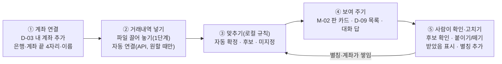

# 09. 돈 맞추기: 계좌 입출금으로 못 받은 돈·안 낸 돈 찾기

> 작성일: 2026-11-12 · 상태: **기획 v0.1(제안, 대표 확인 전)** · 설계·코드 없음 · 지시: 대표(2026-11-12, 부장 경유) "사업자 계좌를 연결하고 실제로 매출이나 매입이 발생했는지 체크해서, 내가 돈을 못 받은 건이나 안 낸 건을 바로바로 알 수 있도록 하는 기능 기획. 사업자명 같은 것이 입금자명과 다를 수도 있고 이상하게 찍혀 있을 수도 있으니까 수동 체크 가능하고, 거래처의 계좌번호도 등록 가능하도록."
> 관련: 02 §10(플레이북 카탈로그)·§12(하지 않는 것)·§14(기한 알림)·§17(세무사 꾸러미, H-12 [최신화]), 08 §1(제품 원칙)·§5(M-02 이번 달 판)·§8(D-02 거래처·D-03 내 사업장), D05(금고), D06(마스킹), D07(데이터 모델, `card_txns`·`card_txn_memos`의 구간 교체·다시 잇기), ADR-020·021·032·033, R15(시온랩 계좌·카드 대사)
> **2026-11-12 대표 결정**: "계좌연결은 API를 쓰되, 유저가 원할 경우에만 진행". 자동 연결은 중계 사업자 API를 사용자가 켤 때만 쓰고(옵트인), 켜지 않은 사용자는 파일 올리기로 쓴다. §0·§3.1·§3.2·§4.3·§9·§10·§11·§13을 이 결정에 맞췄다. 소버린 규칙 2(README 원칙 2)의 예외라 설계 전에 ADR이 필요하다(§4.4).
> **2026-11-12 대표 지시(이어서)**: "각 계좌별로 이거 활용하자" — CODEF 「개인 수시입출 거래내역」(developer.codef.io/products/bank/common/p/transaction)·「기업 수시입출 거래내역」(…/b/transaction). §3.1·§3.2·§4.4·§6.2·§9·§10·§11에 반영했다. 두 API는 connectedId(로그인 정보 등록) 방식이라 공동인증서 로그인을 고르면 인증서 개인키와 비밀번호가 CODEF에 보관된다 
> **2026-11-12 대표 결정(이어서)**: "고객 입장에서 가장 좋은 거로 하자. 그냥 공동인증서만 하는 게 나을듯. 문제 생기면 codef 책임이지". 자동 연결의 로그인은 **공동인증서 하나만** 둔다(아이디 로그인 없음). 홈택스 로그인과 같은 동작이라 사장님이 처음 한 번 하기 가장 쉽다. 인증서 파일·비밀번호가 CODEF에 보관된다는 점은 동의 카드에 그대로 적는다. 유출 때 CODEF가 어디까지 책임지는지는 약관·계약에서 확인한다(Q12).
> 표기: (결정)은 대표가 이미 정한 것, (제안)은 이 문서가 권하는 것, 【결정 필요 n】은 §11의 대표 결정 항목, **미확인**은 공개 자료로 확인하지 못한 사실이다.

## 0. 한 줄 요약

내 계좌의 입출금을 세금계산서와 맞춰 **"못 받은 돈"(매출)·"안 낸 돈"(매입)** 을 이번 달 판과 대화에 바로 보여 준다. 맞추기는 이 PC 안에서 정해진 규칙으로만 하고(모델 없음), 확실할 때만 자동으로 붙이며 애매하면 사람에게 묻는다. 입금자명이 상호와 달라도 **거래처 계좌번호·예금주·입금자 별칭**으로 다음부터 알아보고, 사람은 언제든 "받았음/냈음"을 직접 표시하거나 입출금 한 줄을 붙이고 뗄 수 있다.

- **길(결정, 2026-11-12)**: 기본은 **은행 거래내역 파일(엑셀·CSV·PDF) 올리기**. 사용자가 원하면 계좌마다 **자동 연결(CODEF API, 옵트인)** 을 켠다: 개인뱅킹 계좌는 「개인 수시입출 거래내역」, 기업뱅킹 계좌는 「기업 수시입출 거래내역」 API. 로그인은 **공동인증서 하나만**(대표 결정 2026-11-12). 이 API는 인증서 파일과 인증서 비밀번호를 CODEF에 등록해 보관시키는 방식이라, 켤 때 그 점을 밝힌 동의를 따로 받는다(§4.4·§9.4). 오픈뱅킹·마이데이터는 쓰지 않는다. 전용 Chrome 빠른조회는 보류(§4.3).
- **처음 쓸 범위(제안)**: 매출만. 앱 발급 원장 + 은행 파일 + 거래처 계좌 등록 + 수동 체크. 매입·안 낸 돈은 2단계(§10).

## 1. 왜, 그리고 어디까지

사장님은 세금계산서를 끊고 나서 돈이 들어왔는지를 은행 앱과 엑셀을 번갈아 보며 확인한다. 입금자명은 상호가 아니라 대표자 이름, 약칭, 잘린 글자, 경리 담당자 이름으로 찍히는 일이 많아서 "누가 보낸 돈인지" 맞추는 데 시간이 든다. 이 앱은 이미 **내가 발급한 세금계산서(원장)** 와 **거래처 장부**를 갖고 있으므로, 계좌 입출금만 더하면 못 받은 돈을 먼저 알려 줄 수 있다. 08 §1 "먼저 알려 준다"의 연장이다.

| 범위 안 | 범위 밖 (§13) |
|---|---|
| 세금계산서(매출·매입, 수정·취소 반영)와 계좌 입출금 맞추기 | 돈 보내기·이체 실행, 자동이체 등록 |
| 못 받은 돈·안 낸 돈 목록, 기한 지남 알림 | 거래처에 독촉 메일·문자 보내기 |
| 사람의 수동 체크(받았음/냈음, 붙이기·떼기, 계좌 밖 결제, 되돌리기) | 대손·회계 처리·계정과목·세무 판단 |
| 거래처 계좌번호(여러 개, 은행, 예금주)와 입금자 별칭 | 카드매출 정산 대사, 현금영수증 대사(후속 검토) |
| 거래처별 결제 조건(기한) | 잔액·자금 흐름 예측, 대출·금융상품 추천 |

## 2. 사용자 이야기

| # | 사장님은 | 하고 싶다 | 그래서 |
|---|---|---|---|
| U1 | 이번 달 세금계산서를 10건 끊었다 | 아직 안 들어온 돈만 보고 싶다 | 받으러 연락할 곳을 바로 안다 |
| U2 | 거래처 B가 대표자 개인 계좌로 보낸다 | B의 입금자 이름을 한 번 알려 주고 싶다 | 다음부터는 앱이 알아서 B로 붙인다 |
| U3 | C가 두 달 치를 한 번에 보냈다 | 한 입금을 두 건에 나눠 붙이고 싶다 | 두 건이 모두 "받음"이 된다 |
| U4 | D가 수수료 500원을 빼고 보냈다 | 차액 때문에 "덜 받음"으로 남지 않게 하고 싶다 | 목록이 깨끗해진다 |
| U5 | E에게 현금으로 받았다 | 계좌에 없는 돈도 받았다고 표시하고 싶다 | 못 받은 돈 목록에서 빠진다 |
| U6 | 앱이 엉뚱한 건에 붙였다 | 떼고 맞는 건에 붙이고 싶다 | 기록에 남고 다음에 같은 실수를 덜 한다 |
| U7 | 받은 세금계산서가 있다(매입, 2단계) | 아직 안 보낸 돈을 보고 싶다 | 결제를 놓치지 않는다 |
| U8 | 거래처 F의 계좌번호를 안다 | 거래처에 계좌를 등록해 두고 싶다 | 그 계좌로 오가는 돈은 F로 확실히 붙는다 |
| U9 | 대화창에서 일한다 | "이번 달 못 받은 돈 있어?"라고 묻고 싶다 | 카드 하나로 답을 받는다 |

## 3. 화면 흐름

새 화면은 레일의 **받을 돈·낼 돈(D-09)** 하나이고, 나머지는 기존 화면(M-02 판, D-02 거래처, D-03 내 사업장, 대화 카드)에 칸과 카드를 더한다(제안). 화면 ID는 08 §3 목록에 더한다.

### 3.1 ① 계좌 연결 (D-03 내 사업장 > 내 계좌)

- [계좌 추가]: 은행(목록에서 고름), 계좌번호, 부르는 이름(예: "주거래 국민"), 쓰임(받는 계좌 / 내는 계좌 / 둘 다). 개인사업자가 대표자 개인 계좌를 사업용으로 쓰는 경우도 같은 칸으로 받는다.
- 계좌번호는 화면에 끝 4자리만 보인다("국민 ···1234"). [보기]를 누르면 전체가 3초 보인다(제안).
- 처음 추가할 때 동의 카드(§9.4)를 한 번 보인다. 동의하지 않으면 계좌를 저장하지 않는다.
- 파일로만 쓰면 **은행 로그인 정보를 받지 않는다.** 이 화면에 비밀 칸이 없다.
- **[자동 연결 켜기](옵트인, 결정 2026-11-12, CODEF)**: 계좌마다 따로 켠다. 기본은 꺼짐이고, 앱이 먼저 권하지 않는다(파일을 세 번 넘게 올린 사용자에게 한 줄 안내만, 제안).
  1. 이 계좌가 개인뱅킹인지 기업뱅킹인지 고른다 → CODEF 개인/기업 수시입출 거래내역 API가 정해진다(§4.4).
  2. 자동 연결 동의 카드(§9.4 두 번째 문구). [동의하고 연결] 전에는 아무것도 보내지 않는다.
  3. 공동인증서 고르기(홈택스 발급 인증을 공동인증서로 정했으면 그 인증서를 먼저 보여 준다)와 인증서 비밀번호, 은행이 요구하면 계좌 비밀번호를 **금고 창**(T-06과 같은 OS 프레임 창)에서 받는다. 대화창·렌더러에는 입력 칸을 두지 않는다. 개인뱅킹 계좌는 개인(은행용·범용) 인증서, 기업뱅킹 계좌는 그 은행 기업뱅킹에 등록한 인증서다. 금융인증서(클라우드)만 쓰는 사장님은 이 길로 연결할 수 없고(CODEF 계정 등록은 der·key·pfx 파일만 받는다) 파일 올리기를 쓴다.
  4. CODEF 계정 등록으로 connectedId를 받고 첫 조회(지난 3개월, 예금주 포함)를 한다. 예금주가 내 사업장과 다르면 멈추고 묻는다. 결과 카드: "국민 ···1234 자동 연결됨 · 지난 3개월 입출금 n줄을 가져왔어요".
  5. 실패하면 CODEF 응답 코드를 사람 말로("로그인 정보가 맞지 않아요", "이 인증서가 이 은행에 등록돼 있지 않아요", "인증서가 만료됐어요", "은행이 문자 인증을 요구해요") 보이고 파일 올리기를 그대로 쓸 수 있다고 알린다.
- **[자동 연결 끊기]**: CODEF에서 계정 등록을 지우고(계정 관리 API 유무 **미확인**), PC의 connectedId를 지운다. 이미 가져온 입출금 줄은 남길지 묻는다(기본 남김).
- 계좌 목록에 연결 방식 칩: "파일" / "자동 연결 · 마지막 조회 n시간 전".

### 3.2 ② 거래내역 넣기

**1단계: 파일 올리기(제안)**
1. 사장님이 은행 인터넷뱅킹이나 앱에서 거래내역을 엑셀·CSV로 내려받는다(앱은 은행에 접속하지 않는다). D-09의 [거래내역 올리기] 옆에 은행별 내려받는 곳 안내 한 줄을 둔다.
2. 파일을 대화창이나 D-09에 끌어 놓는다.
3. 앱이 은행 서식을 알아보고(머리줄 낱말과 열 순서), 어느 내 계좌인지 묻는다(파일에 계좌번호가 있으면 끝 4자리로 제안).
4. 읽기 카드: "국민 ···1234 · 10월 1일~11월 11일 · 입금 42줄 · 출금 18줄. 이 중 새 줄 12줄." [맞추기] [취소].
5. 맞추기 결과 카드: "자동으로 붙임 5건 · 확인할 후보 3건 · 누가 보낸지 모르는 입금 2건" [후보 확인하기].

- 같은 계좌·같은 기간 파일을 다시 올려도 결과가 같아야 한다. 겹치는 기간은 통째로 새 파일 것으로 바꾸고, 사람이 한 연결·메모는 줄 열쇠로 다시 잇는다(D07 `card_txns`·`card_txn_memos`와 같은 방식, 제안). 다시 잇지 못한 연결은 "연결 대상 확인 필요"로 보인다.
- 서식을 모르는 파일은 열 고르기 카드(날짜·입금·출금·적요·잔액 열을 사람이 지정)로 한 번 받고, 그 서식을 기억한다.
- 파일 읽기는 docparse 샌드박스(ADR-014)에서 한다. 비밀번호 걸린 엑셀은 PDF 열기 암호와 같은 규칙(미저장, D05 §2)이다.

**자동 연결한 계좌(옵트인, CODEF)**: D-09에 [최신화]와 "마지막 조회: n시간 전". 등록한 로그인 정보는 CODEF 쪽에 있어 PC에 사람 비밀이 필요 없으므로 앱이 켜져 있을 때 **정해진 횟수만** 스스로 조회할 수 있다. 기본은 앱을 켤 때 1번 + 하루 2번, [최신화]는 하루 상한을 둔다(제안) 【결정 필요 11】. 은행이 문자 추가 인증을 요구하면 그때만 사람 차례가 된다(§4.4). 조회라 승인 카드는 띄우지 않는다. 가져온 줄은 파일과 같은 입출금 줄로 들어가고 같은 맞추기를 탄다(원천 칸만 `api`).

### 3.3 ③ 맞추기

§6 규칙으로 로컬에서 한다. 결과는 세 가지다.
- **자동 확정**: 건에 붙이고 "받음 · 자동"으로 보인다. 되돌릴 수 있다.
- **후보**: 사람이 한 번 눌러 확정한다. 이유를 한 줄로 보인다("금액은 같고 입금자 '김철수'는 처음 보는 이름이에요").
- **미지정**: 어느 건에도 붙이지 않고 "누가 보낸지 모르는 입금"에 둔다.

### 3.4 ④ 보여 주기

**M-02 이번 달 판 카드(제안, ADR-033 개정 필요 【결정 필요 5】)**
- "못 받은 돈" 카드: 기한이 지난 받을 돈 건수·합계, 가장 오래된 건 한 줄. 예: "기한 지난 받을 돈 3건 · 7,150,000원 · 가장 오래된 것: A상사 10월 5일(37일 지남)". 누르면 D-09.
- "확인할 입금" 카드: 후보·미지정이 있을 때만. "확인할 입금 4건".
- "안 낸 돈" 카드: 2단계.
- 판 카드 아래 작은 글씨로 **거래내역 기준일**("거래내역 11월 11일까지 반영")을 늘 보인다. 기준일이 7일 넘게 지났으면 금액 대신 "거래내역이 오래됐어요 · [거래내역 올리기]"를 보인다(§8.3).

**D-09 받을 돈·낼 돈 (레일 화면, 왼쪽 목록·오른쪽 상세, 08 §8과 같은 틀)**
- 탭: 못 받은 돈 / 안 낸 돈(2단계) / 확인할 입출금 / 전체 입출금.
- 못 받은 돈 목록 열: 거래처, 작성일, 합계, 받은 돈, 남은 돈, 기한(D-day, 지나면 황토 주의색), 상태 칩(못 받음 / 일부 받음 / 기다리는 중 / 받음 · 자동 / 받음 · 직접).
- 필터: 기한 지남만(기본), 이번 달 작성분, 거래처. 정렬: 기한 지난 날수 큰 순.
- 상세: 세금계산서 요약(승인번호 끝 8자리·품목·합계), 붙은 입출금 줄들(날짜·금액·입금자명·계좌 끝 4자리), 상태 기록(누가·언제·무엇을, §7.6), 버튼 [받았음 표시] [입출금 붙이기] [기다리는 중으로] [목록에서 빼기].
- 확인할 입출금 탭: 후보가 있는 줄은 "→ A상사 10월 5일 3,300,000원?" [맞아요] [다른 건에] [아니에요]. 미지정 줄은 [건에 붙이기] [거래처 지정] [상관없는 입금(예: 이자·내 돈 옮김)].

**대화(제안)**: 질문은 의도 해석에만 모델을 쓰고(마스킹, D04·D06), 답의 숫자와 이름은 로컬에서 계산해 카드로 보인다(08 §1 "데이터는 모델 문장 안에 섞지 않는다").

| 사장님 말 | 앱 답(짧은 말 + 카드) |
|---|---|
| "이번 달 못 받은 돈 있어?" | "기한 지난 건 3건이에요." + 목록 카드(거래처·작성일·남은 돈·지난 날수, [D-09에서 보기]) + 기준일 줄 |
| "A상사 돈 들어왔어?" | 건별 카드: "10월 5일 3,300,000원 · 못 받음 · 37일 지남" 또는 "11월 3일 입금 '에이상사'로 받음 · 자동" [떼기] |
| "A상사 현금으로 받았어" | 수동 체크 카드: A상사 남은 건 목록에서 고르기, 받은 날, 방법(현금·다른 계좌·상계·기타) [받았음으로 표시] |
| "입금자 김철수는 B상사야" | 별칭 카드: "'김철수'를 B상사 입금자 이름으로 기억할까요? 지금 모르는 입금 1건이 B상사로 붙어요." [기억하기] |
| "B상사 계좌 국민 123-45-6789 예금주 김철수" | 거래처 계좌 카드(은행·번호·예금주, 고쳐서 [저장]). 계좌번호는 대화 기록에 끝 4자리만 남긴다(§9.3) |
| "안 낸 돈 있어?"(1단계) | "아직 받은 세금계산서(매입)는 맞추지 않아요. 매입 목록 파일을 올리면 볼 수 있어요."(2단계 전 안내) |

- 입력창 요청 칩(08 §5)에 "못 받은 돈 보기"를 더한다(제안).
- 할 수 있는 일 목록(chat_reply의 고정 목록)에 이 기능을 더한다. 세무 판단 질문("이거 대손 처리해도 돼?")은 기존 고정 문구로 거절한다.

### 3.5 ⑤ 확인·고치기

§7에 따로 적는다. 원칙: 고치는 모든 동작은 한 번의 클릭이고, 되돌리기가 있으며, 기록이 남는다. 되돌릴 수 없는 일이 아니므로 승인 카드(T-03)는 쓰지 않는다.

### 3.6 거래처 화면(D-02) 더하는 칸(제안)

- **계좌**(여러 개): 은행, 계좌번호, 예금주, 쓰임(이 계좌로 받음 / 이 계좌로 보냄 / 둘 다), 메모. 끝 4자리만 보이고 [보기].
- **입금자 이름**(별칭, 여러 개): 사람이 넣었거나 확인한 것만 자동 맞추기의 강한 신호가 된다. 출처 표시(직접 입력 / 후보 확인에서 배움 / 계좌 예금주에서).
- **결제 조건**: 기본값 따름 / 작성일 + N일 / 다음 달 n일 / 매월 말일 / 기한 없음.
- **받을 돈 요약**: 남은 돈 합계, 기한 지난 건수, 최근 입금일. [받을 돈 보기] → D-09 필터.
- 거래처 등록 카드(O-05)·[등록증으로 채우기]는 그대로 두고, 계좌는 상세에서만 더한다(등록 흐름에 클릭을 더하지 않는다, 08 머리말 yulmu 지시 2026-11-05와 같은 취지).

## 4. 계좌 거래를 얻는 길 비교

조사 기준일 2026-11-12, 공개 자료만 읽었고 은행·금결원·중계 사업자에 로그인·가입·신청하지 않았다. 은행·금결원 공식 페이지는 대부분 본문을 읽지 못해 **언론·업체 문서를 통한 2차 확인**이 많다(표의 "2차"). 출처 목록은 §4.3.

### 4.1 비교

| 길 | 앱 쪽 자격 요건 | 사용자 인증 | 자격 증명이 PC를 떠나나 | 비용 | 이번 달 PoC | 소버린 궁합 |
|---|---|---|---|---|---|---|
| **A. 은행 거래내역 파일 올리기** | 없음 | 사용자가 은행에 직접 로그인해 내려받음(앱은 관여 안 함) | **아니요**(앱이 자격 증명을 다루지 않음) | 없음 | **높음**. 은행별 서식 읽기만 필요 | 가장 좋음 |
| **B. 전용 Chrome 은행 화면 자동화 · 빠른조회** | 없음(약관은 별개, **미확인**) | 은행 홈페이지에서 "빠른조회(간편조회)" 사전 등록 → 계좌번호·계좌 비밀번호·조회용 ID/PW·사업자번호(기업)/생년월일(개인) 등, 은행마다 다름(오늘얼마·홈버튼 도움말, 2차) | 아니요(로컬 금고에 두면) | 없음 | 중간. 은행마다 화면·입력이 다르고 약관·보안 프로그램 **미확인** | 좋음 |
| B'. 전용 Chrome · 인터넷뱅킹 로그인(공동·금융인증서, OTP·보안카드) | 없음(약관은 별개) | 은행·상품별로 다름. 기업뱅킹은 사업자용 인증서에 OTP가 필요한 경우가 있다(KB 자료, 2차) | 아니요(인증서 비밀번호는 사용자가 직접 입력, ADR-020 결정 2와 같음) | 없음 | 낮음. 은행 보안 프로그램(키보드 보안 등) 요구 여부 **미확인**, 커널 키보드 보안이면 합성 입력이 닿지 않는다(README R3 사실) | 좋음 |
| C. 오픈뱅킹(금융결제원) | 이용기관 신청 → 금결원 적합성 심사 → 개발·테스트 → 금융보안원 보안점검 → 이용계약(IT위키 2020, 2차). 현행 요건·전자금융업 등록 필요 여부 **미확인** | 사용자 동의(은행·금결원 쪽 인증) | 은행 자격 증명은 앱이 받지 않음. 다만 거래내역은 우리 서버(이용기관)를 거치는 구조가 일반적 | 현행 단가 **미확인**(2020년 인하 기록만) | **낮음**. 절차가 길다 | 데이터가 서버를 지나므로 보통 |
| D. 마이데이터(본인신용정보관리업) | 신용정보법 허가제(자본금 등 요건, 2차). 개인사업자 확대는 2026 하반기 법 개정 추진 보도(2차) | 정보주체 전송요구 | API 방식 | **미확인** | **없음**(허가 필요) | — |
| E. 중계(스크래핑) 사업자 API: 팝빌·CODEF·쿠콘·볼타 등 | 사업자 연동 계약·API 키 | 상품에 따라 빠른조회 ID/PW(팝빌, CODEF 빠른계좌 조회) 또는 **인터넷뱅킹 아이디·비밀번호나 공동인증서 파일·비밀번호**(CODEF 개인/기업 수시입출 거래내역, connectedId)를 사업자 API로 등록 | **예**. 팝빌 계좌 등록 API는 계좌 비밀번호·빠른조회 ID/PW를 받는다(팝빌 개발자 문서). CODEF는 비밀번호를 공개키로 암호화해 CODEF로 보낸다(GitHub 샘플) | 팝빌 정액 월 5,000원·1개월 무상 시험(팝빌 요금 페이지). CODEF 데모 1개월 하루 100회 무료, 정식은 호출 건수 과금·별도 상담(CODEF 멤버십 페이지). 그 밖은 **미확인** | 높음(기술적으로) | **어긋남**(규칙 2 "비밀값은 기기 밖으로 나가지 않는다") |
| F. 펌뱅킹·CMS·가상계좌·입금 알림 파싱 | 은행 직접 계약(조건 **미확인**) | **미확인** | **미확인** | **미확인** | 낮음 | — |

### 4.2 길별 핵심 사실과 판단

**A. 파일 올리기**
- 열 구성은 은행마다 다르다. 2차 자료 기준 예: 국민 = 거래일시·적요·기재내용·찾으신금액·맡기신금액·잔액·거래점(날짜 `YYYY.MM.DD HH:MM`), 신한 = 거래일자·시간·적요·출금액·입금액·잔액·거래기점(`YYYY-MM-DD`), 우리 = 날짜 8자리. 하나·농협·카카오뱅크·토스뱅크·IBK의 열 이름은 **미확인**(lido.app 가이드, 2차).
- 서식은 바뀐다: 하나은행은 2025 하반기 개편으로 "거래종류" 열이 "적요"로 합쳐졌다고 한다(같은 출처, 2차). 그래서 서식 판별은 열 이름 사전 + 모르면 열 고르기(§3.2)로 한다.
- 카카오뱅크는 앱에서 엑셀·PDF 거래내역서 발급(최대 500건, 2차), 토스뱅크는 PDF 발급만 확인(엑셀 **미확인**, 2차). **PDF만 주는 은행은 PDF 표 읽기가 필요하다**(docparse, 정확도는 1단계에서 확인).
- 입금자명이 "기재내용"·"적요"·"내용" 중 어디에 들어가는지는 은행별 **미확인**(추정).
- 주요 시중은행의 엑셀 내려받기 공식 지원·조회 기간 상한은 **미확인**.
- 판단: 인증·약관·보안 프로그램 문제가 없고, 맞추기 규칙의 정확도를 실제 데이터로 바로 잴 수 있다. 사용자 수고(매번 내려받기)가 단점이다.

**B. 전용 Chrome · 빠른조회**
- 빠른조회는 인증서 없이 입출금 내역만 보는 은행 기능이고, 사용자가 은행 홈페이지에서 먼저 등록해야 한다. 22개 은행 등록 안내 목록이 있다(홈버튼 도움말, 2차). 케이뱅크는 기업계좌만, 별도 신청 없이 된다고 한다(오늘얼마 도움말, 2차).
- 오늘얼마 도움말은 **"기업계좌 중 개인사업자 계좌는 연동 불가"** 라고 적는다(그 서비스 기준, 2차). 개인사업자 계좌의 빠른조회 가능 여부가 은행별로 다를 수 있다(**미확인**). PoC 고객 대부분이 개인사업자라면 먼저 확인할 점이다.
- 국민·우리 빠른조회를 쓰는 오픈소스 수집기가 있었다는 기록이 있다(원문 삭제, 요약만 확인).
- 일반 인터넷뱅킹 약관에서 자동화·매크로 금지 조항은 찾지 못했다. 접근매체를 제3자에게 대여·위임·누설하지 말라는 취지는 있다(하나은행 약관). 하나은행 계좌통합관리서비스 약관에 금결원 제휴 없는 기업의 스크린 스크래핑을 막는 문구가 있다는 검색 요약이 있으나 원문 **미확인**.
- 판단: 자격 증명을 PC에 두는 자동 수집으로는 가장 낫지만, 은행마다 화면·약관 확인이 선행 조건이다(05 문서의 "허용은 받고"와 같은 원칙). 대표 결정(API 옵트인)으로 **보류**한다. API를 원하지 않으면서 자동 수집을 원하는 사용자가 많으면 다시 본다.

**C·D. 오픈뱅킹·마이데이터**
- 2025-01-02부터 오픈뱅킹 조회 대상이 법인·임의단체 계좌로 넓어졌다(조회만, 이체 불가, 제공 정보: 거래일자·금액·입출금 구분·거래 후 잔액·거래점, 금융위 2024-12-30 발표 보도, 2차). 이것이 은행 채널용인지 핀테크 이용기관도 쓰는지는 **미확인**.
- 판단: 정식 길이지만 이용기관 자격·보안점검·계약이 필요하고, 받은 데이터가 이용기관 서버를 지나는 구조라 이 제품의 로컬 원칙과도 다시 맞춰야 한다. 이번 기획 범위에서 뺀다. 개인사업자 마이데이터 확대(2026 하반기 법 개정 추진)는 지켜본다.

**E. 중계 사업자 API**
- 팝빌: 빠른조회로 등록한 계좌만, 공동인증서를 쓰지 않음, 이체 불가, 원화 입출금만, 정액 월 5,000원, 1개월 무상 시험(실제 은행 데이터). 계좌 유형은 법인/개인이며 개인사업자 계좌가 어디 드는지 **미확인**. 연동 비밀키를 데스크톱 앱에 넣으면 노출 위험이 있다(구조상 쟁점).
- 볼타: 계좌를 볼타 대시보드에 연결하고 인증서 처리·기관 연결은 볼타가 맡는다고 공개(볼타 API 소개).
- 하이픈·웹케시·바로빌·빌링원 계좌 상품, 쿠콘 요금·가입 조건은 **미확인**.
- 판단: 가장 빨리 "자동"을 보여 줄 수 있지만 **사용자 은행 조회 비밀번호가 제3자 서버로 간다.** 소버린 규칙 2와 어긋나므로 **사용자가 원할 때만(옵트인)** 쓴다(대표 결정 2026-11-12). 조건은 §4.4.

### 4.3 결정과 보류

- **결정(대표, 2026-11-12)**: 기본 = **A 파일 올리기**. 원하는 사용자만 = **E 중계 사업자 API(옵트인)**.
- 보류: B 전용 Chrome 빠른조회, B' 인증서 로그인. API를 원하지 않는 사용자의 자동 수집 요구가 쌓이면 다시 본다.
- 쓰지 않음: C 오픈뱅킹, D 마이데이터(자격·허가), F 펌뱅킹 등.

### 4.4 API 옵트인: CODEF 계좌별 거래내역 API (결정 2026-11-12, 조건은 제안)

**쓰는 API(대표 지시 2026-11-12 "각 계좌별로 이거 활용하자")**

| 계좌 | API | 엔드포인트(정식/데모) | 로그인 방식 |
|---|---|---|---|
| 개인뱅킹 수시입출 계좌(대표자 개인 계좌, 개인뱅킹으로 쓰는 개인사업자 계좌) | 「개인 수시입출 거래내역」 `/v1/kr/bank/p/account/transaction-list` | `api.codef.io` / `development.codef.io` | 계정 등록 `clientType=P`: **공동인증서(`loginType=0`)만**(결정) |
| 기업뱅킹 수시입출 계좌(법인, 기업뱅킹에 가입한 개인사업자) | 「기업 수시입출 거래내역」 `/v1/kr/bank/b/account/transaction-list` | 같음 | 계정 등록 `clientType=B`: **공동인증서만**(결정) |

CODEF 문서에서 확인한 것(developer.codef.io, 2026-11-12 열람, 개인 API 갱신 2026-09-15)
- **둘 다 connectedId 방식이다.** 먼저 계정 등록(`/v1/account/create`)으로 사용자의 은행 로그인 정보를 CODEF에 등록해 connectedId를 받는다. **인증서 방식이면 der·key 파일(Base64)과 인증서 비밀번호**, 아이디 방식이면 **인터넷뱅킹 아이디·비밀번호**를 보내고, 비밀번호는 CODEF가 발급한 공개키로 RSA 암호화한다. 문서는 이를 "엔드 유저의 계정 정보를 등록"한다고 적는다. 즉 **로그인 정보를 CODEF가 보관**한다(보관 방식은 공개 문서에 없음, **미확인**). 빠른조회(로그인 없이 조회)가 아니다.
- 입력: 기관코드, connectedId, 계좌번호, 시작·종료일, 정렬, 계좌상세 포함 여부. 개인 API는 계좌 비밀번호(RSA)·생년월일(아이디 로그인)이 은행에 따라 필요하다. 기업 API는 대구은행 다중사용자만 아이디·비밀번호를 더 받는다. 은행별 필수 값은 CODEF 스프레드시트에 있다.
- 출력: 거래일자·시각, 입금액·출금액, 거래 후 잔액, **비고1 = 보낸분/받는분**, 비고2 = 거래구분(개인은 메모 포함), 비고3 = 적요, 비고4 = 거래점. 계좌상세로 예금주·계좌명·잔액. 실제 조회 구간 `commStartDate`·`commEndDate`. 상대 계좌번호 칸은 없다.
- 조회 가능 기간은 은행마다 다르다(개인: 국민·신한 등 제한 없음 ~ 우체국 90일, 기업: 신한 2009년부터·씨티 6개월 등). 요청 구간이 넘치면 CODEF가 가능한 구간으로 줄인다.
- 추가 인증: 응답 `CF-03002` + `continue2Way`면 SMS 인증번호를 받아 다시 보낸다(씨티 아이디 로그인은 로그인 기기가 바뀌면 SMS, CODEF 서버도 기기로 친다).
- **"과도한 API 호출 시 대상기관으로부터 IP가 차단될 수 있다", 배치형·비정상 호출은 이용 제한**이라고 적는다.
- 과금: 거래내역은 5,000건 단위(3,000건 = 1회, 5,500건 = 2회). 정식은 호출 건수 과금·별도 상담, 데모는 실제 데이터로 1개월 하루 100회 무료(멤버십 페이지).
- CODEF에는 로그인 없이 은행 빠른조회로 개인·기업 계좌 거래내역을 보는 「빠른계좌 조회」 패키지도 있다(상품 목록). 인증서·인터넷뱅킹 비밀번호 대신 빠른조회 비밀번호만 맡기는 길이라 위험이 더 작다. 대표 지시는 위 두 API(공동인증서 로그인)이고, 빠른계좌 조회는 쓰지 않는다. 인증서를 맡기고 싶지 않은 사장님은 파일 올리기를 쓴다.

**앱에서의 흐름(제안)**
1. 계좌를 추가할 때 "이 계좌를 어디서 보세요?" [개인뱅킹] [기업뱅킹] → API가 정해진다.
2. 로그인은 공동인증서 하나(결정). CODEF 문서상 인증서 로그인은 씨티 아이디 로그인 같은 SMS 추가 인증을 요구하지 않는다. 같은 인증서로 여러 은행 계좌를 연결할 수 있다(은행마다 그 인증서를 등록해 둔 경우).
3. 같은 은행·같은 로그인을 쓰는 계좌가 여럿이면 connectedId 하나에 계좌를 여러 개 붙인다(계정 등록은 기관 단위). 계좌마다 켜고 끈다.
4. 첫 조회는 지난 3개월(은행 상한 안), 계좌상세 포함으로 예금주를 받아 **내 사업장(상호·대표자)과 다르면 경고**한다(남의 계좌를 실수로 연결하지 않게).
5. 이후 조회는 마지막 거래일 하루 전부터(겹침은 구간 교체로 처리, §3.2). 계좌상세는 빼서 응답을 줄인다.
6. 응답의 비고1(보낸분/받는분)을 입금자명으로, 비고2·3을 적요로 넣는다. 맞추기는 파일과 같다(§6).
7. 추가 인증(`continue2Way`)이 오면 대화 카드 "은행이 문자 인증번호를 보냈어요"로 사람에게 넘기고 170초 안에 받는다(T-05 사람 차례와 같다).

**지킬 조건(제안)**: 소버린 규칙 2(비밀값은 기기 밖으로 나가지 않는다)의 **사용자 선택 예외**다.
1. **기본은 꺼짐.** 계좌마다 사용자가 켠다. 앱이 켜기를 조르지 않는다.
2. **조회 API만 부른다.** 이체·출금 API는 계약·코드 어디에도 두지 않는다. 다만 맡긴 로그인 정보(특히 공동인증서)는 은행에서 조회 밖의 일도 할 수 있는 접근매체라는 점을 동의 문구에 적는다(§9.4).
3. **인증서 만료·갱신을 챙긴다.** 공동인증서는 기간이 있다. 만료 30일 전부터 판에 "은행 자동 연결용 인증서가 곧 만료돼요"를 보이고, 갱신하거나 인증서 비밀번호를 바꾸면 금고 창에서 다시 등록(CODEF 계정 수정)한다. 만료로 조회가 실패하면 그 계좌는 "확인 못 함"이 된다(§8.3).
4. **비밀번호·인증서 파일은 PC에 남기지 않는다.** 금고 창에서 받아 RSA로 암호화해 등록 요청에 한 번 쓰고 지운다. 비밀번호를 바꾸면 계정 수정으로 다시 등록한다.
5. **연동 키는 앱에 넣지 않는다.** CODEF 클라이언트 키는 우리 게이트웨이가 들고, 앱 요청은 `net/egress` → 게이트웨이 → CODEF로 간다. 게이트웨이는 본문(로그인 정보·거래내역)을 저장·기록하지 않는다(D09 본문 무저장과 같다). 대신 **우리 게이트웨이 메모리를 등록 정보와 거래내역이 지난다** — 동의 문구에 적는다. 【결정 필요 12】
6. **호출은 적게.** 앱이 켜져 있을 때 정해진 횟수, [최신화]에 하루 상한(제안 10회), 실패가 이어지면 멈추고 사람에게(05 문서 "비정상 속도의 반복 요청" 금지와 같다).
7. **가져온 거래내역은 PC에만 쌓는다.** 우리 서버 색인·백업에 넣지 않는다(파일과 같다). CODEF 쪽 보관 기간은 계약 때 확인(**미확인**).
8. **끊으면 지운다.** CODEF 계정 삭제(계정 관리 API 유무 **미확인**) + PC의 connectedId 삭제. 사용자가 다시 켜면 처음부터 등록한다.
9. **ADR을 먼저 쓴다.** 규칙 2 예외의 범위(은행 조회 로그인 정보, 옵트인, 조회 API만), 인증서 로그인 허용 범위, D05 비밀 목록에 "PC 밖 보관(사용자 선택)" 등급과 D05 §6 인증서 파일 읽기 예외, D19 위협(CODEF·게이트웨이 유출, connectedId 도용), README 원칙 문구를 정한다. 설계 단계 일이다.
10. **활동 기록에 남긴다.** 조회마다 "자동 연결 조회 · 국민 ···1234 · n줄 · CODEF 경유", 보낸 바이트 수(02 §11 투명성).
- 계약은 우리 회사가 CODEF와 맺는다(데모 → 정식). 최종 이용자(사장님) 조건·재판매 조건은 CODEF 약관·계약 때 확인(**미확인**).
- 팝빌(빠른조회 방식, 정액 월 5,000원)은 CODEF가 안 되는 은행·계좌의 예비로 남긴다(§4.2 E).

출처(모두 확인일 2026-11-12)
- 팝빌 계좌조회: https://www.popbill.com/Content/Link/EasyFin · API: https://developers.popbill.com/reference/easyfinbank/pb/api/manage · 요금: https://www.popbill.com/Pricing
- 오늘얼마 계좌 연동 도움말(2차): https://docs.channel.io/todayhelpcenter/ko/articles/%EA%B3%84%EC%A2%8C-%EC%97%B0%EB%8F%99-%EB%B0%A9%EB%B2%95%EC%9D%84-%EC%95%8C%EB%A0%A4%EC%A3%BC%EC%84%B8%EC%9A%94-a4f01bcf
- 홈버튼 은행별 빠른조회 등록(2차): https://docs.channel.io/homebutton/ko/articles/2-4-5-은행별-빠른조회-서비스-등록-자세히-알아보기-3dc3eebe
- 은행 거래내역 서식 가이드(2차): https://www.lido.app/kr/eunhaeng-georaenaeyeok
- 카카오뱅크 거래내역서(2차): https://thinknection.idelighter.com/2026/01/pdf.html · 토스뱅크(2차): https://funissu.com/tossbank-transaction-history-print/
- KB 사업자 인증서(2차): https://kbthink.com/startup/corporate-certificate.html
- 하나은행 약관: https://image.kebhana.com/cont/download/documents/provide/0000002020028_20200406.pdf
- 오픈뱅킹 절차(2차, 2020): https://itwiki.kr/w/오픈 뱅킹 · 법인 확대 보도(2차): https://www.etnews.com/20241230000143 , https://www.tfmedia.co.kr/news/article.html?no=175304
- 마이데이터 개인사업자 확대 보도(2차): https://www.etoday.co.kr/news/view/2617873 · 금융위 가이드라인 보도자료: https://www.fsc.go.kr/no010101/75435
- 볼타 계좌 연동: https://bolta.io/api-integration/bank-transactions · CODEF 샘플: https://github.com/codef-io/codef-python · CODEF 멤버십(요금): https://codef.io/pricing/overview · CODEF 상품 목록("계좌" 검색): https://codef.io/service/list?keyword=계좌&type=all

## 5. 매출·매입 원천과 결제 기한

### 5.1 건(받을 돈·낼 돈)의 원천

| 원천 | 매출/매입 | 지금 있나 | 단계(제안) | 비고 |
|---|---|---|---|---|
| 앱 발급 원장(H-01 committed, 문서함 세금계산서) | 매출 | 있음 | 1단계 | 승인번호·작성일·거래처·합계가 이미 로컬에 있다. 가장 확실한 원천 |
| 수정·취소 세금계산서(H-01c·H-06) | 매출 | H-01c 앱 개발 뒤 | 1단계부터 반영 | 원 건의 받을 돈을 음(-) 금액만큼 줄인다. 전액 취소면 받을 돈 0. 이미 받은 돈이 있으면 "돌려줄 돈이 있을 수 있어요" 표시만 한다(판단 안 함) |
| 홈택스 발급 목록(앱 밖에서 직접 발급한 매출) | 매출 | 조회 패키지 `hometax.invoice.lookup`은 발급 확인용(verify)이다 | 1단계: 홈택스 목록 **엑셀 파일 올리기**. 2단계: H-02 발급분 기간 조회 | 같은 승인번호는 원장 건과 하나로 합친다 |
| 홈택스 수취 목록(받은 세금계산서) | 매입 | 없음(H-02 수취분은 02 §10 베타) | 2단계: 엑셀 파일 올리기 → 이후 H-02 수취분 조회 | 세무사 꾸러미 1층 "매출·매입 세금계산서"(02 §17)와 같은 자료를 같이 쓴다 |
| 계산서(면세) | 매출·매입 | 홈택스 목록에 함께 있는지 **미확인** | 목록에 있으면 같은 규칙 | 합계 = 공급가액(세액 없음) |
| 세금계산서 없이 생기는 받을 돈 | 매출 | 없음 | 후속 검토 | "받을 돈 직접 추가"(거래처·금액·기한·메모). 앱이 증빙을 만들지 않는다는 점을 카드에 적는다 |
| 현금영수증·카드매출·간이영수증 | — | — | **범위 밖** | 카드매출은 카드사가 묶어 입금하므로 승인·매입·입금 3단 대사가 따로 필요하다(R15 B-card-sales). 이 계좌 화면에서는 "카드사 입금"으로 분류만 해 미지정 목록을 깨끗이 한다(제안) |

- 영수/청구: H-01은 지금 "영수"가 기본이다(H01 캡처 목록 receiptType). 세금계산서의 영수·청구 표시는 돈을 받았는지의 근거로 쓰지 않는다(실제 입금과 다를 수 있다). 【열린 질문 Q6】
- 매출 건의 금액은 **합계(공급가액 + 세액)** 다. 원장에 합계가 없고 공급가액·세액만 있으면 더해서 쓴다.

### 5.2 결제 기한은 어디서 받나

세금계산서에는 결제 기한 칸이 없다. 그래서 기한은 사장님이 정한다(제안).

1. **기본 기한**(설정, 사업장마다): 작성일 + 30일(제안 기본값) / 다음 달 말일 / 기한 없음. 【결정 필요 3】
2. **거래처별 결제 조건**(D-02): 기본값보다 앞선다. 예: "다음 달 10일", "작성일 + 60일".
3. **건별 약속일**: 사장님이 "12월 5일에 준대"라고 하면 그 건만 그날까지 "기다리는 중"(§7.4).
4. 대화로 바꾸기: "A상사는 말일 결제야" → 결제 조건 카드 [저장].
- 계약서·견적서에서 기한을 읽어 내는 기능은 뺀다(§13).
- "기한"이라는 말은 세법상 기한(발급기한·전송기한, 02 §14)과 섞이지 않게 화면에서 **"받기로 한 날"·"내기로 한 날"** 로 쓴다(제안).

## 6. 맞추기 규칙

맞추기는 **결정적 규칙**으로만 한다. 모델에 입출금이나 이름을 보내 판정하지 않는다(제안, §9.3). 같은 입력이면 늘 같은 결과다.

### 6.1 비교 전에 다듬기(정규화)

- 이름: NFKC, 전각 → 반각, 공백·점·괄호 제거, 법인 표기 제거(`주식회사`·`(주)`·`㈜`·`유한회사`·`(유)`·`합자회사`·`사단법인` 등), 영문 대소문자 통일, 흔한 은행 표기 앞뒤 낱말 제거(예: `CMS`, `펌뱅킹`, `인터넷`, `모바일`, `타행`, 지점명. 은행별 실제 표기는 1단계에서 PoC 고객 파일로 모은다, **미확인**).
- 잘린 글자: 입금자명은 은행 화면·파일에서 앞 몇 글자로 잘릴 수 있다(은행별 길이 **미확인**). 그래서 "다듬은 입금자명이 다듬은 상호·별칭의 **앞부분**과 같다"를 약한 일치로 센다(앞부분 2글자 이하는 세지 않는다).
- 금액: 원 단위 정수. 입금/출금은 부호가 아니라 방향 칸으로 둔다.
- 날짜: 거래일(시각은 같은 날 여러 줄의 순서에만 쓴다).

### 6.2 신호와 세기

| 신호 | 세기 | 설명 |
|---|---|---|
| S1 거래처 등록 계좌와 상대 계좌번호가 같다 | 강 | 출금(내가 보낸 돈)은 받는 계좌가 내역에 남는 경우가 많다. 입금 줄에 보낸 계좌번호가 나오는지는 은행별 **미확인**이라, 매입(2단계)에서 특히 쓸모가 크다. **CODEF 거래내역 응답에는 상대 계좌번호 칸이 없고**(보낸분/받는분 이름만, `resAccountDesc1`) 자동 연결 계좌에서는 이 신호를 쓸 수 없다. 거래처 계좌는 예금주(S3)로 쓰인다 |
| S2 입금자명이 사람이 넣었거나 확인한 별칭과 같다 | 강 | 별칭은 사람이 확정한 것만 강한 신호다 |
| S3 입금자명이 거래처 계좌의 예금주와 같다 | 강 | 은행 이체의 기본 입금자명은 보내는 계좌의 예금주명이다(일반적 관행, 은행별 예외 **미확인**). 그래서 계좌를 등록하면 예금주가 곧 별칭 후보가 된다 |
| S4 입금자명이 다듬은 상호와 같다 | 중 | 상호가 짧거나 흔한 낱말이면(예: "한빛") 다른 거래처와 겹칠 수 있다 |
| S5 입금자명이 대표자명과 같다 | 중 | 동명이인이 흔하다 |
| S6 앞부분 일치(잘린 글자)·약칭 일치 | 약 | §6.1 |
| A1 금액이 남은 돈과 정확히 같다 | — | 합계 = 공급가액 + 세액 기준 |
| A2 금액이 남은 돈보다 수수료 허용치 안에서 적다 | — | 허용치 기본 1,000원(제안, 설정) |
| A3 금액이 같은 거래처 미결 건 몇 개의 합과 같다 | — | 합산 입금 |
| A4 금액이 남은 돈보다 적다(허용치 밖) | — | 부분 입금 |
| D1 날짜가 창 안이다 | — | 창 = [작성일 − 30일, 받기로 한 날 + 90일](제안, 설정). 앞쪽은 선입금 |

### 6.3 세 단계 판정

**자동 확정**은 아래를 **모두** 만족할 때만 한다(제안).
1. 이름 신호가 **강**(S1·S2·S3) 하나 이상이고, 그 신호가 가리키는 거래처가 **하나**다.
2. 금액이 **A1**(정확히 같음)이다.
3. 날짜가 **D1** 창 안이다.
4. 그 거래처에 이 금액·창에 맞는 미결 건이 **하나**뿐이다.
5. 그 입출금 줄에 다른 후보 건이 없다.
6. 그 거래처의 **첫 맞춤이 아니다**(그 거래처로 사람이 확정한 맞춤이 1건 이상 있다). 첫 맞춤은 사람이 본다.

**후보 제시**: 자동 확정이 아니지만 아래 중 하나에 해당하면 후보 1~3개를 이유와 함께 보인다. 사람이 [맞아요]를 누르면 확정이다.
- 이름 강·중 + 금액 A2(수수료)·A3(합산)·A4(부분).
- 이름 중·약 + 금액 A1 + 날짜 D1.
- 이름 신호 없음 + 금액 A1 + 날짜 D1 + 그 금액의 미결 건이 하나뿐(이름이 처음 보는 경우, "새 입금자 이름이에요" 표시).
- 같은 금액의 미결 건이 여러 개(같은 거래처의 매달 같은 금액 등): 작성일이 가장 이른 건을 첫 후보로 보인다. 자동 확정하지 않는다.

**미지정**: 위 어느 것도 아니면 붙이지 않는다. "누가 보낸지 모르는 입금"(출금은 "어디로 간지 모르는 출금")에 둔다. 사람이 무시해도 받을 돈 계산은 틀어지지 않는다(붙지 않은 돈은 받은 돈으로 세지 않는다).

### 6.4 경우별 처리

| 경우 | 처리(제안) |
|---|---|
| 부분 입금 | 후보로 "일부 받음 2,000,000원 · 남은 1,300,000원". 확정하면 건 상태 "일부 받음", 남은 돈은 계속 못 받은 돈 |
| 여러 건 합산 입금 | 같은 거래처의 미결 건 중 합이 입금액과 정확히 같은 묶음을 찾는다. 작성일 순으로 이어진 묶음을 먼저 보고, 건이 10개를 넘으면 찾지 않는다(사람이 고른다). 늘 후보로만 보인다 |
| 수수료 차감 | 후보로 "수수료 500원을 빼고 받은 것 같아요". [차액은 수수료로 닫기](건 "받음", 차액 표시) / [남은 돈으로 두기] |
| 선입금 | 입금이 작성일보다 앞서도 창 안이면 후보. 건이 아직 없으면 미지정에 두었다가, 그 거래처의 건이 생기면 후보로 다시 보인다 |
| 초과 입금 | 남은 돈보다 많으면 자동 확정하지 않는다. 후보로 "남은 돈보다 n원 많아요"(합산·선입금 가능성) |
| 환불·반환 | 매출 거래처로 나간 출금, 매입 거래처에서 온 입금은 자동으로 붙이지 않는다. 후보로 "돌려준 돈인가요?"만 보인다 |
| 수정·취소 세금계산서 | §5.1. 받을 돈이 줄어 이미 받은 돈보다 작아지면 "받은 돈이 더 많아요" 표시만 한다 |
| 한 입금을 여러 거래처에 | 막는다(제안). 한 줄은 한 거래처의 건들에만 나눠 붙인다 |
| 내 계좌끼리 옮긴 돈, 이자, 카드사 입금 | 사람이 "상관없는 입출금"으로 표시하면 그 뒤로 같은 적요·같은 상대(내 다른 계좌)를 자동으로 "상관없음"에 둔다(제안) |
| 다시 올린 파일 | §3.2. 연결은 줄 열쇠(계좌·거래일·방향·금액·잔액·같은 값 순번)로 다시 잇는다 |

### 6.5 틀린 자동 맞춤을 줄이는 원칙

1. **애매하면 사람에게.** 자동은 정답이 하나일 때만이다. 후보가 둘이면 자동이 아니다.
2. **이름은 사람이 가르친 것만 믿는다.** 자동 확정의 이름 신호는 등록 계좌·사람이 확인한 별칭·예금주뿐이다. 상호·대표자명 일치만으로는 자동으로 붙이지 않는다.
3. **첫 맞춤은 사람.** 거래처마다 처음 한 번은 사람이 확정한다(H-01의 "처음 거래"는 로컬 승인과 같은 취지, ADR-021).
4. **자동도 보이게.** 자동 확정 건은 "자동" 칩과 근거 한 줄("등록 계좌 ···1234에서 3,300,000원")을 단다. PoC 첫 달은 판에 "자동으로 붙인 n건 훑어보기" 카드를 둔다(제안).
5. **사람이 고친 것은 덮지 않는다.** 사람이 확정·떼기·표시한 것은 다시 맞추기에서 바꾸지 않는다. 사람이 뗀 (줄, 건) 짝은 다시 후보로도 내지 않는다.
6. **모르면 모른다고.** 거래내역이 오래됐거나 빠진 기간이 있으면 "못 받음"이 아니라 "확인 못 함"이다(§8.3).
7. **측정한다.** 자동 확정 중 사람이 뗀 비율을 센다(목표 1% 미만, §10). 넘으면 그 신호의 자동 확정을 끈다.

## 7. 수동 체크

모든 수동 동작은 D-09 상세·확인할 입출금 탭·대화 카드 어디서든 같다. 되돌릴 수 없는 일이 아니라서 승인 카드 없이 한 번 누르면 되고, 모두 **되돌리기**와 **기록**이 있다.

### 7.1 "받았음/냈음" 직접 표시

- [받았음 표시]: 받은 날(기본 오늘), 금액(기본 남은 돈 전부, 일부도 가능), 방법(계좌 · 현금 · 다른 계좌 · 상계 · 기타), 메모(선택).
- 방법이 "계좌"인데 붙일 줄이 없으면 "거래내역에 아직 없는 입금"으로 두고, 나중에 맞는 줄이 들어오면 후보로 이어 붙인다(제안).
- 방법이 현금·다른 계좌·상계·기타면 **계좌 밖 결제**로 남는다. 칩 "받음 · 직접(현금)".

### 7.2 입출금 한 줄을 붙이기·떼기

- [입출금 붙이기]: 건 상세에서 창 안의 미지정 줄을 고르거나, 줄에서 건을 고른다. 금액을 나눠 붙일 수 있다(한 줄 → 여러 건, 같은 거래처만).
- [떼기]: 자동·사람 확정 모두 뗄 수 있다. 떼면 줄은 미지정으로, 건은 남은 돈이 다시 늘어난다. 뗀 짝은 다시 후보로 내지 않는다(§6.5 5).

### 7.3 입금자 별칭 더하기

- 후보·미지정 줄을 거래처에 붙일 때 "다음부터 '김철수' 입금은 B상사로 볼까요?" [기억하기] [이번만]. 기본은 [이번만](제안). 한 이름이 거래처 둘에 걸리면 기억하지 않고 이유를 보인다.
- 거래처 계좌를 등록하면 예금주를 별칭 후보로 제안한다(자동으로 넣지 않는다).
- 별칭을 지우면 이미 붙은 맞춤은 그대로 두고, 다음 맞추기부터 신호에서 뺀다.

### 7.4 기다리는 중·목록에서 빼기

- [기다리는 중으로]: 약속일을 받는다. 그날까지 기한 지남 알림을 멈추고, 그날 지나면 다시 보인다.
- [목록에서 빼기]: 받지 않기로 했거나 다른 방법으로 정리한 건. 사유(받지 않기로 함 · 거래 취소 · 기타) 메모. 회계·세무 처리(대손 등)는 앱이 판단하지 않으며 카드에 "세무 처리는 세무사와 상의하세요" 한 줄(02 §12).

### 7.5 되돌리기

- 모든 수동 동작은 결과 토스트에 [되돌리기](10초)가 있고, 그 뒤에도 건 상세의 기록에서 하나씩 되돌린다.
- 되돌리기도 기록에 남는다(지우지 않고 반대 동작을 더한다).

### 7.6 기록

- 건마다 상태 기록: 시각, 누가(자동 / 사장님 / 다시 맞추기), 무엇을(붙임·뗌·받았음 표시·기다리는 중·빼기·되돌림), 근거(신호 이름, 예: "등록 계좌", "별칭 확인"). 값(계좌번호 전체·입금자명 원문)은 활동 기록(S-01)에 남기지 않고 건 상세에서만 본다(제안, 08 D-03 "칸 이름만 남는다"와 같은 취지).
- 활동 기록(S-01)에는 "거래내역 올림 · 국민 ···1234 · 60줄 · 자동 5 · 후보 3" 같은 요약만.

## 8. 알림

### 8.1 언제

- **받기로 한 날이 지난 다음 날**: 그 건이 처음 "기한 지남"이 된다.
- **새 거래내역을 넣은 직후**: 맞추기 결과 카드(자동·후보·미지정 건수)와, 새로 기한이 지난 건.
- **매주 월요일 앱을 처음 열 때**(제안): 판 맨 위에 "이번 주 확인할 받을 돈 n건" 한 번.

### 8.2 어디에

| 자리 | 무엇을 | 기본 |
|---|---|---|
| M-02 이번 달 판 | 못 받은 돈 카드(기한 지남 건수·합계), 확인할 입금 카드 | 켬 |
| 대화 | 새 거래내역 맞추기 결과 카드, 사장님이 물을 때의 답 | 켬 |
| OS 알림(트레이, 08 §5) | 새로 기한 지난 건이 있을 때 하루 한 번 묶어서 | **끔**(제안, 설정에서 켬) 【결정 필요 6】 |
| 폰 알림(P-07) | — | 이번 기획에서 뺌(§13). 거래 내용을 폰으로 보내려면 E2EE 범위를 따로 정해야 한다 |

### 8.3 조용히 해야 할 때

- **거래내역이 오래되면 알리지 않는다.** 마지막 거래내역 기준일이 7일(제안)보다 오래되면 기한 지남 알림 대신 "거래내역을 새로 넣어 주세요"를 판에 한 번만 보인다. 모르는 상태에서 "못 받았다"고 말하지 않는다.
- 기다리는 중인 건, 목록에서 뺀 건, 사장님이 "알리지 않기"를 켠 거래처.
- 같은 건은 7일에 한 번만 다시 알린다.
- 금액이 작은 건(설정, 기본 꺼짐)을 묶어 한 줄로.
- 밤(22시~8시)·주말에는 OS 알림을 보내지 않고 다음 앱 열 때로 미룬다(제안).
- 발급이 진행 중(T-04)이면 판 카드는 그대로 두되 대화 카드는 끝난 뒤에 보인다.

## 9. 데이터·보안

### 9.1 저장 항목(로컬 DB, 제안)

모두 로컬 SQLCipher DB(D07 §1)에만 있고, 서버 색인(D07 §5)·서버 백업에 올리지 않는다. Phase 2 E2EE 백업에 넣을지는 그때 정한다(급여대장과 같은 처리, D07 §2 끝).

| 항목 | 내용 | 보호(제안) |
|---|---|---|
| 내 계좌 | 은행, 계좌번호, 부르는 이름, 쓰임 | 계좌번호는 DB 키로 한 번 더 암호화한 칸 + 찾기용 HMAC(원장 `cp_biz_no_hmac`와 같은 파생 키 방식). 화면은 끝 4자리 |
| 거래처 계좌 | 거래처, 은행, 계좌번호, 예금주, 쓰임, 메모 | 위와 같음 |
| 입금자 별칭 | 거래처, 다듬은 이름, 원문, 출처, 만든 시각 | DB 기본 암호화. 마스킹 사용자 사전(D06 §4)에 넣는다 |
| 입출금 줄 | 계좌, 거래일시, 방향, 금액, 적요·입금자명, 잔액, 줄 열쇠, 가져온 회차 | DB 기본 암호화. 상대 계좌번호가 있으면 암호화 칸 + HMAC |
| 가져온 회차 | 계좌, 기간, 줄 수, 원천(파일·최신화), 시각 | `card_fetches`와 같은 구간 교체 |
| 연결(배분) | 줄 ↔ 건, 금액, 판정(자동·후보 확정·사람), 근거 신호 | — |
| 건 상태·수동 표시 | 받음/일부/기다리는 중/빼기, 약속일, 계좌 밖 결제 방법·메모 | — |
| 상태 기록 | §7.6 | 지우지 않고 더하기만 |
| 원본 파일 | 은행·홈택스 엑셀 | `documents` 행, doc_type은 서버 색인을 끈 채 고정(D07 §2 꾸러미 파일과 같다). 원본 보관 여부 【결정 필요 7】 |

- 사업자 프로필마다 따로 둔다(설정 키에 프로필 ID, D07 §2 꾸러미 설정과 같다).
- 계좌를 지우면 그 계좌의 입출금 줄·연결을 함께 지울지 묻는다. 지우면 그 연결로 "받음"이 된 건은 "못 받음"으로 돌아간다(기록에 남김).

### 9.2 금고에 둘 것

- **1단계(파일)**: 금고에 새로 둘 비밀이 없다. 은행 로그인 정보를 받지 않는다.
- **자동 연결(API 옵트인, CODEF, 공동인증서만)**: 공동인증서 비밀번호와 은행이 요구하는 계좌 비밀번호는 **금고 창**(T-06과 같은 OS 프레임 창)에서만 받는다. 금고가 사용자가 고른 인증서의 der·key 파일을 읽어 등록 요청에 바로 싣는다(D05 §6 "하네스는 인증서 파일을 열지 않는다"의 **예외**라 ADR에 넣는다). 비밀번호는 CODEF 공개키로 RSA 암호화해 한 번 보내고 PC에서 지운다(PC 저장 없음). 렌더러·엔진·대화·로그에는 값이 들어오지 않는다. 등록 결과 connectedId는 이 계정의 은행 조회 열쇠라 금고의 무인 등급 항목으로 둔다(제안). 계좌 비밀번호를 요구하는 은행(개인 API의 `accountPassword`)은 조회마다 필요한지 은행별 **미확인** — 필요하면 그 칸만 사람 비밀(세션 결박)로 둔다.
- 계좌번호는 비밀이 아니라 **개인정보·금융정보**다. 금고가 아니라 DB의 암호화 칸에 둔다(포털 아이디를 DB에 두는 것과 같은 판단, D05 §2 주석).

### 9.3 모델에 보낼 수 있는 것과 가릴 것

| 보낼 수 있음(마스킹 뒤) | 보내지 않음 |
|---|---|
| 사장님 질문 문장의 의도 해석("이번 달 못 받은 돈 있어?"). 상호·금액·계좌·이름은 토큰으로(D06 §4) | 입출금 줄, 입금자명 원문, 적요, 잔액 |
| | 계좌번호(내 것·거래처 것), 예금주 |
| | 맞추기 판정(모델에 맡기지 않는다) |
| | 답 카드의 숫자·이름(로컬 계산, 모델 문장에 섞지 않음) |

- 대화 문장에 계좌번호를 쓰면 D06 `[ACCT_n]`으로 가린다. 계좌 탐지는 REVIEW-B의 지적(문맥어 근처 10~14자리, 주요 은행 하이픈 형식, 가상계좌 14자리)대로 다듬어야 한다(설계 때, 제안).
- 대화 기록(타임라인)에도 계좌번호는 끝 4자리만 남긴다(제안).
- 입금자명은 제3자(거래처 직원·대표자 개인)의 이름이다. 마스킹 사용자 사전에 별칭을 넣어 이름 탐지를 돕는다.
- 서버로 가는 것: 파일로만 쓰면 없음. **자동 연결을 켠 계좌만** 계좌번호·공동인증서 파일과 인증서 비밀번호(등록 때 한 번)와 조회 요청이 게이트웨이를 거쳐 CODEF로 가고, 거래내역이 같은 길로 돌아온다(게이트웨이 본문 무저장, §4.4). 모델로는 가지 않는다. 운영 통계는 계정과 묶지 않은 건수·비율만(자동 확정률, 사람이 뗀 비율, D09 계량 분리와 같은 등급, 제안).

### 9.4 동의 문구(초안, 제안)

계좌를 처음 추가할 때 한 번, 거래처 계좌를 처음 저장할 때 한 줄.

> **계좌 거래내역을 이 PC에서만 맞춰요**
> 넣으신 거래내역과 계좌번호는 이 PC에 암호화해 저장해요. 우리 서버와 AI 모델로 보내지 않아요.
> 거래내역에는 입금하신 분의 이름처럼 다른 사람의 정보도 들어 있어요. 사업 거래 확인에만 써 주세요.
> 앱은 은행에 로그인하지 않아요(파일을 넣을 때). 돈을 보내거나 이체하지 않아요.
> 언제든 내 사업장 > 내 계좌에서 계좌와 거래내역을 지울 수 있어요.
> [동의하고 계좌 추가] [취소]

거래처 계좌 저장 때: "거래처 계좌번호와 예금주는 입금을 알아보는 데만 써요. 이 PC에만 저장돼요."

[자동 연결 켜기] 때(옵트인, 계좌마다):

> **이 계좌를 자동으로 연결할까요?**
> 자동 연결은 은행 조회 대행 회사(CODEF, (주)헥토데이터)를 통해 거래내역을 가져와요. 그래서 다른 기능과 달리 **PC 밖으로 나가는 정보가 있어요.**
> 나가는 것: 계좌번호, 고르신 **공동인증서 파일과 인증서 비밀번호**, 거래내역 조회 요청. 우리 중계 서버를 거쳐 CODEF에 가고, 거래내역이 같은 길로 돌아와요. 우리 서버는 내용을 저장하지 않아요.
> **CODEF는 인증서 파일과 비밀번호를 보관해요.** 이 인증서로 홈택스 발급이나 은행 이체를 할 수 있다면, CODEF에서 유출될 때 그 일에 쓰일 수 있어요. 이 앱의 다른 기능은 인증서 비밀번호를 저장하지 않아요.
> [ ] 위 내용을 읽었어요
> 나가지 않는 것: 세금계산서, 거래처 정보. AI 모델로는 아무것도 보내지 않아요.
> 앱은 조회만 해요. 돈을 보내거나 이체하지 않아요.
> 언제든 [자동 연결 끊기]로 그만둘 수 있고, 그러면 파일 올리기로 계속 쓸 수 있어요.
> [동의하고 연결] [파일로만 쓸게요]

문구의 사업자 이름·보관 방식은 계약 뒤 확정한다.

### 9.5 관련 법·규정에서 확인이 필요한 점(단정하지 않음)

아래는 쟁점이다. 해석은 법률 자문(outreach/04)으로 확인한다 【열린 질문 Q9】.

| 쟁점 | 지금 아는 것 | 확인할 것 |
|---|---|---|
| 전자금융거래법: 접근매체 | 은행 약관에 접근매체(인증서·비밀번호 등)를 제3자에게 대여·위임·누설하지 말라는 취지가 있다(하나은행 약관). 1단계(파일)는 앱이 접근매체를 다루지 않는다 | 3단계에서 사용자 본인 PC의 본인 앱이 빠른조회 비밀번호를 보관·입력하는 것이 "위임"에 해당하는지. 이 앱이 전자금융업 등록 대상이 아닌지(돈을 움직이지 않고 조회만 함) — **확인 필요** |
| 은행 약관의 자동화·스크래핑 조항 | 일반 인터넷뱅킹 약관에서 명문 금지를 찾지 못함. 하나은행 계좌통합관리서비스 약관의 스크래핑 문구는 원문 **미확인** | 3단계에서 켤 은행마다 약관 원문 확인. 필요하면 05 문서처럼 은행에 문의 — **확인 필요** |
| 신용정보법: 스크래핑 금지 | 금지는 마이데이터 사업자에 대한 것이라는 설명(2020 보도, 2차, README 사실과 같음) | 이 앱이 신용정보 수집·이용 주체가 되는지(사용자 PC 안에서 사용자가 쓰는 도구) — **확인 필요** |
| 개인정보보호법: 본인전송요구권·자동화 수집 사전협의 | 2026-08-20부터 일부 정보 보유 기관에 적용, 대리인의 자동화 수집은 사전협의 방식이어야 한다(시행령 제42조의6, 2차 해설). README의 개인정보위 '대리인' 질의(outreach/03)와 같은 쟁점 | 은행 화면 자동화가 대상인지, 금융기관 적용 시기 — **확인 필요**, 기존 개인정보위 질의에 은행 조회를 더할지 |
| 개인정보보호법: 거래처 계좌번호·예금주·입금자명 | 개인사업자 거래처의 예금주·입금자명은 개인정보다. 처리는 사용자 PC 안에서만 하고 우리 서버는 받지 않는다 | 사용자가 처리자이고 우리는 처리 위탁을 받지 않는다는 구조가 맞는지, 동의 문구(§9.4)로 충분한지 — **확인 필요** |
| 중계 사업자 이용(API 옵트인, CODEF) | 등록 때 **공동인증서 파일(der·key)과 인증서 비밀번호**가 CODEF로 가고 CODEF가 connectedId로 보관한다(CODEF 계정 등록 문서). 거래내역은 CODEF와 우리 게이트웨이를 지난다 | 접근매체(공동인증서·비밀번호)를 사업자에게 맡기는 것이 전자금융거래법·은행 약관상 "제3자 위임·누설"에 해당하는지(**가장 먼저**), 우리·CODEF의 개인정보 처리 지위(처리위탁 / 제3자 제공), 위탁계약·처리방침 고지, CODEF 약관의 최종 이용자 조건 — **확인 필요** |
| 세무사법 경계 | 받을 돈·낼 돈 목록은 사실 대조이고 세무 판단을 하지 않는다(§13) | "미수금 관리"류 표현이 광고규정(2026.6.24 시행)상 문제 되는지 — 화면 이름은 【결정 필요 9】 |

참고(2차, 확인일 2026-11-12): 신용정보법 스크래핑 https://www.kbanker.co.kr/news/articleView.html?idxno=89528 · 본인전송요구권 해설 https://datalaw.kr/posts/mydata-transfer-right-who-and-when/ · 금융권 사전협의 보도 https://www.ajunews.com/view/20260811133429434

## 10. 단계 나누기

| 단계 | 범위 | 끝난 모습 | 측정 |
|---|---|---|---|
| **1단계: PoC 고객 첫 사용(제안, 이번 달)** | 매출만. 원천 = 앱 발급 원장(+ 선택: 홈택스 발급 목록 엑셀). 거래내역 = **은행 파일 올리기**(PoC 고객이 쓰는 은행 서식부터, 모르는 서식은 열 고르기). 내 계좌·거래처 계좌·별칭·결제 조건. 자동/후보/미지정. 수동 체크 전부(§7). 판 카드 "못 받은 돈"·"확인할 입금", D-09 못 받은 돈·확인할 입출금 탭, 대화 질문 3가지 | PoC 고객 1명 이상이 자기 은행 파일로 지난 1~3개월 매출을 맞추고, 앱의 "못 받은 돈" 목록이 실제와 같다고 확인한다(고객 PC, 실제 파일, 2026-11-11 결정의 완료 기준과 같다) | ① 사람이 뗀 자동 확정 비율(목표 < 1%) ② 후보 중 [맞아요] 한 번으로 끝난 비율 ③ 미지정으로 남은 입금 비율(2회차 파일에서 1회차보다 줄어드는지 = 별칭 학습) ④ 파일 넣기부터 목록 확인까지 걸린 시간 ⑤ 고객이 "목록이 맞다"고 한 건 비율과 틀린 건의 원인 분류 |
| **2단계: 매입·안 낸 돈** | 홈택스 수취 목록 엑셀 → 낼 돈. 출금 맞추기(거래처 계좌 S1 중심). "안 낸 돈" 판 카드·탭. 대화 "안 낸 돈 있어?" | 고객이 다음 달 결제할 매입 건을 앱 목록으로 챙긴다 | 1단계 ①~⑤ + 안 낸 돈 목록이 실제 결제 계획과 같은 비율 |
| **자동 연결(API 옵트인, 결정 2026-11-12)** | 1단계와 나란히 준비: ADR(§4.4 9) → CODEF 데모 신청(실제 데이터 1개월 하루 100회 무료) → PoC 고객 계좌·공동인증서로 개인/기업 거래내역 API 확인 → 금고 창 입력·게이트웨이 중계·동의 카드·[자동 연결 끊기]. 원하는 PoC 고객에게만 켠다 | 원한 고객의 계좌가 자동 연결되어, 파일을 올리지 않아도 하루 안에 입금이 맞춰진다 | 연결 성공률(은행·개인/기업별), 조회 실패(인증서 만료 포함)·추가 인증 횟수, 켠 사용자 비율과 끈 사용자 비율·사유, 동의 카드에서 그만둔 비율, 파일 대비 미지정 비율 |
| **3단계: 홈택스 목록 자동** | H-02 발급분·수취분 기간 조회(전용 Chrome, 사람이 누를 때) | 홈택스 목록을 파일 없이 갱신 | 조회 성공률 |
| **후속 검토** | 세금계산서 없는 받을 돈 직접 추가, 카드매출 정산(3단 대사), 세무사 꾸러미에 "받을 돈·낼 돈" 시트, 폰 알림, 여러 계좌 합쳐 보기 개선 | — | — |

- 1단계를 PoC 고객에게 먼저 주는 이유: 은행 접속·약관·보안 프로그램 문제(§4) 없이 바로 실제 데이터로 맞추기 규칙의 정확도를 잴 수 있다. 규칙이 실제 입금자명에서 틀리는 곳을 먼저 알아야 자동 수집이 의미가 있다.
- 1단계 전에 PoC 고객에게 받을 것: 쓰는 은행, 은행 거래내역 파일 견본(고객 PC에서만 열고 우리에게 보내지 않는다. 서식은 머리줄만 옮겨 적는다), 월 입금 건수·거래처 수, 입금자명이 상호와 다른 거래처의 대략 비율.

## 11. 대표가 정해야 할 것

| # | 정할 것 | 선택지 | 추천 |
|---|---|---|---|
| 1 | 거래내역 얻는 길 | — | **결정(2026-11-12)**: 기본 파일 올리기, 원하는 사용자만 중계 API(옵트인). 전용 Chrome 빠른조회 보류, 오픈뱅킹·마이데이터 안 씀(§4.3) |
| 2 | 처음 범위 | (가) 매출만 (나) 매출·매입 함께 | **(가)**. 매출 원천(원장)은 이미 있고, 매입은 홈택스 수취 목록이 아직 없다 |
| 3 | 기본 결제 기한 | (가) 작성일 + 30일 (나) 다음 달 말일 (다) 기한 없음(전부 바로 "못 받은 돈") | **(가)**, 거래처별로 바꿈 |
| 4 | 자동 확정 | (가) §6.3 엄격 기준으로 켬 + 첫 달 "자동 훑어보기" 카드 (나) 처음엔 모두 후보(사람 확인)로만 | **(가)**. (나)는 건이 많으면 확인 피로로 기능을 안 쓰게 된다. ① 비율이 1%를 넘으면 (나)로 |
| 5 | 이번 달 판 카드 | (가) "못 받은 돈"·"확인할 입금" 카드를 더함(ADR-033 카드 4종 → 6종, 개정) (나) 판에 넣지 않고 D-09·대화만 | **(가)** |
| 6 | OS 알림 기본값 | (가) 끔(판·대화만) (나) 켬 | **(가)** |
| 7 | 은행 원본 파일 보관 | (가) 보관함에 보관(서버 색인 끔, 지울 수 있음) (나) 읽은 뒤 바로 지움 | **(가)**. 다시 읽기·고객 문의 대응에 필요하다. 개인정보 최소화를 더 앞세우면 (나) |
| 8 | 플랜 | (가) 9,900원 한 플랜에 포함(ADR-034) (나) 별도 | **(가)** |
| 10 | 중계 사업자·상품 | — | **결정(2026-11-12)**: CODEF. 계좌별로 개인뱅킹 계좌는 「개인 수시입출 거래내역」, 기업뱅킹 계좌는 「기업 수시입출 거래내역」 API(§4.4) |
| 11 | 자동 연결 계좌의 조회 횟수 | (가) 앱 켤 때 + 하루 2번 + [최신화](하루 상한) (나) [최신화]를 누를 때만 (다) 1시간마다 | **(가)**. CODEF가 "과도한 호출 시 대상기관이 IP를 차단할 수 있다"고 적으므로 적게, 상한을 둔다 |
| 12 | 연동 키·connectedId의 자리 | (가) CODEF 클라이언트 키는 우리 게이트웨이, connectedId는 PC 금고(무인 등급), 게이트웨이는 본문 무저장 중계 (나) 앱에 키를 넣음 | **(가)**. (나)는 키가 모든 사용자에게 노출된다. 대신 등록 정보·거래내역이 게이트웨이 메모리를 지난다 |
| 13 | 자동 연결 비용 | (가) 9,900원 플랜에 포함 (나) 켠 사용자만 추가 요금 | CODEF 정식 단가(호출 건수 과금, 별도 상담. 거래내역은 5,000건 단위 과금) 확인 뒤 정함 |
| 14 | 자동 연결 로그인 방식 | — | **결정(2026-11-12)**: 공동인증서 하나만. 고객이 처음 한 번 하기 가장 쉽다(홈택스 로그인과 같은 동작). 위험(인증서 파일·비밀번호가 CODEF에 보관)은 동의 카드에 적고 체크를 받는다. 유출 때 책임 범위는 Q12 |
| 9 | 화면 이름 | (가) "받을 돈·낼 돈" / "못 받은 돈·안 낸 돈" (나) "미수금·미지급금" | **(가)**. 사장님 말 그대로이고 회계 용어를 피한다(세무대리 오인 회피, 02 §12) |

## 12. 열린 질문

- Q1 PoC 고객이 쓰는 은행과 계좌 종류(기업뱅킹 법인 계좌 / 개인사업자 개인뱅킹 / 대표자 개인 계좌)는?
- Q2 은행 파일의 실제 열 구성, 입금자명 잘림 길이, 입금 줄에 보낸 계좌번호가 나오는지(§4 표의 **미확인**). 1단계에서 고객 파일 머리줄로 확인한다.
- Q3 같은 거래처가 여러 계좌·여러 이름으로 보내는 비율은? 별칭 학습으로 미지정이 얼마나 줄까?
- Q4 한 사업장에 계좌가 여러 개일 때 판의 "기준일"을 계좌별로 볼지, 가장 오래된 기준일 하나로 볼지.
- Q5 외화 계좌·해외 입금, 가상계좌(거래처별 가상계좌로 받는 사업장)는 1단계에서 뺄지.
- Q6 H-01 영수/청구를 사장님이 고르게 할지(지금 "영수" 고정). 이 기능의 상태와 연결할지(제안: 연결하지 않음, §5.1).
- Q7 세무사 꾸러미(02 §17)에 "받을 돈·낼 돈" 시트를 넣으면 세무사에게 유용한가, 아니면 범위만 넓히는가.
- Q8 CODEF가 등록 정보(인증서 파일·비밀번호, connectedId)를 어떻게 보관·암호화하고 얼마나 두는지, 계정 삭제 API가 있는지(계약 때).
- Q9 §9.5 법·규정 질문을 법률 자문 질의서(outreach/04)에 추가할지와 순서.
- Q10 PoC 고객 계좌가 CODEF 개인/기업 중 어디로 되는지, 그 은행에 공동인증서가 등록돼 있는지(금융인증서만 쓰면 파일 올리기). 개인사업자 사업자 계좌·대표자 개인 계좌에서 빠른조회가 되는지도 은행별로(§4.2 B, 중계 사업자 한 곳은 "개인사업자 기업계좌 연동 불가"라고 적는다).
- Q11 PDF로만 거래내역을 주는 은행(토스뱅크 등, §4.2 A)의 표 읽기 정확도.
- Q12 인증서 유출·오용이 생기면 CODEF가 어디까지 책임지는지(손해배상·통지·보험), 우리 회사의 책임은 어떻게 나뉘는지. 사장님에게 피해가 가면 앱의 신뢰 문제가 되므로, CODEF 약관·계약과 법률 자문(§9.5)에서 확인한다(**미확인**).

## 13. 일부러 뺀 것

- **돈 보내기·이체 실행, 자동이체·예약이체 등록.** 앱은 돈을 움직이지 않는다. 안 낸 돈 목록은 알려 주기까지다.
- **거래처 독촉 연락**(메일·문자·카톡). 사장님 이름으로 메시지를 보내는 일이고, 넣더라도 따로 기획하고 승인 규칙을 정해야 한다.
- **회계·세무 판단**: 대손 처리, 계정과목, 부가세 영향, 매출 누락 판정. 02 §12 그대로다.
- **모델로 맞추기**: 입금자명 유사도를 모델에 묻지 않는다. 개인정보를 보내야 하고, 틀린 자동 맞춤을 키운다.
- **오픈뱅킹·마이데이터 연동**(§4). 중계 사업자 API는 옵트인으로만 쓴다(결정 2026-11-12, §4.4).
- **전용 Chrome 은행 화면 자동화**: 보류(§4.3).
- **데몬 무인 수집**: 앱이 꺼져 있을 때의 수집은 하지 않는다. 자동 연결 계좌의 정해진 횟수 조회는 앱이 켜져 있을 때만이다(§3.2).
- **PC 꺼짐 조회(클라우드 조회 에이전트)·폰에서 보기**: 거래내역은 서버 메타데이터 색인 대상이 아니다.
- **카드매출 정산 대사, 현금영수증 대사, 계약서에서 기한 읽기**: 후속 검토.
- **잔액·자금 흐름 예측, 금융상품 추천.**
- **여러 사업장 묶어 보기**: 계정당 사업자 프로필 1개(02 §9)라 해당 없음.
